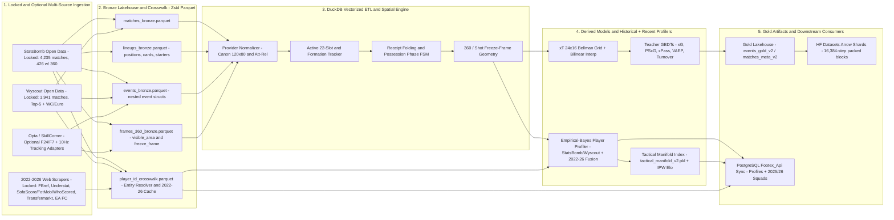

# PixelPitchAI v2 Revamp — Pillar 1: Data Engineering & Rich Feature Pipeline (`statsbombapi` v2)

> **Owner**: `@worktree-data`  
> **Branch / Worktree**: `feat/v2-hybrid-simulation-revamp` at `D:\programming\GitHub\PixelPitchAI-v2-revamp`  
> **Scope**: End-to-end replacement of the legacy La Liga-only PostgreSQL + plain-text pipeline (`Nader7x/statsbombapi` + `simulation-engine/DataMigration` + `api/core/xgboost_class.py` + `api/core/parser.py`) with a **DuckDB / Zstd-Parquet / HuggingFace Datasets** lakehouse, **Unified Multi-Provider Event Schema** (with `xG`, `PSxG`, `xPass`, `xT`, `VAEP`, 360 freeze frames, 3D coordinates, possession phases, and 22-player pitch slots), and the **Historical Player Capability & Role Profiler**.  
> **Downstream Consumers**:
> - Module A & B (`02_tactical_state_and_experimentation.md`): `player_profiles_v2.parquet`, `tactical_manifold_v2.pkl`
> - Module C & D (`03_hybrid_event_transformer_and_models.md`): `events_gold_v2.parquet`, `matches_meta_v2.parquet`, `hf_dataset_v2/` (`16,384`-step packed shards), and calibrated teacher datasets for `xG`/`PSxG`/`xPass`/`xT`/`VAEP`/`Turnover`
> - Module E & .NET 11 Backend (`04_presentation_and_integration.md`): `Footex_Api` profile sync & canonical `[0, 120] × [0, 80]` event contract

---

## 1. Forensic Audit of Legacy v1 Data Pipeline

Before designing v2, we audited both the existing `simulation-engine` codebase (`D:\programming\GitHub\PixelPitchAI\simulation-engine`) and the upstream ingestion repository (`Nader7x/statsbombapi`: `main.py`, `events.py`, `match_event_processing_utils.py`, `lineups.py`, `Gimini.py`, `CalculatePossession.py`, `DOCUMENTATION.md`). Every major bottleneck in v1 simulation realism traces directly to data engineering choices made two years ago.

### 1.1 Exact Inventory of Legacy Pipeline Gaps

| Component & Verified Source | What v1 Did | Critical Flaws & Missing Signal | Impact on v1 Simulation Quality |
| :--- | :--- | :--- | :--- |
| **Competition & Match Scope** `statsbombapi/main.py:123-155`, `events.py:989`, `DataMigration/MIGRATION_README.md:204-210` | Hardcoded `competition_id = 11` (La Liga) across 6 seasons (`season_id` ∈ `[90, 42, 4, 1, 2, 27]`: 2015/16–2020/21), yielding **1 competition, 6 seasons, 29 teams, 1,329 players, 79 managers**. | Ignored **90%+ of StatsBomb Open Data** (`hudl/open-data` contains **80 competition-season entries across 24 competitions, 4,235 event files, and 426 StatsBomb 360 match files**). Also hardcoded `TEAM_NAME_MAPPING` for only 29 La Liga clubs (`events.py:254-298`), returning `NULL` `team_id` for any other club. | Severe overfitting to 2016–2021 La Liga; zero tactical diversity (Bundesliga high press, Premier League transitions, WC/Euro knockouts). |
| **Hardcoded `Team_Year` Tokens** `simulation-engine/api/config/settings.py:20-72`, `scripts/xgboost_use.py:1-48`, `gpt2-football-finetuned/config.json:37` | Injected `174` special tokens (`29` teams × `6` years, e.g., `Barcelona_2016`, `Real_Madrid_2021`) + `7` structural markers into GPT-2 (`vocab_size = 50,438`). | Model conditions on memorized team-year strings rather than rosters or tactics. Cannot simulate newly promoted teams, custom user lineups, transfers, or counterfactual tactical tweaks. Required `bad_words_ids` hack (`optimized_simulation_service.py:580-607`) to stop hallucinating other teams mid-match. | Impossible to ask *"What if Player X joins Team Y?"* or *"What if Team A uses a low block?"*. |
| **Coarse Match Header Conditioning** `simulation-engine/api/core/xgboost_class.py:16-125` | `MatchStatProcessor` ran `tuned_xgboost_model.json` on `[teamA_id, teamB_id, team_A_season, team_B_season]` to predict 22 aggregate match stats, then bucketed them into 11 vague English lines (`"dominant possession"`, `"created very dangerous chances"`, `"applied low pressing"`). | Zero Starting XIs, zero formations (`4-3-3`, `3-5-2`), zero player roles, zero coach styles, zero bench/substitution policies. Lost all continuous precision via coarse thresholds. | Simulator did not even know which 22 players were on the pitch at minute `00:00`, relying on GPT-2 memorizing 2016–2021 lineups. |
| **Missing `xG`, `PSxG`, `xPass`, `xT`, `VAEP`** `Matches/Barcelona_2016 vs Real_Madrid_2021.txt:103`, `archive/Matches/match_15973.txt`, `statsbombapi/events.py:766-805` | Although `statsbombapi/events.py` extracted `shot_statsbomb_xg` into PostgreSQL `shot_events` (and `Gimini.py:2252` plotted it), **neither `shot_statsbomb_xg` nor any threat/pass probability metric was exported into the GPT-2 training text** (`01:02 - Barcelona_2016 - shot by Luis Suárez at (102.5, 41.4), type: Open Play, using Right Foot, aimed at (120.0, 33.5), outcome: Off T`). | No `xG`, no `PSxG`, no `xPass`, no `xT`, no `VAEP`. Sequence model learned raw shot outcomes from rare (`~0.12%`) goal tokens with zero chance-quality grounding. | Uncalibrated scorelines, no momentum/chance-quality feedback, no explainable analytics telemetry. |
| **Missing Event-Level Tactical & Spatial Richness** `Matches/*.txt`, `api/core/parser.py:18-28`, `statsbombapi/events.py:549-868` | Training text only kept `timestamp`, `team`, `action`, `player`, `location (x,y)`, `type` (restart), `height`, `to (x,y)`, `aimed at (x,y)`, `body_part`, `outcome`, `card`. | **Dropped from training text**: `under_pressure`, `pass_switch`, `pass_through_ball`, `pass_cross`, `pass_cut_back`, `pass_technique`, `shot_end_location` **z-coordinate** (`end_z`), `shot_first_time`, `shot_one_on_one`, `carry_end_location` (text only kept carry start!), `tactics` (`Starting XI` / `Tactical Shift` formations & lineups), and **all StatsBomb 360 freeze frames**. | Model could not distinguish a pressured back-pass from a line-breaking through-ball or a low-driven corner from a crossbar-skimming shot. |
| **Broken / Incomplete Ingestion Bugs** `statsbombapi/events.py:1721`, `match_event_processing_utils.py:1783-1800`, `lineups.py:2472-2486` | Row-by-row `sb.events()` HTTP fetch + synchronous `psycopg2` inserts across 18 tables. | (1) `shot_events` INSERT in `match_event_processing_utils.py:1709-1723` listed 12 columns with only 11 `%s` placeholders; (2) `tactics_events` subscripted a JSON string (`tactics_data["formation"]`); (3) `lineups.py` dropped StatsBomb `positions` spells and `cards`; (4) `CalculatePossession.py` computed possession from raw timestamp diffs without `possession` IDs or tactical phases; (5) **zero 360 `sb.frames()` ingestion** outside single-shot plotting in `Gimini.py`. | Silent failures, partial tables, and manual Python enrichment scripts (`DataMigration/Players/*.py`) forced to guess player positions/preferred foot via heuristics. |
| **Verbose Text Bloat & Coordinate Flip Discontinuity** `Matches/Barcelona_2016 vs Real_Madrid_2021.txt:14-105`, `api/core/parser.py:284-377`, `optimized_simulation_service.py:908-965` | Every pass emitted 3 lines (`pass`, redundant `ball receipt*`, and `carry` with no end point), totaling **3,441–5,557 lines (~150k–200k BPE tokens)** per match. | (1) Exceeded GPT-2 `1024`-token context window ~150× over, forcing `keep_last_n=400` truncation and complete first-half erasure at `[SECOND HALF START]`; (2) Raw StatsBomb per-team attacking orientation flipped coordinates mid-sequence (`(102.5, 41.4)` shot vs `(2.4, 41.8)` save on lines 103–104); (3) `MatchParser` had to guess duel outcomes post-hoc via 5-second lookahead (`_infer_duel_outcomes`). | Context amnesia, spatial discontinuities, and fragile regex post-processing. |

---

## 2. `statsbombapi` v2: DuckDB / Parquet / HuggingFace Datasets Architecture

V2 replaces the slow row-by-row PostgreSQL ingestion and plain-text serialization with a **columnar Lakehouse pipeline** built on **DuckDB + Apache Arrow / Zstd Parquet + HuggingFace `datasets`**.

### 2.1 End-to-End Pipeline Topology

### 2.2 Ingestion & Tiered Storage Strategy (`statsbombapi` v2 — Tier 1A Completed vs. Tier 1B Async)

To keep downstream model training and Phase 4–5 backend/frontend integration completely unblocked while preserving a clean upgrade path, Pillar 1 separates its corpus into two operational tiers:

- **Tier 1A — Locked Curated Baseline (Completed & Cached on Google Drive):**
  - Built via `scripts/build_v2_lakehouse.py --preset mens_big5_and_top_360 --max-matches 800` over local shallow-cloned `hudl/open-data` (`--depth 1`): yields **800 high-signal men's Big-5 league & major tournament/360 matches (`2,074,045` receipt-folded events, `events_gold_v2.parquet` = `216.12 MB`)**, `player_profiles_v2.parquet`, `player_id_crosswalk.parquet`, `tactical_manifold_v2.pkl`, `xt_grid_24x16.npy`, and `lakehouse_manifest.json`.
  - Filtering out youth/lower-tier/women's matches in Tier 1A prevents multi-tier `xG`/tempo dilution and is backed up directly to Google Drive (`PixelPitchAI-v2-lakehouse-mens800`) for `~18s` headless `gdown` pulls on Colab without re-cloning `hudl/open-data`.
- **Tier 1B — Optional Async Corpus Expansion & Live Scraping (Decoupled from Phases 4–5):**
  - Optional full `4,235`-match StatsBomb ingestion, Wyscout Open (`1,941` matches), and polite `2022–2026` web scraping refresh (`scrape_recent.py`) run asynchronously without gating Phase 4 (`.NET 11` gRPC/SSE) or Phase 5 (Next.js 16 pitch).

Instead of calling `statsbombpy.sb.events()` match-by-match over HTTP (which took hours even for 6 La Liga seasons), `statsbombapi` v2 performs:

1. **Zero-Throttle Local Mirror Ingestion**:
   - Shallow-clones `https://github.com/hudl/open-data.git` (`--depth 1`) onto fast NVMe scratch (Colab `/content/open-data` or local `data/raw/hudl-open-data`) and computes an incremental SHA manifest against `data/competitions.json`.
   - Uses **DuckDB `read_json(..., union_by_name=true)`** with parallel worker threads (`PRAGMA threads=8`) to parse event files, lineup files, match metadata, and 360 freeze-frame files directly into **Hive-partitioned Zstd Parquet** (`compression='ZSTD', row_group_size=100_000`) in **under 3 minutes** on an 8-core CPU or Colab instance.
2. **Verified StatsBomb Open Data Coverage (`hudl/open-data`)**:
   - **Total catalog**: `80` competition-season entries across `24` competitions; `4,235` matches with full event logs and lineups (`~3,400+` historical baseline expanded with 2022–2025 releases).
   - **StatsBomb 360 freeze-frame subset (`426` matches across `12` competition-seasons)**:
     * `1. Bundesliga` (`2023/2024`), `La Liga` (`2020/2021`), `Ligue 1` (`2021/2022`, `2022/2023`), `Major League Soccer` (`2023`), `FIFA World Cup` (`2022`), `UEFA Euro` (`2020`, `2024`), `African Cup of Nations` (`2023`), `Women's World Cup` (`2023`), and `UEFA Women's Euro` (`2022`, `2025`).
   - **Important Licensing & Gender/Tier Metadata**: Every match stores `competition_gender` (`male` / `female`), `competition_youth`, `competition_international`, and `competition_tier` so curated presets (`mens_big5_and_top_360`, `mens_top_360_core`) and Stage 2 calibration weight or condition cleanly without conflating men's elite club football, women's tournaments, and youth matches.

### 2.3 Multi-Provider Schema Normalization (Tier 1A StatsBomb + Tier 1B Wyscout / Opta / SkillCorner)

To expand pre-training volume beyond the **Tier 1A curated StatsBomb baseline (`800` matches, `2.07M` events)** up to the **Tier 1B optional full expansion (`~10.7M+` folded events across `~6,176` StatsBomb + Wyscout matches)**, the v2 schema supports **StatsBomb Open Data**, **Wyscout Open Data** (`Tier 1B`), and optional **Opta / SkillCorner** adapters:

| Provider & Commitment | Expected Volume & Availability | Coordinate Transform to Canonical `[0, 120] × [0, 80]` | Key Taxonomy & Modifier Mapping | 360 / Tracking Compatibility Flag |
| :--- | :--- | :--- | :--- | :--- |
| **StatsBomb Open (`statsbomb` — Locked Primary)** | `4,235` matches (`426` w/ 360) | Native yards `[0, 120] × [0, 80]`. Flip Away events (`120 - x`, `80 - y`) for canonical global frame. | Native reference taxonomy (`Pass`, `Shot`, `Carry`, `Dribble`, `Pressure`, `Duel`, etc.). | `tracking_coverage = "SB_360"` (`426` matches) or `"SHOT_FF_ONLY"` (`3,809` matches). |
| **Wyscout Open (`wyscout` — Locked Primary)** | `1,941` matches (Top-5 leagues 2017/18 + WC 2018 + Euro 2016) | `x_sb = x_wy * 1.20`, `y_sb = y_wy * 0.80` (Wyscout stores `[0, 100]` % pitch; attack always left-to-right per acting team, same flip rule for canonical global frame). | Map `subEventName` (`Simple pass`, `High pass`, `Launch`, `Smart pass` -> `through_ball=True`, `Cross` -> `cross=True`, `Hand pass` -> `KeeperHands`). Map tag `1801`->`COMPLETE`, `1802`->`INCOMPLETE`, `101`->`GOAL`, `1901`->`counter_attack`, `2101`->`BLOCKED`, `301`/`302`->`assist/key_pass`. Synthesize implicit `CARRY` events when `dist(prev_end, next_start) > 2.0 yd` within same player possession. | `tracking_coverage = "NONE"` (`has_360 = False`); Module B spatial proxy imputes 360 features at training time with `is_360_imputed = True`. |
| **Opta F24 / F7 (`opta` — Optional Adapter)** | Optional enterprise / plug-in feed | `x_sb = x_opta * 1.20`, `y_sb = (100.0 - y_opta) * 0.80` (Opta `y=0` is bottom touchline; StatsBomb `y=0` is top touchline!). | Map `type_id` (`1`=Pass, `13..16`=Shot/Miss/Post/Save/Goal, `7`=Tackle, `8`=Interception, `12`=Clearance, `4`=Foul) + qualifiers (`140,141` pass end XY, `102,103` goalmouth YZ scaled `z = z_opta * 0.0244m` or `2.67m`, `2`=cross, `4`=through_ball, `213`=angle). | `tracking_coverage = "NONE"` unless fused with tracking feed by `timestamp_ms`. |
| **SkillCorner Open (`skillcorner` — Optional Adapter)** | Broadcast 10 Hz tracking + events | `x_sb = (x_m + pitch_len/2) * (120 / pitch_len)`, `y_sb = (pitch_wid/2 - y_m) * (80 / pitch_wid)` (metric origin at center spot, `+y` up -> StatsBomb `+y` down). | Attach exact 22-player `(x, y, vx, vy)` tracking snapshot at `t_event` as a full-pitch `freeze_frame` with `visible_area = FULL_PITCH`, supplying ground-truth off-ball kinematics to calibrate Module B's off-ball spatial model! | `tracking_coverage = "FULL_TRACKING_10HZ"`. |

### 2.4 HuggingFace `datasets` Export & Leakage-Free Splits

The Gold Parquet store compiles directly into an Arrow-backed HuggingFace `DatasetDict` (`hf_dataset_v2/`) with **strict match-grouped, temporally & competition-stratified splits**:

- **`train` (~85%, ~3,600 SB + ~1,650 Wyscout matches)**: Pre-training & Stage 2 conditioning corpus.
- **`val_calib` (~7.5%, ~320 SB + ~145 Wyscout matches)**: Stratified across competitions + includes 360-rich matches (`~40` 360 matches) for Module D isotonic/temperature calibration and early stopping.
- **`test_eval` (~7.5%, ~315 SB + ~146 Wyscout matches)**: Held-out matches **plus an explicit OOD Tournament Holdout** (e.g., holding out `UEFA Euro 2024` and `1. Bundesliga 2023/2024` Leverkusen matches or dedicated seasons in an `ood_eval` split) to test unseen teams, formations, and tactical extrapolation without memorization.
- **Sequence Packing for `PixelPitch-EventTF-112M`**:
  - Matches are stored both as **Match-Level Nested Arrow Rows** (1 row = 1 match, `events: list<struct>`, `lineup_snapshots`, `team_tactics`) and **Packed `16,384`-Step Fixed Blocks** (`packed_16k_blocks.parquet`) with `match_boundary_ids` / `cu_seqlens` arrays so Colab A100/L4 FlashAttention-2 `varlen` training runs with zero padding waste and zero cross-match attention leakage.

### 2.5 Tier 1B: Multi-Source Web Scraping & Recent Season Enrichment Pipeline (2022–2026 — Async / Non-Blocking)

StatsBomb Open Data's league depth peaks prior to `2021/2022` (with targeted `2022–2025` additions such as `1. Bundesliga 2023/2024`, `Ligue 1 2022/2023`, `FIFA World Cup 2022`, `UEFA Euro 2024`, and `UEFA Women's Euro 2025`), while Wyscout Open Data covers `2017/2018`. Without fresh recent-season data, active `2025/2026` squads, newly emerged players (e.g., `2006–2008`-born breakthroughs), recent transfers, and modern tactical shifts (`3-2-4-1` box midfields, inverted fullbacks, extreme high lines) would be outdated or missing.

To provide those updates without blocking downstream Phase 3 calibration or Phase 4–5 `.NET 11` / Next.js integration on upstream anti-bot/Cloudflare gates, `statsbombapi_v2` isolates this workflow as **Tier 1B (`scrape_recent.py`)** built over `soccerdata` and modular polite scrapers:

#### A. Multi-Source Scraper Matrix (`2022–2026` Big-5 Leagues + UCL/UEL + Major Tournaments)

| Source & Tooling | Extracted Signals (`2022–2026`) | Normalization & Target Lakehouse Tables | Primary Role in PixelPitchAI v2 |
| :--- | :--- | :--- | :--- |
| **FBref (`soccerdata.FBref`)** | Opta-derived per-90 season & match logs: progressive passes/carries, switches, through-balls, shot-creating actions (SCA/GCA), `npxG`, `xAG`, `PSxG+/-`, touches by pitch third, pressures, tackles won %, interceptions, blocks, aerial win %, `minutes_played`. | Ingested into `bronze/fbref_scouting_2022_2026.parquet`; normalized to positional percentiles & mapped onto the exact `attributes_24d` + `gk_attributes_8d` definitions (§4.3). | **Core 2022–2026 capability calibration** for active players without recent StatsBomb matches; updates `player_profiles_v2.parquet` & `sigma_24d`. |
| **Understat (`soccerdata.Understat` / JSON)** | Shot-level `xG`, normalized `(x, y)` coordinates, `shotType` (`RightFoot`/`LeftFoot`/`Head`), `situation` (`OpenPlay`/`FromCorner`/`SetPiece`/`DirectFreekick`), `lastAction` (`Throughball`/`Cross`/`Chipped`), `result`, `player_assisted`, minute. | Rescaled `[0, 1] -> [0, 120] × [0, 80]` into `bronze/understat_shots_2022_2026.parquet` (`provider_source = "understat"`). | Refreshes `shot_tendency_8d`, `finishing_log_odds` residuals, and recent-season `xG` calibration drift checks. |
| **SofaScore / FotMob / WhoScored (`soccerdata.WhoScored` + async JSON)** | Match-level Starting XIs, confirmed formations (`4-2-3-1`, `3-2-4-1`, `4-3-3`), substitution timestamps, cards, `24×16` spatial touch/pressure heatmaps, average player `(x, y)` positions, and Opta-derived match event logs (`x, y, endX, endY`, pass qualifiers). | Event logs normalized (`[0, 100] -> [0, 120] × [0, 80]`) into `silver/recent_events_2022_2026.parquet` (`event_fidelity_tier = "SCRAPED_EVENT"`); heatmaps & lineups into `bronze/recent_lineups_heatmaps.parquet`. | (1) Populates real `2022–2026` `touch_heatmap_24x16`, `pressing_zone_heatmap_24x16`, and `role_suitability_scores`; (2) Feeds **Stage 2 recent-era tactical fine-tuning** & `tactical_manifold_v2.pkl` (`2022–2026` formations & pressing benchmarks). |
| **Transfermarkt / EA FC** | Current `2025/2026` club rosters, transfers, shirt numbers, age, height, `preferred_foot`, `weak_foot` rating, market value, and physical attributes (`sprint_speed`, `acceleration`, `stamina`, `jumping`, `strength`). | Stored in `bronze/squad_rosters_physical_2022_2026.parquet`; mapped onto `Player.TeamId`, `Player.ShirtNumber`, `Player.PreferredFoot`, and weak-prior physical baselines (`stamina_endurance`, `sprint_recovery_capacity`). | Guarantees **100% up-to-date 2025/2026 club rosters**, accurate `preferred_foot` / `weak_foot_balance`, and physical priors for young/newly promoted players with low event minutes. |

#### B. Unified Entity Resolution (`player_id_crosswalk.parquet`)

Because each source uses incompatible player IDs (`StatsBomb` int, `Wyscout` int, `FBref` 8-char hex, `Understat` int, `SofaScore`/`FotMob`/`WhoScored` ints, `Transfermarkt` int, `EA FC` int, and legacy `Footex_Api` `Players.Id`), Pillar 1 maintains a versioned **`player_id_crosswalk.parquet`** resolver:

1. **Deterministic Seed & Legacy Preservation**: Preserves all existing `Footex_Api` IDs (`1..1329` players, `1..29` La Liga teams) and bootstraps known open-source ID bridges (`StatsBomb <-> FBref <-> Transfermarkt <-> Understat`).
2. **Multi-Stage Entity Linking**:
   - *Stage 1 (Exact ID)*: Join on verified source ID pairs where present.
   - *Stage 2 (Normalized Blocking)*: Unicode NFKD accent-folding (`"Mbappé"` -> `"mbappe"`), surname/known-name token extraction, `|birth_year_a - birth_year_b| <= 1`, nationality ISO match, and club-season overlap blocking.
   - *Stage 3 (Bipartite Optimal Assignment)*: Hungarian (`scipy.optimize.linear_sum_assignment`) matching within club-season blocks using Jaro-Winkler + position-group similarity; auto-accepts matches with score `>= 0.92`, assigns fresh canonical `pixelpitch_player_id >= 100_000` for net-new players, and logs ambiguous pairs (`0.78 <= score < 0.92`) to `audit_crosswalk_conflicts.csv` for human review.

#### C. Cross-Source Profile Fusion & Scraping Operational Hygiene

- **Time-Decayed Empirical-Bayes Blending (`player_profiles_v2.parquet`)**:
  - When a player has both historical StatsBomb/Wyscout events and `2022–2026` scraped FBref/Understat/SofaScore logs, attributes blend via precision-weighted inverse-variance pooling with exponential recency decay (`half_life = 540` days).
  - For post-2022 breakthroughs with zero StatsBomb history, `attributes_24d` and `gk_attributes_8d` are populated directly from Empirical-Bayes shrunk `FBref + Understat + SofaScore + EA FC/Transfermarkt` metrics (with an explicit `source_provenance_flags` bitmask and slightly higher initial `sigma_24d` floor `1.15x` to reflect aggregated vs event-level estimation), and `latent_style_64d` is initialized via `attr24_to_style64.onnx` + SofaScore/WhoScored `24×16` heatmap projection.
- **Scraping Hygiene & Compliance Guardrails**:
  - Uses local immutable response caching (completed past seasons are fetched once and never re-scraped), domain-level token-bucket throttling (`2–4s` jittered delay between HTTP calls), and Pydantic schema-drift validation before merging into Parquet.
  - **Strict Access Control Compliance**: Scrapers strictly access publicly exposed endpoints/datasets with standard rate limits; if any upstream endpoint gates a request behind authentication, paywall, or anti-bot/CAPTCHA challenge, the pipeline **halts that connector gracefully**, logs the fallback gap (`sigma_24d` preserved from available sources), and never attempts CAPTCHA or anti-bot circumvention.

---

## 3. Unified Gold Event Schema & Derived Features (`events_gold_v2`)

### 3.1 Dual Coordinate Convention (Eliminating Spatial Discontinuities)

In StatsBomb raw data, coordinates are always oriented in the **acting team's attacking direction** (`(0,0)` top-left, attacking toward `x=120`). Thus, on consecutive events, Luis Suárez shooting at `(102.5, 41.4)` is immediately followed by Thibaut Courtois saving at `(2.4, 41.8)`.

Pillar 1 solves this by storing **both** coordinate systems explicitly on every Gold event row:

1. **Canonical Global Pitch Frame (`*_canon`)** — used by the Hybrid FSM, Module B 22-player spatial state, and Transformer `START_XY` / `END_XY` tokens:
   - Home team attacks `+x` (`0.0 -> 120.0`), Away team attacks `-x` (`120.0 -> 0.0`), `y ∈ [0.0, 80.0]` (`y=0` top/left touchline from TV broadcast perspective).
   - Conversion from raw StatsBomb coordinates `(x_raw, y_raw)`:
     $$\text{if acting\_team == Home: } (x_{\text{canon}}, y_{\text{canon}}) = (x_{\text{raw}}, y_{\text{raw}})$$
     $$\text{if acting\_team == Away: } (x_{\text{canon}}, y_{\text{canon}}) = (120.0 - x_{\text{raw}},\; 80.0 - y_{\text{raw}})$$
2. **Attacking-Relative Frame (`*_att`)** — used by Module D (`xG`, `PSxG`, `xPass`, `xT`) so geometric features remain symmetric between Home and Away:
   - Always oriented so the acting team attacks toward `x_att = 120.0`, goal mouth `x_att = 120.0, y_att ∈ [36.0, 44.0]` (`7.32 m` wide), crossbar `z_m = 2.44 m` (capped at `5.0 m` for over-bar shots).
   - Pitch scale conversion for Euclidean physics: `1 yard_x = 105.0 / 120.0 = 0.875 m`, `1 yard_y = 68.0 / 80.0 = 0.850 m` (or StatsBomb standard `0.9144 m/yd` — we store exact `dist_m` using standardized `105m × 68m` metric projection alongside `dist_yd` in `[0,120]×[0,80]`).

### 3.2 Receipt Folding, Active 22-Player Slot Tracking, & Possession Phases

1. **Redundant Event Folding (`~5,500 lines -> ~1,800–2,400 events/match`)**:
   - StatsBomb emits a separate `Ball Receipt*` event for every pass target. When a `Pass` has a linked `Ball Receipt*` (via `related_events` UUID or immediate sequence match), DuckDB folds `receipt_x`, `receipt_y`, `target_player_id`, `target_slot`, and `ball_receipt_outcome` directly onto the `Pass` row and drops the standalone `Ball Receipt*` row.
   - `Carry` events are **retained** as first-class events—now enriched with **`carry_end_location` (`end_x`, `end_y`), carry distance, carry speed (`yd/s`), progressive distance toward goal, and `under_pressure`** (all missing in v1 text!). Zero-distance placeholder carries (`< 0.5 yd` and `< 0.4 s` between receipt and immediate one-touch pass) are optionally folded into a `first_touch = True` / `one_touch = True` modifier flag on the subsequent action to cut noise while preserving genuine dribbling/carrying runs.
2. **Deterministic Active 22-Player Slot State (`slot 1..22`)**:
   - Instead of raw player names (which caused OOV/name-memorization in v1), every match initializes 22 tactical slots from `Starting XI` (`tactics.formation` + `tactics.lineup`) cross-checked with `lineups/*.json` `positions` spells:
     * `slot 1..11` = Home XI (ordered deterministically from GK `[1]` -> Defenders -> Midfielders -> Forwards `[11]` by canonical formation template).
     * `slot 12..22` = Away XI (same canonical ordering).
     * `slot 0` = `SYSTEM` (for period boundaries / stoppages).
   - Whenever a `Substitution` event occurs, DuckDB updates `active_slots_player_ids[slot]` in-place to `substitution_replacement_id`, increments `sub_count`, and marks the outgoing player off-pitch. Whenever a `Tactical Shift` occurs, it updates `home_formation_id` / `away_formation_id` and re-maps `active_slots_roles[22]`. Whenever a `Red Card` / `Second Yellow` occurs, it flags `slot_sent_off[slot] = True`.
3. **Possession Phase State Machine (`possession_id`, `poss_phase`)**:
   - StatsBomb's raw `possession` integer increments on every restart or clean turnover, and `possession_team_id` tracks who holds the ball.
   - DuckDB derives the 8-state **`POSS_PHASE`** enum required by Module C (`03_...` §2.2) at every event:
     * `DEAD_BALL` (`0`): Period boundaries, substitutions, injury stoppages, pre-kickoff.
     * `SET_PIECE_ATTACK` (`1`) / `SET_PIECE_DEFENSE` (`2`): Throw-in, corner, free kick, goal kick, or penalty, plus the **first `6.0` seconds / `2` events** immediately following a corner/free-kick restart (`within_set_piece_window = True`).
     * `TRANSITION_FAST` (`3`): First `8.0` seconds after regaining possession (`possession_id` changed) with forward velocity `> 3.5 yd/s` or `counter_attack = True`.
     * `TRANSITION_COUNTERPRESS` (`4`): Defensive actions (`Pressure`, `Tackle/Duel`, `Foul`, `Interception`) occurring within `5.0` seconds of losing possession in the attacking/middle half.
     * `OPEN_BUILDUP` (`5`): Possessing team in own defensive third (`x_att < 40.0`).
     * `OPEN_PROGRESSION` (`6`): Possessing team in middle third (`40.0 <= x_att < 80.0`).
     * `OPEN_FINAL_THIRD` (`7`): Possessing team in attacking third (`x_att >= 80.0`).

### 3.3 Exact Gold Event Schema (`events_gold_v2.parquet`)

Every row in `events_gold_v2.parquet` (partitioned by `competition_id` / `season_id`) contains the exact fields below. Columns map 1:1 to Module C's 10-field Transformer schema $e_t$ and Module D's tabular/MLP feature vectors.

| Group | Column Name | Arrow / Parquet Type | Domain / Encoding | Source & Derivation Logic |
| :--- | :--- | :--- | :--- | :--- |
| **Keys & Clock** | `match_id` | `int64` | Unique match ID | StatsBomb `match_id` (namespaced offset for Wyscout/Opta) |
| | `event_seq_idx` | `int32` | `0 .. N-1` | Monotonic folded sequence index within match |
| | `event_uuid` | `string` | UUID / synthetic ID | Raw StatsBomb `id` |
| | `period` | `int8` | `0..6` (`PRE,1H,HT,2H,ET1,ET2,FT`) | StatsBomb `period` + FSM period boundary rows |
| | `minute`, `second`, `timestamp_ms` | `int16`, `int8`, `int32` | Match clock in ms | Exact period-offset + stoppage ms |
| | `dt_sec`, `dt_bucket_id`, `dt_res` | `float32`, `int8`, `float32` | `dt_bucket_id ∈ [0..63]` | Log-spaced time delta since `event_seq_idx - 1` + residual |
| **Possession** | `possession_id` | `int32` | `1 .. K` | Monotonic match possession counter (`possession`) |
| | `possession_team_id` | `int32` | Team ID | `possession_team.id` |
| | `poss_phase` | `int8` | `0..7` (`POSS_PHASE` enum) | Deterministic phase FSM (§3.2) |
| | `score_home`, `score_away` | `int8`, `int8` | `0 .. 20` | Cumulative score state *prior* to `e_t` (updated after Goal) |
| **22-Player Roster** | `actor_slot` | `int8` | `0` (`SYSTEM`), `1..11` (Home), `12..22` (Away) | Resolved from `player_id` -> active slot map |
| | `actor_player_id` | `int64` | Canonical `player_id` | `player.id` (`-1` for SYSTEM) |
| | `actor_team_id` | `int32` | Team ID | `team.id` (`-1` for SYSTEM) |
| | `is_home_actor` | `bool` | `true/false` | `actor_team_id == home_team_id` |
| | `target_slot`, `target_player_id` | `int8`, `int64` | `0..22`, Player ID | Folded `Ball Receipt*` / `pass.recipient.id` (`0` if N/A) |
| | `active_slots_player_ids` | `fixed_size_list<int64>[22]` | Canonical IDs in slots `1..22` | Maintained across `Starting XI` & `Substitution` |
| | `active_slots_roles` | `fixed_size_list<int8>[22]` | Canonical `PlayerRole` enum IDs (`0..21`) | Derived from `position.id` + `tactics.formation` + spatial tendency; aligned 1:1 with Module A (`02_...` §2.7) |
| | `active_slots_sent_off` | `uint32` | 22-bit mask | Bit `i` set if slot `i+1` received Red/Second-Yellow |
| | `home_formation_id`, `away_formation_id` | `int16`, `int16` | Canonical formation enum | Updated on `Starting XI` and `Tactical Shift` |
| **Action & Outcome** | `action_type` | `int8` | `0..17` (+6 reserved = `24`) | Unified `ACTION_TYPE` enum (`PASS`, `CARRY`, `DRIBBLE`, `SHOT`, `CLEARANCE`, `INTERCEPTION`, `TACKLE_DUEL`, `BALL_RECOVERY`, `SAVE`, `BLOCK`, `PRESSURE`, `FOUL_COMMITTED`, `MISCONTROL`, `DISPOSSESSED`, `OFFSIDE`, `CARD`, `SUBSTITUTION`, `PERIOD_BOUNDARY`) |
| | `outcome` | `int8` | `0..23` (`OUTCOME` enum) | Unified outcome (`COMPLETE`, `INCOMPLETE`, `OUT_TOUCHLINE`, `OUT_BYLINE`, `OFFSIDE`, `GOAL`, `SAVED_HELD`, `SAVED_PARRY`, `BLOCKED`, `OFF_TARGET`, `POST`, `WON`, `LOST`, `YELLOW_CARD`, `SECOND_YELLOW`, `RED_CARD`, `FOUL_CONCEDED`, `PENALTY_WON`, `SUB_EXECUTED`, `PERIOD_END`, etc.) |
| **Spatial `(x,y,z)`** | `x_canon`, `y_canon` | `float32`, `float32` | `[0, 120] × [0, 80]` | Start position in Canonical Global Pitch Frame |
| | `end_x_canon`, `end_y_canon`, `end_z_m` | `float32`, `float32`, `float32` | `[0,120]×[0,80]`, `z ∈ [0, 5.0]` | Pass `end_location`, Carry `end_location`, or Shot `end_location[0..2]` (`0.0` if non-3D) |
| | `x_att`, `y_att`, `end_x_att`, `end_y_att` | `float32` × 4 | `[0, 120] × [0, 80]` | Attacking-relative coordinates (`+x` always toward target goal) |
| | `start_cell_id`, `end_cell_id` | `int16`, `int16` | `0..601` (`30×20` 4×4-yd grid + special) | Discretized spatial tokens + `dx_res, dy_res ∈ [-2, 2]` |
| | `end_z_bin` | `int8` | `0..31` (or `-1` if N/A) | `32` vertical bins across `[0, 5.0m]` for 3D shots |
| | `distance_yd`, `angle_rad` | `float32`, `float32` | Euclidean yards, `[-π, π]` | Computed from `(x_att, y_att)` to `(end_x_att, end_y_att)` |
| **Modifiers & Tactics** | `restart_type` | `int8` | `0..7` | `OpenPlay, KickOff, ThrowIn, Corner, FreeKickD, FreeKickI, GoalKick, Penalty` |
| | `pass_height` | `int8` | `0..3` | `N/A, Ground, Low, High` (`pass.height`) |
| | `body_part` | `int8` | `0..4` | `RightFoot, LeftFoot, Head, KeeperHands, Other` |
| | `under_pressure` | `bool` | `true/false` | Raw StatsBomb `under_pressure` (coalesced `false`) |
| | `pass_switch` | `bool` | `true/false` | `pass.switch` (or Wyscout/Opta lateral span `> 35 yd`) |
| | `through_ball` | `bool` | `true/false` | `pass.through_ball` |
| | `cross` | `bool` | `true/false` | `pass.cross` |
| | `cutback` | `bool` | `true/false` | `pass.cut_back` |
| | `first_time`, `one_on_one`, `counter_attack` | `bool` × 3 | `true/false` | `shot.first_time`, `shot.one_on_one`, `play_pattern == 'From Counter'` |
| | `modifier_bitmask_8` | `uint8` | 8 packed flag bits | Packed representation matching Module C `MODIFIERS` field |
| **360 Freeze Frames** | `has_360_frame` | `bool` | `true/false` | Joined from `three-sixty/{match_id}.json` via `event_uuid` |
| | `has_shot_freeze_frame` | `bool` | `true/false` | True for shots with `shot.freeze_frame` (available across all 4,235 SB matches!) |
| | `shot_freeze_frame` | `list<struct>` | `[{player_id, slot, x_canon, y_canon, teammate, is_gk}]` | Preserved raw/normalized defender + attacker + GK locations |
| | `freeze_frame_360` | `list<struct>` | `[{teammate, actor, keeper, x_canon, y_canon}]` | StatsBomb 360 snapshot (or SkillCorner full tracking) |
| | `visible_area_poly` | `list<float32>` | `[x1, y1, x2, y2, ...]` | StatsBomb 360 camera polygon in canonical frame |
| | `ff_n_defenders_in_shot_triangle` | `int8` | `0..11` | Defenders inside triangle `(shooter_xy, goal_post_L, goal_post_R)` |
| | `ff_open_goal_fraction` | `float32` | `[0.0, 1.0]` | Unoccluded angular width of `[36, 44]` goal mouth subtracting GK & defender cones |
| | `ff_gk_dist_goal`, `ff_gk_angle_offset` | `float32`, `float32` | Yards, radians | GK distance from goal center `(120, 40)` & lateral offset from shot-center bisector |
| | `ff_closest_defender_dist`, `ff_n_pressers_3m` | `float32`, `int8` | Yards, count | Nearest opponent Euclidean distance & opponents within `3.0 yd` (`~2.7m`) |
| | `ff_min_defender_dist_to_pass_ray` | `float32` | Yards | Minimum perpendicular distance from any opponent to pass segment `[start, end]` |
| | `ff_n_defenders_in_pass_corridor` | `int8` | `0..11` | Opponents within `±3.0 yd` lateral corridor of pass ray |
| | `ff_receiver_voronoi_area`, `ff_actor_packing_bypassed` | `float32`, `int8` | `sq yd`, `0..11` | Voronoi cell area at receiver `(end_x, end_y)` & opponents bypassed closer to goal |
| **Analytics (`xG..VAEP`)** | `xg_statsbomb` | `float32` | `[0, 1]` or `NULL` | Raw `shot.statsbomb_xg` (reference benchmark) |
| | `xg_v2_pre_shot` | `float32` | `[0, 1]` | Module D1 calibrated pre-shot `xG` teacher target |
| | `psxg_v2` | `float32` | `[0, 1]` | Module D2 post-shot `xG` conditioned on `(end_y, end_z)` |
| | `xpass_prob` | `float32` | `[0, 1]` | Module D3 calibrated pass completion probability |
| | `xt_start`, `xt_end`, `xt_delta` | `float32` × 3 | `[-1, 1]` | `24×16` Bellman Expected Threat bilinearly interpolated at start/end |
| | `vaep_p_score_before`, `vaep_p_score_after` | `float32`, `float32` | `[0, 1]` | 10-action horizon scoring probability before/after `e_t` |
| | `vaep_p_concede_before`, `vaep_p_concede_after` | `float32`, `float32` | `[0, 1]` | 10-action horizon conceding probability before/after `e_t` |
| | `vaep_value` | `float32` | `[-2, 2]` | `(p_score_after - p_score_before) - (p_concede_after - p_concede_before)` |

### 3.4 Exact Computation of `xT`, `xG`/`PSxG`, `xPass`, and `VAEP` Labels

All four analytical label families are computed inside Pillar 1 over the Silver event lakehouse so both **Module C (`XG_XT_HEAD` 4D feedback vector)** and **Module D (`D1..D6` teacher models)** share identical, leak-free targets:

1. **`xT` (Expected Threat — `24 × 16` Grid + Continuous Bilinear Interpolation)**:
   - Partition canonical attacking pitch `[0, 120] × [0, 80]` into **`24 × 16 = 384`** square cells of `5.0 × 5.0` yards (`24` columns along `x`, `16` rows along `y`), matching Module B (`24×16` pitch control overlay) and Module D (`03_...` §3.3).
   - Estimate empirical move probability $m(z)$, shoot probability $s(z)$, conversion rate $g(z) = \text{mean}(\text{is\_goal} \mid z)$ (or `mean(xg_v2)`), and transition matrix $T_{z \to z'}$ over `train` split open-play passes & carries using Laplace smoothing ($\alpha = 1.0$).
   - Run 5-step (or convergence `< 1e-6`) Bellman value iteration:
     $$xT^{(k+1)}(z) = s(z)\cdot g(z) + m(z)\sum_{z'} T_{z\to z'}\cdot xT^{(k)}(z')$$
   - Evaluate continuous threat at exact `(x_att, y_att)` and `(end_x_att, end_y_att)` via **bilinear interpolation** across the 4 nearest cell centers (`xt_delta = xt_end - xt_start`, masked to `0` on incomplete passes / turnovers). Export `xt_grid_24x16.npy` (`384` floats) for zero-latency O(1) lookup inside GPU Monte Carlo batches.
2. **Pre-Shot `xG` & Post-Shot `PSxG` (with 360 Shot Freeze-Frame Geometry)**:
   - Train out-of-fold 5-fold **CatBoost + Isotonic Calibration** on all StatsBomb open-data shots (`~105k+` shots across `4,235` matches — every StatsBomb shot includes `shot.freeze_frame`, even when full-match 360 is absent!).
   - Geometric inputs computed in DuckDB/Numba: `shot_dist_m`, `shot_angle_rad`, `body_part`, `shot_type`, `first_time`, `one_on_one`, `under_pressure`, `assist_pass_height`, `assist_through_ball`, `assist_cross`, `assist_cutback`, `preceding_carry_dist`, plus the 360 cone features (`ff_n_defenders_in_shot_triangle`, `ff_open_goal_fraction`, `ff_gk_dist_goal`, `ff_gk_angle_offset`, `ff_closest_defender_dist`).
   - `PSxG` adds `end_y_att`, `end_z_m`, `dist_to_nearest_post`, `is_on_target`, and `gk_reach_dist` (evaluated on on-target non-blocked shots, `0.0` if off-target/blocked), calibrated with `ECE < 0.010`.
3. **`xPass` Features & Completion Probability**:
   - Out-of-fold LightGBM/CatBoost classifier trained on passes (`~4.2M+` passes) predicting `[P(Complete), P(Incomplete), P(Out), P(Offside)]` using `(x_att, y_att, end_x_att, end_y_att, pass_length, pass_angle, pass_height, restart_type, under_pressure, through_ball, switch, cross, cutback)` plus 360 corridor features (`ff_min_defender_dist_to_pass_ray`, `ff_n_defenders_in_pass_corridor`, `ff_receiver_voronoi_area`) when `has_360_frame=True` (with native CatBoost NaN / indicator handling when `has_360_frame=False`).
4. **VAEP (Valuing Actions by Estimating Probabilities — 10-Action Horizon)**:
   - Following Decroos et al. (KDD 2019), construct game states $S_t = (e_{t-2}, e_{t-1}, e_t, \text{score\_diff}, \text{time\_rem}, \text{red\_diff}, \text{poss\_phase}, \Delta xT, xG, x\text{Pass})$ and label $y_{\text{score}} = 1$ if possessing team scores within `[t, t+10]` actions (same half), $y_{\text{concede}} = 1$ if opponent scores within `[t, t+10]`.
   - Out-of-fold calibrated CatBoost classifiers estimate $P_{\text{score}}(S_t)$ and $P_{\text{concede}}(S_t)$ so every defensive block, interception, tackle, foul, carry, and pass receives an explicit $\text{VAEP}(a_t) = \Delta P_{\text{score}} - \Delta P_{\text{concede}}$ value.

---

## 4. Historical Player Capability & Role Profiler (`player_profiles_v2`)

To completely eliminate `Team_Year` memorization and enable realistic counterfactual experiments (*"Which midfielder fits a possession team?"*, *"Does a new signing duplicate an existing player?"*), Pillar 1 builds a **leak-free, Empirical-Bayes Historical Player Capability & Role Profiler** exported as `player_profiles_v2.parquet` and synced to PostgreSQL.

### 4.1 Minutes Played, Position Spell Tracking & Anti-Leakage Windows

From `lineups/*.json` (`positions` array) + `events` (`Substitution`, `Red Card`, `Period End`), augmented for `2022–2026` seasons by scraped `FBref` / `SofaScore` / `FotMob` / `WhoScored` match logs linked via `player_id_crosswalk.parquet`, DuckDB computes exact **minutes played per player per match and per positional zone** (`minutes_played`, `minutes_gk`, `minutes_def`, `minutes_mid`, `minutes_att`), filtering out garbage-time distortions while accurately crediting substitutes.

Two profile views are materialized:
1. **`(player_id, season_id)` Snapshot**: Computed using **only matches prior to or within that season** (and for Stage 1/2 training on match $m$, optionally using **strictly pre-match rolling 365-day / trailing 2,700-minute causal profiles** `(player_id, as_of_match_date)` so a breakout player's future stats never leak into past matches!).
2. **`(player_id, "career_latest")` Serving Profile**: Exponentially time-decayed multi-season profile (half-life `= 540` days) combining historical StatsBomb/Wyscout events with `2022–2026` scraped scouting/shot/heatmap feeds for live `2025/2026` simulation & recruitment experiments.

### 4.2 Empirical-Bayes Shrinkage & Epistemic Uncertainty ($\mathbf{a}_p, \boldsymbol{\sigma}_p$)

Raw per-90 rates explode for players with small sample sizes (e.g., 1 goal in 30 minutes = `3.0` goals/90). Following Module B (`02_...` §3.1), every raw percentile-normalized capability $\tilde{a}_{p,d} \in [0, 1]$ is shrunk toward its **Positional Peer Prior** $\mu_{\text{pos}(p), d}$ with prior weight $m_0 = 900$ minutes (10 full 90-minute matches, or event-count equivalents for binomial rates via Beta-Binomial shrinkage):

$$\hat{a}_{p,d} = \frac{m_p}{m_p + m_0}\,\tilde{a}_{p,d} + \frac{m_0}{m_p + m_0}\,\mu_{\text{pos}(p), d}, \qquad \sigma_{p,d} = \frac{\tau_{\text{pos}(p), d}}{\sqrt{1 + m_p / m_0}}$$

- High-minute veterans (`m_p = 3,000+` min) retain `> 77%` individual signal with tight $\sigma_{p,d}$; academy debutants (`m_p = 90` min) smoothly pull `91%` toward peer positional averages while exposing wide $\sigma_{p,d}$ for Monte Carlo epistemic uncertainty sampling (`02_...` §4.5).

### 4.3 Complete Capability Attribute Vector (`attributes_24d` + `gk_attributes_8d`)

To guarantee **100% schema consistency** across Pillar 1, Module B (`02_...` §3.1–3.2), Module C (`03_...` §2.3), and Module D (`03_...` §3.4), Pillar 1 exports two cleanly separated capability arrays in `player_profiles_v2.parquet`:
1. **`attributes_24d` (`[0..23]`) + `sigma_24d`**: The 24 core Empirical-Bayes attributes fused directly into Module B's slot conditioning vector `player_cond` (`[B, 22, 128] = 64 z_p + 24 a_eff + 16 r_role + 10 tau_team + 5 phi_instr + 6 s_pos + 3 s_stat`) and read by Module C's Cross-Attention memory $M_t$ (Tokens `0..21`).
2. **`gk_attributes_8d` (`[0..7]`) + `finishing_log_odds`**: 8 Goalkeeper & Spatial Specialist metrics (`6` GK metrics `active_gk_attributes_6d` + `2` spatial lane/verticality biases) routed directly to **Module B** (`SweeperKeeper` vs `ShotStopperGK` off-ball anchors, lateral lane priors, and 22-role suitability scoring), **Module C** (Tokens `22..23` `active_gk_attributes_6d` in $M_t$), and **Module D** (Bayesian log-odds GK shot-stopping & shooter finishing residuals in `03_...` §3.4)—keeping `player_cond` exact at `24d` (`128` dims total).

| Index | Attribute Group | Raw Metric & Historical Data Formula (DuckDB) | Shrinkage Family |
| :---: | :--- | :--- | :--- |
| `0..5` | **Passing & Progression (6)** | `short_pass_accuracy` (completion % `< 15 yd` minus `xPass` baseline), `progressive_pass_volume` (`prog_passes_per90`, `>= 10 yd` toward goal), `long_switch_propensity` (`pass_switch` + `> 35 yd` lateral per90), `through_ball_vision` (`through_ball` + `key_pass` xA/xPass per90), `cross_frequency` (`cross` + `cutback` per90), `press_resistance` (`completion_under_pressure - xPass_under_pressure` residual) | Empirical-Bayes vs positional prior (`m0 = 900` min) |
| `6..9` | **Ball Manipulation & Carrying (4)** | `dribble_takeon_volume` (`dribble` attempts per90), `dribble_success_skill` (`dribble_complete_rate` shrunk by attempts), `ball_carry_progression` (`sum(carry_prog_yd)` + `xT_carry_per90`), `first_touch_retention` (`1 - (miscontrol + dispossessed)_per_touch` percentile) | Empirical-Bayes vs positional prior |
| `10..14` | **Shooting & Threat (5)** | `shot_volume_box` (open-play shots inside `x_att >= 102` per90), `shot_volume_long` (shots `x_att < 102` per90), `finishing_skill_psxg_delta` (Bayesian-shrunk `(goals - npxg)` & `(psxg - xg)` per shot, mapped to `[0, 1]` + raw log-odds residual `finishing_log_odds`), `aerial_box_threat` (`headed_shot_xg_per90`), `weak_foot_balance` (`min(left_touches, right_touches) / max(1, left+right)` on passes+shots) | Beta-Binomial / Empirical-Bayes |
| `15..20` | **Defending & Pressing (6)** | `pressing_workrate` (`pressures_per90` + `counterpress_5s_per90` adjusted for team out-of-possession share!), `tackle_duel_win_rate` (`tackles_won / tackles_attempted`), `interception_reading` (`(interceptions + ball_recoveries)_per90`), `aerial_duel_win_rate` (`aerial_won / aerial_total`), `foul_proneness` (`fouls_committed_per_def_action`), `recovery_speed_proxy` (`max_carry_speed_p95` + long recovery runs `> 20 yd` per90) | Empirical-Bayes (possession-adjusted) |
| `21..23` | **Physical & Specialist (3)** | `stamina_endurance` (`1 - activity_drop_75_90_vs_15_45` adjusted for minutes & role), `sprint_recovery_capacity` (`high_speed_carries_per90` in `70+` min), `set_piece_delivery` (`xT + xA` generated per corner / indirect free kick taken) | Empirical-Bayes |
| `gk_0..7` | **GK & Specialist Sidecar (`gk_attributes_8d`)** *(routed to Module B priors, Module C Tokens `22..23`, & Module D residuals)* | `gk_shot_stopping_psxg_prevented` (`(PSxG_on_target - goals_conceded) / 90` + GK log-odds residual), `gk_save_hold_ratio` (`saved_held / saves`), `gk_sweeper_action_rate` (`def_actions_outside_box_per90`), `gk_claim_cross_rate` (`keeper_claims / opp_crosses`), `gk_short_buildup_share` (`ground_passes / total_gk_passes`), `gk_long_kick_accuracy` (`complete_long_gk_passes / long_gk_passes`), `left_vs_right_lane_bias` (`mean_y_canon_norm` in `[0,1]`), `positional_verticality` (`mean_x_att_norm` of touches) | GK peer prior (`0.5` neutral for outfield on `gk_0..5`; active spatial biases on `gk_6..7`) |

> **Schema Alignment Guarantee**:
> - **Module B (`02_...` §3.2)** consumes `attributes_24d` (`[0..23]`), `sigma_24d`, and `latent_style_64d` inside `player_cond [B, 22, 128]`, and reads `gk_attributes_8d` for GK anchor depth, lane biases, and 22-role suitability scoring.
> - **Module C (`03_...` §2.3)** consumes Module B's exact `128`-dim `player_cond` directly (`64 + 24 + 16 + 10 + 5 + 6 + 3 = 128`) in Tokens `0..21` and ingests `active_gk_attributes_6d` (`gk_0..5`) in Team Tactical Tokens `22..23` of $M_t$.
> - **Module D (`03_...` §3.4)** reads `finishing_log_odds` and `gk_shot_stopping_psxg_prevented` from `gk_attributes_8d` for Bayesian log-odds calibration residuals.

### 4.4 Per-90 Style Vectors, Spatial Tendencies & Role Profiler

In addition to `attributes_24d` + `gk_attributes_8d`, `player_profiles_v2.parquet` stores rich **per-90 behavioral style tensors** for role classification, scout similarity search, and Module B spatial priors:

- **Zone & Tendency Maps (`24 × 16` flattened & normalized distributions)**:
  - `touch_heatmap_24x16`: Empirical touch density across the `384` `5×5`-yard cells (captures *"drifts into left half-space"* vs *"hugs right touchline"*).
  - `pass_vector_summary_16d`: Quantiles of pass lengths, forward vs lateral vs backward pass shares, switch/through-ball/cross rates per 100 touches.
  - `carry_tendency_8d`: Carry frequency per touch, mean carry length, forward vs inward carry angle cosine/sine, carry-under-pressure rate.
  - `shot_tendency_8d`: Shot frequency per final-third touch, central vs wide shot split, mean shot distance, first-time shot ratio.
  - `pressing_zone_heatmap_24x16`: Pressure + defensive engagement density (captures *"high counter-presser"* vs *"passive mid-block screener"*), plus `avg_def_action_x_att` and `avg_def_action_y_att`.
- **Natural Roles & Role Suitability Scores (`22` Canonical Module A/B `PlayerRole` Enums, IDs `0..21`)**:
  - Hierarchical supervised + GMM clustering over `(touch_heatmap_24x16, pass_vector_summary_16d, carry_tendency_8d, pressing_zone_heatmap_24x16, statsbomb_position_spells, tactical_formation)` outputs:
    * `primary_position`: Canonical enum (`GK, CB, LB, RB, CDM, CM, CAM, LM, RM, LW, RW, ST, CF` aligned with `.NET` `Domain.Enums.PlayerPosition`), used as a hierarchical fallback prior when granular tactical sub-roles have low historical minutes.
    * `natural_roles`: Ranked list over all **22 canonical Module A `PlayerRole` enums (`0..21`)** (`0: SweeperKeeper`, `1: ShotStopperGK`, `2: BallPlayingCB`, `3: StopperCB`, `4: WideCenterBack`, `5: InvertedFullback`, `6: OverlappingFullback`, `7: DefensiveFullback`, `8: CompleteWingBack`, `9: DeepLyingPlaymaker`, `10: DestroyerDM`, `11: BoxToBoxMidfielder`, `12: Mezzala`, `13: Carrilero`, `14: AdvancedPlaymaker`, `15: InvertedWinger`, `16: TouchlineWinger`, `17: InsideForward`, `18: False9`, `19: PressingForward`, `20: TargetForward`, `21: Poacher`).
    * `role_suitability_scores`: Continuous `[0, 1]^22` vector measuring how closely the player's historical spatial/action profile matches each of the 22 canonical role centroids.
- **Latent Style Embedding (`latent_style_64d`)**:
  - Initialized via an L2-normalized **Sparse/Denoising Autoencoder (or SVD + MLP)** compressed from the `~800`-dim `(touch_heatmap + pressing_heatmap + pass/carry/shot tendencies + attributes_24d + gk_attributes_8d)` vector, and refined jointly during Module C Stage 1 pre-training.
  - A companion Ridge/MLP regression adapter `attr24_to_style64.onnx` is also exported so synthetic/custom players (`PlayerAttributeOverride` with `attributes_24d` in `02_...` §2.7) without historical matches receive a coherent `latent_style_64d`.

### 4.5 Historical Team-Match Tactical Manifold (`tactical_manifold_v2.pkl`)

To train Module C Stage 2 (tactical conditioning + causal IPW debiasing) and power Module B's Tier-1 OOD detector (`02_...` §4.5), DuckDB extracts **observed team-half tactical sliders** (`10`-dim `TacticalInstructions`) for all `8,470` team-match halves (`4,235 × 2`) + Wyscout matches:

| Tactical Instruction Slider | Empirical Measurement Formula from Historical Events + 360 Frames |
| :--- | :--- |
| `defensive_line_height` | Normalized `10th–25th` percentile `x_canon` of non-GK defensive actions (`tackle`, `interception`, `pressure`, `clearance`, `offside_trap`) + 360 back-4 centroid `x_canon` when available. |
| `pressing_intensity` | Inverted normalized **PPDA** (Opponent Passes in own `60%` / Own Defensive Actions in opp `60%`) blended with high-third pressure share. |
| `build_up_tempo` | Normalized `passes_per_minute_of_own_possession` + `1 / median(dt_sec_between_passes)`. |
| `directness` | Normalized ratio of `vertical_progression_yd / total_pass_distance_yd` + long-ball share (`> 30 yd`). |
| `attacking_width` | Standard deviation of `y_canon` across open-play passes & carries in middle/final third (`std(y) / 28.0`). |
| `defensive_compactness` | Inverse vertical & horizontal spread of defensive actions + 360 out-of-possession convex-hull area. |
| `counter_press_vs_regroup` | Fraction of possessions lost where a `Pressure`/`Duel`/`Foul` occurs within `5.0 s` and `15 yd` of turnover point. |
| `counter_attack_urgency` | Share of newly won possessions advancing `> 25 yd` within `8.0 s` (`TRANSITION_FAST`). |
| `possession_risk_appetite` | `1 - mean(xpass_prob)` on open-play passes attempted + `through_ball` rate. |
| `game_state_adaptivity` | Within-match sensitivity $\Delta(\text{directness, pressing}) / \Delta(\text{score\_diff})$ between leading and trailing spells. |

We fit and serialize `tactical_manifold_v2.pkl` containing:
- Empirical mean $\boldsymbol{\mu}_{\text{tac}}$, regularized covariance $\Sigma_{\text{tac}}^{-1}$ (Ledoit-Wolf shrinkage), and a `FAISS / BallTree` $k$-NN index over `(TacticalInstructions_10d, SquadElo_Diff)` for instant OOD Mahalanobis distance scoring.
- Propensity model `propensity_tactic_given_elo.pkl` ($P(\text{TacticStyle} \mid \text{SquadElo}, \text{OppElo})$) used in Module C Stage 2 Inverse-Propensity Weighting (`03_...` §4.2).

---

## 5. Data Quality Gates, Backend PostgreSQL Sync & Colab Workflow

### 5.1 Automated Validation Gates (DuckDB / Pandera Suite)

Every pipeline build (`uv run --no-sync python -m statsbombapi_v2.validate` or `.\.venv\Scripts\python.exe -m statsbombapi_v2.validate` — `--no-sync` prevents `pyproject.toml`'s `pytorch-cpu` index from overwriting local `torch+cu128`) enforces zero-tolerance data contracts before generating HuggingFace training shards:

1. **Spatial Bounds & Normalization**: `0.0 <= x_canon, end_x_canon <= 120.0` (with controlled `[-1.5, 121.5]` out-of-bounds margin only when `outcome ∈ {OUT_TOUCHLINE, OUT_BYLINE, OFF_TARGET}`), `0.0 <= end_z_m <= 5.0`, zero NaNs in coordinates on spatial actions.
2. **Temporal & FSM Invariants**: Monotonic `timestamp_ms` within every `period`; `sum(possession_time) ≈ active_match_time`; `active_slots_player_ids` always has exactly `11` valid slots per team (`sent_off` players strictly masked from on-ball events after red card); `score_home` / `score_away` matches official `matches.home_score / away_score` (`±0` discrepancy after accounting for own goals).
3. **Analytics Calibration Sanity**: `0.0 <= xg_v2_pre_shot <= 1.0`, `0.0 <= xpass_prob <= 1.0`, `mean(xg_v2)` within `±0.005` of `mean(xg_statsbomb)` across held-out StatsBomb shots; `sum(vaep_value)` correlation with match goal difference `r > 0.65`.
4. **Zero Leakage Gate**: Assert `set(train_match_ids).isdisjoint(val_calib_match_ids | test_eval_match_ids)` and confirm zero `Team_Year` strings or future match outcomes exist in model input tensors.

### 5.2 Backward-Compatible PostgreSQL (`Footex_Api`) & .NET 11 Integration (Tier 1B Sync)

Rather than breaking existing IDs (`1..29` La Liga teams, `1,329` players, `79` coaches documented in `DataMigration/MIGRATION_README.md`), v2 provides an idempotent sync exporter (`sync_postgres_v2.py`) backed by `player_id_crosswalk.parquet`:
- Preserves existing `Teams.Id`, `Players.Id`, `Coaches.Id` via deterministic external key mapping (`ExternalStatsBombId` + crosswalk IDs + normalized name/country matching), inserting new global teams/players (`4,235` SB + `1,941` Wyscout + `2022–2026` Transfermarkt/SofaScore squads -> `~35,000+` real players) with clean non-colliding IDs (`>= 10,000`).
- Populates `PlayerTacticalProfiles` (`PlayerId`, `SeasonLabel`, `MinutesPlayed`, `PrimaryPosition`, `NaturalRolesJson`, `RoleSuitability22Json`, `Attributes24dJson`, `Sigma24dJson`, `GkAttributes8dJson`, `StyleEmbedding64dJson`, `FinishingLogOdds`, `SourceProvenanceFlags`, `UpdatedAt`) and `TeamTacticalDefaults` (real season baseline `TacticalInstructions` & current `2025/2026` default `StartingXI`).
- Updates `Player.TeamId`, `Player.ShirtNumber`, `Player.Position`, and `Player.PreferredFoot` (`backend/src/Domain/Models/Player.cs`) from real observed `foot_usage` + `position_spells` + `Transfermarkt/SofaScore/FBref` `2022–2026` squad feeds rather than legacy heuristics!

### 5.3 Storage Footprint, Compute Budget & Colab Integration

Building on `simulation-engine/pyproject.toml` (`uv`, Python `>=3.12`), Pillar 1 adds modular data & scraping dependencies (`duckdb>=1.1`, `pyarrow>=18.0`, `polars>=1.14`, `datasets>=3.1`, `soccerdata>=1.8`, `httpx>=0.27`, `beautifulsoup4>=4.12`, `catboost>=1.2`, `lightgbm>=4.5`, `scikit-learn`, `scipy`, `shap`):

| Artifact | Format & Compression | Estimated Size (SB + Wyscout + 2022–26) | Build Time (8-Core CPU / Colab A100) | Consumer |
| :--- | :--- | :--- | :--- | :--- |
| `bronze/` (Raw SB + Wyscout Tables) | Hive-Partitioned Zstd Parquet | `~2.4 GB` | `~3.5 min` (DuckDB JSON parallel) | Pillar 1 internal |
| `recent_enrichment_2022_2026/` + `player_id_crosswalk.parquet` | Zstd Parquet (FBref, Understat, SofaScore/FotMob/WhoScored, Transfermarkt, EA FC) | `~380 MB` | `~15–25 min` initial polite crawl (`< 2 min` incremental) | Pillar 1 Profiler & Stage 2 |
| `events_gold_v2.parquet` | Zstd Parquet (`~10.7M+` events) | `~1.4 GB` | `~6 min` (Spatial + 360 + xT + D1..D6 OOF) | Module D & E |
| `player_profiles_v2.parquet` | Zstd Parquet (`~60k+` player-seasons) | `~65 MB` | `~2 min` (DuckDB + Empirical Bayes + Fusion) | Module A, B, C, .NET |
| `tactical_manifold_v2.pkl` | Joblib / Pickle + BallTree | `~15 MB` | `~25 sec` | Module B OOD & Stage 2 IPW |
| `hf_dataset_v2/` (`16k` Packed Shards) | HF Arrow / Zstd Parquet | `~1.6 GB` | `~1.5 min` | Module C Colab Training |

- **Total Gold + Training Footprint**: **`~3.1 GB`** (or `~3.5 GB` including `2022–2026` enrichment & crosswalk) — fits effortlessly on Google Drive / Colab local NVMe (`~100 GB` free) and streams at `> 2 GB/s` directly into PyTorch `DataLoader` on Colab A100/L4!
