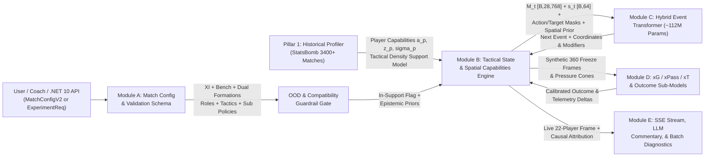
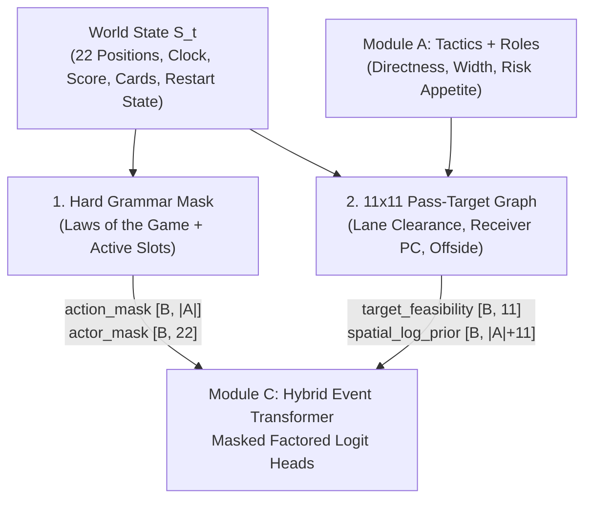

# PixelPitchAI v2: Modules A & B — Tactical State, Player Capabilities, & Counterfactual Experimentation Platform

**Document Owner:** `@tactical-state`  
**Branch / Worktree:** `feat/v2-hybrid-simulation-revamp` (`D:\programming\GitHub\PixelPitchAI-v2-revamp`)  
**Scope:** Module A (Match Configuration Schema), Module B (Tactical State & Player Capabilities Engine bridging Approach A & Approach B), and the Counterfactual Football Experimentation Platform.  
**Downstream Consumers:** Module C/D (`03_hybrid_event_transformer_and_models.md`), Module E & .NET Integration (`04_presentation_and_integration.md`), Pillar 1 Player Profiler (`01_data_and_feature_pipeline.md`).

---

## 1. Executive Summary & Current-State Gap Analysis (V1 → V2)

PixelPitchAI v1 proves out end-to-end streaming (FastAPI + gRPC → .NET 10 → Redis/PostgreSQL → SSE → Next.js pitch UI), but its simulation core treats football matches as an unconditioned team-year text prompt:

| Dimension | PixelPitchAI v1 (Verified Current State) | PixelPitchAI v2 (Modules A & B Target) |
| :--- | :--- | :--- |
| **Simulation Request** | `MatchRequest` (`simulation-engine/api/models/schemas.py`) & `SimulateMatchDto` (`backend/src/Application/Dtos/MatchDto.cs`) only send `home_team_id`, `away_team_id`, `home_team_season`, `away_team_season`, and GPT-2 decoding flags (`temperature`, `top_p`, `top_k`, `max_length`). | `MatchConfigurationV2` specifies full Starting XIs (22 slots + bench), dual-phase formations, 22 granular player roles, continuous tactical instruction vectors, and substitution policies. |
| **Team & Era Conditioning** | `SPECIAL_LIST` (`simulation-engine/api/config/settings.py`) hardcodes 29 La Liga teams × 6 seasons (`Barcelona_2016` … `Sporting_Gijón_2021`). `MatchStatProcessor` (`api/core/xgboost_class.py`) predicts 22 coarse team stats from `[teamA_id, teamB_id, seasonA, seasonB]` and discretizes them into text buckets (`"dominant possession"`, `"moderate pressing"`). | Zero hardcoded team-year special tokens. Teams are composed dynamically from **any** 11 players' learned capability profiles + explicit tactical rules, enabling arbitrary custom XIs, new signings, and cross-era matchups. |
| **Player & Coach Domain Utilization** | `Domain.Models.Player` & `PlayerPosition` (`backend/src/Domain/Models/Player.cs`, `Enums/PlayerPosition.cs`) store only name, foot, shirt number, and 13 coarse position labels. `Coach.PreferredFormation` and `Coach.CoachingStyle` (`Coach.cs`) exist in PostgreSQL but are ignored during simulation. | Every player carries a Bayesian-calibrated 24-dim capability vector + `R^64` style embedding with sample-size uncertainty (`sigma_p`). `Coach` metadata auto-hydrates default formations and tactical presets when explicit overrides are omitted. |
| **Spatial & Tactical Awareness** | Event-only coordinates `(x, y)` in StatsBomb `[0, 120] × [0, 80]` (`api/core/parser.py`, `Matches/Barcelona_2016 vs Real_Madrid_2021.txt`). Off-ball positions, pressure cones, fatigue, and card dynamics are absent; `FootballPitch.tsx` (lines 252–253) mistakenly scales coordinates by `/ 100` instead of `/ 120` and `/ 80`. | Canonical `[0, 120] × [0, 80]` pitch contract with explicit adapter to `[0, 1]^2` / SVG. Module B tracks all **22 players' coordinates, velocities, stamina, cards, and Pitch Control** at every event step on GPU tensors `[B, 22, ...]`. |
| **Experimentation Capability** | Single-match text generation only; no batch counterfactual comparisons, no explainable delta attribution, and no out-of-distribution (OOD) checks. | **Monte Carlo Batch Platform** (`100–1,000` paired Common Random Number rollouts; `~10–18s` per `100` matches on Colab A100) with zone/turnover/`xT`/`xG` causal diagnostics and 4-tier OOD guardrails. |

### End-to-End Architectural Position of Modules A & B



---

## 2. Module A: Match Configuration Schema

Module A defines the single, strongly-typed contract for configuring either a **single live match** or a **batch counterfactual experiment**. Every field is representable identically in Python (Pydantic v2) and C# (.NET 10 Native AOT `System.Text.Json` source-generated DTOs).

### 2.1 Canonical Pitch Coordinate & Slot Standard

To eliminate coordinate drift between StatsBomb ingestion (`120 × 80`), `.NET` processors, and `frontend/app/Components/FootballPitch/FootballPitch.tsx`:

1. **Canonical Global Pitch Frame (`StatsBomb-120x80`):**
   - Length $X \in [0.0, 120.0]$ (`Home` attacks $+x$: own goal line $x=0$, target goal line $x=120$; `Away` attacks $-x$: own goal line $x=120$, target goal line $x=0$; penalty spots at $(12, 40)$ and $(108, 40)$, kickoff at $(60, 40)$).
   - Width $Y \in [0.0, 80.0]$ ($y=0$ and $y=80$ are the touchlines).
   - **Global Continuity + Ego-Centric Feature Symmetry:** All stored events and 22-player coordinates `(x, y)` operate in this **Canonical Global Pitch Frame** (eliminating raw StatsBomb possession-flip discontinuities between consecutive events, aligned with Module C & Module E). Internally, when evaluating `Away` formation anchors or ego-centric goal angles, Module B transforms via $(x_{\text{rel}}, y_{\text{rel}}) = (120 - x, 80 - y)$.
   - **Frontend / Metric Conversion Contract:** Normalize via $(u, v) = (x / 120.0, y / 80.0)$ (fixing v1's `/ 100` scaling mismatch in `FootballPitch.tsx`), or convert to FIFA meters via $(105 \cdot u, 68 \cdot v)$.
2. **Active 22-Slot Addressing (`ACTOR_SLOT_1_22`, GPU Tensor Index `slot - 1`):**
   - **Slot `0`:** Reserved for `SYSTEM` lifecycle events (`PERIOD_BOUNDARY`, `MATCH_END`).
   - **Home Team Slots `1..11`:** Slot `1` is always the active Goalkeeper; slots `2..11` are the 10 outfield tactical slots ordered back-to-front, left-to-right (corresponding to local `slot_index` `0..10` and GPU tensor index `0..10`).
   - **Away Team Slots `12..22`:** Slot `12` is always the active Goalkeeper; slots `13..22` are the 10 outfield tactical slots (corresponding to local `slot_index` `0..10` and GPU tensor index `11..21`).
   - **Substitution Continuity:** When bench player `B` replaces starter `S` in tactical slot $k \in \{1..22\}$, slot $k$ retains its tactical identity (or transitions to the new role if a tactical tweak accompanies the sub) while Module B swaps `player_id`, `capability_vector`, `preferred_foot`, and resets slot `stamina` to `B.initial_fitness`. Thus Module C's `ACTOR_SLOT_1_22` head stays invariant (`vocab=23` including `SYSTEM`) while reflecting fresh legs and new player skill immediately.

### 2.2 Starting XI, Bench, & What-If Custom Players

Each side (`home`, `away`) provides a `TeamMatchConfig`:
- **11 Starting Slots (`starting_xi: List[LineupSlotConfig]`, length = 11):**
  - `slot_index: int` (`0..10` local team slot; slot `0` constrained to `Goalkeeper`).
  - `player_id: Optional[int]` — references `Players.Id` in PostgreSQL / Pillar 1's `PlayerProfileStore`.
  - `inline_profile_override: Optional[PlayerAttributeOverride]` — enables **"what-if" recruitment or custom hypothetical player experiments** without modifying the production database (e.g., cloning an existing player and boosting `press_resistance` by `+0.15`, or injecting a scouted prospect's Wyscout/StatsBomb profile vector).
  - `shirt_number: int` (`1..99`), `preferred_foot: Literal["Right", "Left", "Both"]`.
  - `base_position: GranularPosition` (25 StatsBomb-aligned tactical positions: `GK`, `RCB`, `CB`, `LCB`, `RB`, `LB`, `RWB`, `LWB`, `RDM`, `CDM`, `LDM`, `RCM`, `CM`, `LCM`, `RM`, `LM`, `RAM`, `CAM`, `LAM`, `RW`, `LW`, `RS`, `ST`, `LS`, `CF`).
  - `tactical_role: PlayerRole` (see §2.4).
  - `player_instructions: PlayerInstructionOverrides`:
    - `freedom_to_roam: float = 0.5` (`[0, 1]`, tether tightness around tactical anchor)
    - `width_bias: float = 0.5` (`0.0` tuck inside / half-space, `1.0` hug touchline)
    - `forward_run_appetite: float = 0.5` (`0.0` hold station / rest-defense, `1.0` aggressive runs in behind)
    - `pressing_aggressiveness: float = 0.5` (`0.0` hold shape, `1.0` jump out to engage carrier)
    - `passing_risk_bias: float = 0.5` (`0.0` conservative retention, `1.0` high-risk line-breaking/through-balls)
  - `initial_fitness: float = 1.0` (`[0.5, 1.0]`, models fixture congestion / returning from injury).
  - `is_set_piece_taker: SetPieceRoles` (`corners_left`, `corners_right`, `free_kicks_direct`, `free_kicks_indirect`, `penalties`).
- **Bench Roster (`bench: List[BenchPlayerConfig]`, length `0..12`):**
  - Holds `player_id`, `inline_profile_override`, `shirt_number`, `preferred_foot`, `natural_positions`, `default_role`, and `initial_fitness`.

### 2.3 Dual-Phase Formation Architecture (`FormationConfig`)

Real football systems morph between possession and defense (e.g., Pep/Arteta `4-3-3` nominal → `3-2-5` in possession via an `InvertedFullback`, → `4-4-2` out of possession). Module A models formations across **4 canonical game phases** rather than a single static diagram:

1. **`build_up` (Phase 0 — Own Third / Goal Kick / Deep Progression, ball $x \in [0, 42]$):** Defines where CBs split, whether the GK steps up as a sweeper pivot, and whether a DM drops between CBs (*Salida Lavolpiana*).
2. **`in_possession` (Phase 1 — Attacking Progression & Settled Final Third, ball $x \in (42, 120]$):** Captures structural rest-defense + 5-lane attack (e.g., `3-2-5`, `2-3-5`, `3-4-2-1`).
3. **`high_press` (Phase 2 — Opponent Build-Up & Counter-Press Trigger, opponent ball $x_{\text{opp}} \in [0, 48]$):** Defines man-oriented vs zonal trap pressing assignments.
4. **`out_of_possession` (Phase 3 — Settled Mid/Low Block, opponent ball $x_{\text{opp}} \in (48, 120]$):** Defines defensive block compactness (e.g., `4-4-2`, `4-5-1`, `5-3-2`, `5-4-1`).

Each phase stores an `11 × 5` **Slot Anchor Specification** (`PhaseSlotAnchor`):
- `(anchor_x, anchor_y) ∈ [0, 1]^2`: Canonical base position in normalized team-relative coordinates (attacking $+x$).
- `zone_radius: float ∈ [0.04, 0.25]`: Soft spatial leash radius (normalized pitch units).
- `ball_shift_x: float ∈ [0.0, 0.65]`, `ball_shift_y: float ∈ [0.0, 0.55]`: How strongly this slot tracks ball movement horizontally/vertically.

**Standard Formation Presets Shipped Out-of-the-Box:**
`4-3-3`, `4-2-3-1`, `4-4-2`, `4-4-2_diamond`, `4-1-4-1`, `3-5-2`, `3-4-2-1`, `3-4-3`, `5-3-2`, `5-4-1`, `4-2-2-2`, plus `CUSTOM` (arbitrary user-defined 4-phase anchor arrays). Selecting a role such as `InvertedFullback` automatically applies a deterministic phase-delta to that slot's `in_possession` anchor (shifting $y$ inward toward the central pivot channel) unless the user locks custom coordinates.

### 2.4 Structured Player Role Taxonomy (`PlayerRole`)

Module A standardizes **22 explicit tactical roles** spanning all lines. Each role maps to a deterministic **16-dimensional Behavioral Prior Vector** ($\mathbf{r}_k \in \mathbb{R}^{16}$) and sets baseline `PlayerInstructionOverrides`:

| Positional Line | `PlayerRole` Enum | Tactical Behavior & Anchor Shift Summary | Key Prior Dimensions (High Weight) |
| :--- | :--- | :--- | :--- |
| **Goalkeeper** | `SweeperKeeper` | High starting $x$ behind high defensive line (`x ~ 0.14` in possession); active short build-up option & through-ball sweeper. | `build_up_involvement`, `sweeper_depth`, `short_dist_bias` |
| | `ShotStopperGK` | Conservative goal-line positioning (`x ~ 0.05`); favors medium/long distribution under press. | `long_kick_bias`, `line_hold_conservatism` |
| **Center Back** | `BallPlayingCB` | Carries forward into space (`carry_propensity`), hits diagonal switches & line-breaking ground passes. | `progressive_pass_bias`, `carry_into_midfield` |
| | `StopperCB` | Aggressive step-up duel engagement in half-spaces; conservative recycling in possession. | `front_foot_duel_aggression`, `safe_pass_bias` |
| | `WideCenterBack` | For back-3 systems; overlaps/underlaps into wide half-spaces during `in_possession`. | `half_space_overlap`, `wide_defensive_cover` |
| **Fullback / Wingback** | `InvertedFullback` | Tucks into `DM/CM` pivot (`y -> 0.34 / 0.66`) during `build_up` & `in_possession` to form `3-2-5`/`2-3-5` rest defense. | `inward_channel_shift`, `pivot_recycling`, `press_resistance_demand` |
| | `OverlappingFullback` | Holds wide touchline (`y ~ 0.08 / 0.92`), makes high-sprint overlaps past inverted winger for crosses/cutbacks. | `touchline_width`, `final_third_overlap`, `crossing_bias` |
| | `DefensiveFullback` | Stays tucked in back-3 rest-defense (`x` capped near `0.48`) to guard counter-attacks. | `rest_defense_hold`, `low_forward_run` |
| | `CompleteWingBack` | Primary wide provider in `3-5-2`/`3-4-2-1`; high sprint budget across both thirds. | `high_sprint_load`, `box_entry_run`, `early_cross` |
| **Defensive / Central Mid** | `DeepLyingPlaymaker` | Anchors central lane (`0.35 < x < 0.55`), high touch volume, tempo controller, switches play. | `tempo_control`, `switch_pass_bias`, `low_box_penetration` |
| | `DestroyerDM` | Ball-winner shielding center backs; high counter-press jump & tactical foul/tackle rate; simple release passes. | `interception_radius`, `counter_press_trigger`, `short_release` |
| | `BoxToBoxMidfielder` | Links defense to penalty-box late arrivals; high stamina drain; balanced pass/carry. | `vertical_box_to_box_span`, `late_box_run`, `high_workrate` |
| | `Mezzala` | Half-space #8 (`y ~ 0.28 / 0.72`); rotates with winger/inverted FB, drives progressive carries & shots from edge of box. | `half_space_occupation`, `progressive_carry`, `zone14_shot` |
| | `Carrilero` | Shuttler covering lateral midfield channels behind attacking #10 or overlapping FB. | `lateral_cover_shift`, `ball_retention` |
| **Attacking Mid / Winger** | `AdvancedPlaymaker` | Operates in Zone 14 / half-spaces between opposition lines; prioritizes through-balls & key passes. | `between_lines_pocket`, `through_ball_bias`, `low_defensive_track` |
| | `InvertedWinger` | Starts wide, cuts inside onto stronger foot (`y -> 0.32 / 0.68`) for combination play & curlers. | `cut_inside_carry`, `half_space_shot`, `combination_bias` |
| | `TouchlineWinger` | Pins opposing fullback to touchline (`y ~ 0.06 / 0.94`), attacks 1v1 dribbles on outside & delivers crosses/cutbacks. | `max_width_pinning`, `takeon_1v1_bias`, `byline_cutback` |
| | `InsideForward` | Narrow forward starting in wide channel, makes diagonal runs behind CB/FB gap into penalty box. | `diagonal_run_behind`, `high_box_occupancy`, `shot_appetite` |
| **Striker / Forward** | `False9` | Drops `-12m` from defensive line into Zone 14 during `in_possession` to create midfield overload & feed wingers. | `drop_deep_offset`, `link_up_pass_bias`, `low_aerial_target` |
| | `PressingForward` | Leads `high_press` triggers, curves runs to screen CB-to-DM passing lanes, high OOP sprint load. | `press_trigger_aggression`, `lane_screening`, `transition_sprint` |
| | `TargetForward` | Focal point for direct balls & crosses; holds high central pin (`x ~ 0.85`), competes in aerial duels & lay-offs. | `aerial_target_weight`, `long_ball_magnet`, `layoff_pass_bias` |
| | `Poacher` | Minimal build-up touches; camps on last defender shoulder looking for 1-touch box finishes. | `last_shoulder_pin`, `high_xg_shot_selectivity`, `offside_risk` |

### 2.5 Team Tactical Instructions (`TacticalInstructions`)

All tactical instructions are normalized `[0.0, 1.0]` continuous parameters with transparent football-domain calibrations so coaches/analysts can interpret settings directly:

| Instruction Key | Range `[0,1]` | Domain Anchor Calibration | Primary Behavioral Effect in Module B & C |
| :--- | :--- | :--- | :--- |
| `defensive_line_height` | `0.0 → 1.0` | `22.0m` (deep block) → `52.0m` (halfway line) from own goal | Shifts `out_of_possession` & `high_press` back-4/back-3 anchor $x$; controls space behind defense & offside trap depth. |
| `pressing_intensity` | `0.0 → 1.0` | Target **PPDA** `18.0` (passive) → `5.5` (intense gegenpress) | Controls OOP defender trigger radius, ball-carrier pressure field strength, stamina burn rate, & foul/interception hazards. |
| `build_up_tempo` | `0.0 → 1.0` | Inter-event mean dwell `3.4s` (slow) → `1.2s` (fast) | Conditions Module C's `TIME_DELTA` distribution and first-time vs multi-touch carry probability. |
| `directness` | `0.0 → 1.0` | Avg pass length `13m` / `4%` long → `25m` / `22%` long | Reweights pass-target graph toward vertical/long-channel targets vs short lateral support triangles. |
| `attacking_width` | `0.0 → 1.0` | Effective team width `36m` (narrow) → `64m` (touchline) | Scales lateral `anchor_y` spread in `build_up` and `in_possession` phases. |
| `defensive_compactness` | `0.0 → 1.0` | Block area `1,100 m²` (loose) → `520 m²` (tight) | Compresses inter-line vertical & horizontal distances around the ball centroid out of possession. |
| `counter_press_vs_regroup` | `0.0 → 1.0` | `0.0` immediate drop-off → `1.0` 6-sec high counter-press | Governs `transition_defense` window (first 6 seconds after turnover) before reverting to `settled_defense`. |
| `counter_attack_urgency` | `0.0 → 1.0` | `0.0` secure first pass → `1.0` immediate vertical sprint | Governs `transition_offense` (first 8 seconds after recovery): sprint forward runs & through-ball prior boost. |
| `possession_risk_appetite` | `0.0 → 1.0` | `0.0` safe U-shape → `1.0` high line-breaking risk | Scales acceptance threshold on `xPass` completion probability when choosing progressive/risky passes. |
| `game_state_adaptivity` | `0.0 → 1.0` | `0.0` rigid counterfactual → `1.0` natural score/time shift | Controls whether trailing/leading dynamically shifts effective line height & urgency late in the match (§3.6). |

**Legacy Coach Auto-Hydration Bridge:** When a caller (such as existing `.NET` `MatchesController.SimulateMatch`) does not supply explicit `TacticalInstructions`, Module A queries `Coach.PreferredFormation` and `Coach.CoachingStyle` (`backend/src/Domain/Models/Coach.cs`) via a deterministic preset lookup table (e.g., `"Gegenpressing"` → `pressing_intensity=0.84, counter_press_vs_regroup=0.88, defensive_line_height=0.76`; `"Tiki-Taka"` → `directness=0.22, attacking_width=0.62, build_up_tempo=0.58`; `"Low Block Counter"` → `defensive_line_height=0.24, counter_attack_urgency=0.86`) and populates the historical most-used XI for that team-season.

### 2.6 Automated, Rule-Based, & Scripted Substitution Policies

Substitutions are modeled via `SubstitutionPolicy` containing:
- **Hard FIFA Law Constraints:** `max_subs = 5`, `max_windows = 3` (half-time subs do not consume a stoppage window; extra-time adds `+1` sub & `+1` window if `extra_time_enabled=True`).
- **Three Supported Policy Modes:**
  1. `scripted`: Exact counterfactual interventions (`trigger_minute`, `out_slot_index`, `in_player_id` or `in_bench_index` for custom signings, optional `new_role`, `new_formation`, `tactical_patch`). Crucial for testing *"What if we bring on an Impact Winger and switch to 4-2-3-1 at minute 60?"*
  2. `rule_based`: Evaluates deterministic predicates at every dead-ball stoppage after minute `45`:
     - *Fatigue Guard:* `slot.stamina < stamina_threshold` (default `0.48`) and `minute >= 55`.
     - *Yellow-Card Red-Risk Mitigation:* `slot.has_yellow_card and team.pressing_intensity > 0.68 and minute >= 55`.
     - *Chasing Goal Override:* `score_diff < 0 and minute >= 65` → prioritizes attacking bench replacement + optional formation escalation (`4-3-3` → `4-2-4` / `3-4-3`).
     - *Lead Protection Override:* `score_diff > 0 and minute >= 75` → prioritizes fresh `DestroyerDM` / `DefensiveFullback` + lowers `defensive_line_height` by `0.10`.
  3. `auto_coach`: Learned hazard model $P(\text{sub}_{i,t} \mid \text{minute}, \text{score\_diff}, \text{stamina}_i, \text{card}_i, \text{bench\_quality})$ calibrated on historical StatsBomb substitution timings (used when `mode == "auto_coach"`).

### 2.7 Full Pydantic v2 Reference Schema & .NET 10 Native AOT Contract

```python
from enum import Enum
from typing import Dict, List, Literal, Optional
from pydantic import BaseModel, Field, model_validator


class TacticalPhase(str, Enum):
    BUILD_UP = "build_up"
    IN_POSSESSION = "in_possession"
    HIGH_PRESS = "high_press"
    OUT_OF_POSSESSION = "out_of_possession"


class PlayerRole(str, Enum):
    SWEEPER_KEEPER = "SweeperKeeper"
    SHOT_STOPPER_GK = "ShotStopperGK"
    BALL_PLAYING_CB = "BallPlayingCB"
    STOPPER_CB = "StopperCB"
    WIDE_CENTER_BACK = "WideCenterBack"
    INVERTED_FULLBACK = "InvertedFullback"
    OVERLAPPING_FULLBACK = "OverlappingFullback"
    DEFENSIVE_FULLBACK = "DefensiveFullback"
    COMPLETE_WING_BACK = "CompleteWingBack"
    DEEP_LYING_PLAYMAKER = "DeepLyingPlaymaker"
    DESTROYER_DM = "DestroyerDM"
    BOX_TO_BOX_MIDFIELDER = "BoxToBoxMidfielder"
    MEZZALA = "Mezzala"
    CARRILERO = "Carrilero"
    ADVANCED_PLAYMAKER = "AdvancedPlaymaker"
    INVERTED_WINGER = "InvertedWinger"
    TOUCHLINE_WINGER = "TouchlineWinger"
    INSIDE_FORWARD = "InsideForward"
    FALSE_9 = "False9"
    PRESSING_FORWARD = "PressingForward"
    TARGET_FORWARD = "TargetForward"
    POACHER = "Poacher"


class PhaseSlotAnchor(BaseModel):
    slot_index: int = Field(..., ge=0, le=10)
    anchor_x: float = Field(..., ge=0.0, le=1.0)
    anchor_y: float = Field(..., ge=0.0, le=1.0)
    zone_radius: float = Field(0.12, ge=0.04, le=0.30)
    ball_shift_x: float = Field(0.35, ge=0.0, le=0.75)
    ball_shift_y: float = Field(0.25, ge=0.0, le=0.75)


class FormationConfig(BaseModel):
    base_name: str = Field(..., examples=["4-3-3", "4-2-3-1", "3-5-2"])
    phase_anchors: Dict[TacticalPhase, List[PhaseSlotAnchor]] = Field(
        default_factory=dict,
        description="Optional explicit 11-slot anchors per phase; auto-populated from preset + roles if omitted."
    )


class PlayerInstructionOverrides(BaseModel):
    freedom_to_roam: float = Field(0.5, ge=0.0, le=1.0)
    width_bias: float = Field(0.5, ge=0.0, le=1.0)
    forward_run_appetite: float = Field(0.5, ge=0.0, le=1.0)
    pressing_aggressiveness: float = Field(0.5, ge=0.0, le=1.0)
    passing_risk_bias: float = Field(0.5, ge=0.0, le=1.0)


class PlayerAttributeOverride(BaseModel):
    """Enables custom hypothetical players or counterfactual attribute perturbations."""
    display_name: str
    clone_from_player_id: Optional[int] = None
    attributes_24d: Optional[Dict[str, float]] = None  # Partial or full override in [0, 1]
    attribute_deltas: Optional[Dict[str, float]] = None  # e.g. {"press_resistance": +0.15}
    latent_style_64d: Optional[List[float]] = None


class LineupSlotConfig(BaseModel):
    slot_index: int = Field(..., ge=0, le=10)
    player_id: Optional[int] = Field(None, ge=1)
    inline_profile_override: Optional[PlayerAttributeOverride] = None
    shirt_number: int = Field(..., ge=1, le=99)
    preferred_foot: Literal["Right", "Left", "Both"] = "Right"
    base_position: str = Field(..., min_length=2, max_length=6)
    tactical_role: PlayerRole
    player_instructions: PlayerInstructionOverrides = Field(default_factory=PlayerInstructionOverrides)
    initial_fitness: float = Field(1.0, ge=0.4, le=1.0)

    @model_validator(mode="after")
    def validate_player_source(self):
        if self.player_id is None and self.inline_profile_override is None:
            raise ValueError("Each slot requires either player_id or inline_profile_override.")
        if self.slot_index == 0 and self.tactical_role not in (
            PlayerRole.SWEEPER_KEEPER, PlayerRole.SHOT_STOPPER_GK
        ):
            raise ValueError("Slot 0 must be assigned a Goalkeeper role.")
        return self


class BenchPlayerConfig(BaseModel):
    player_id: Optional[int] = Field(None, ge=1)
    inline_profile_override: Optional[PlayerAttributeOverride] = None
    shirt_number: int = Field(..., ge=1, le=99)
    preferred_foot: Literal["Right", "Left", "Both"] = "Right"
    natural_positions: List[str]
    default_role: PlayerRole
    initial_fitness: float = Field(1.0, ge=0.4, le=1.0)

    @model_validator(mode="after")
    def validate_bench_source(self):
        if self.player_id is None and self.inline_profile_override is None:
            raise ValueError("Each bench slot requires either player_id or inline_profile_override.")
        return self


class TacticalInstructions(BaseModel):
    defensive_line_height: float = Field(0.55, ge=0.0, le=1.0)
    pressing_intensity: float = Field(0.55, ge=0.0, le=1.0)
    build_up_tempo: float = Field(0.50, ge=0.0, le=1.0)
    directness: float = Field(0.45, ge=0.0, le=1.0)
    attacking_width: float = Field(0.55, ge=0.0, le=1.0)
    defensive_compactness: float = Field(0.55, ge=0.0, le=1.0)
    counter_press_vs_regroup: float = Field(0.55, ge=0.0, le=1.0)
    counter_attack_urgency: float = Field(0.50, ge=0.0, le=1.0)
    possession_risk_appetite: float = Field(0.50, ge=0.0, le=1.0)
    game_state_adaptivity: float = Field(0.75, ge=0.0, le=1.0)


class ScriptedSubstitutionRule(BaseModel):
    trigger_minute: int = Field(..., ge=1, le=120)
    condition_score_diff_max: Optional[int] = None  # e.g., 0 if drawing/losing
    condition_score_diff_min: Optional[int] = None
    out_slot_index: int = Field(..., ge=0, le=10)
    in_player_id: Optional[int] = Field(None, ge=1)
    in_bench_index: Optional[int] = Field(None, ge=0, le=11, description="Bench slot index when substituting a custom inline_profile_override player with player_id=None.")
    new_role: Optional[PlayerRole] = None
    new_formation: Optional[str] = None
    tactical_patch: Optional[Dict[str, float]] = None

    @model_validator(mode="after")
    def validate_sub_target(self):
        if self.in_player_id is None and self.in_bench_index is None:
            raise ValueError("ScriptedSubstitutionRule requires either in_player_id or in_bench_index.")
        return self


class SubstitutionPolicy(BaseModel):
    mode: Literal["scripted", "rule_based", "auto_coach", "hybrid"] = "hybrid"
    max_substitutions: int = Field(5, ge=0, le=6)
    max_windows: int = Field(3, ge=0, le=4)
    stamina_sub_threshold: float = Field(0.48, ge=0.20, le=0.80)
    protect_yellow_card_threshold_pressing: float = Field(0.70, ge=0.30, le=1.0)
    scripted_rules: List[ScriptedSubstitutionRule] = Field(default_factory=list)


class TeamMatchConfig(BaseModel):
    team_id: Optional[int] = Field(None, ge=1)
    team_name: str = Field(..., min_length=1, max_length=100)
    season_label: Optional[str] = Field(None, pattern=r"^\d{4}/\d{4}$")
    coach_id: Optional[int] = Field(None, ge=1)
    formation: FormationConfig
    tactical_instructions: TacticalInstructions = Field(default_factory=TacticalInstructions)
    starting_xi: List[LineupSlotConfig] = Field(..., min_length=11, max_length=11)
    bench: List[BenchPlayerConfig] = Field(default_factory=list, max_length=12)
    substitution_policy: SubstitutionPolicy = Field(default_factory=SubstitutionPolicy)

    @model_validator(mode="after")
    def validate_scripted_bench_refs(self):
        bench_ids = {b.player_id for b in self.bench if b.player_id is not None}
        for rule in self.substitution_policy.scripted_rules:
            if rule.in_bench_index is not None and rule.in_bench_index >= len(self.bench):
                raise ValueError(f"in_bench_index={rule.in_bench_index} exceeds bench size {len(self.bench)}.")
            if rule.in_player_id is not None and rule.in_player_id not in bench_ids:
                raise ValueError(f"in_player_id={rule.in_player_id} is not present in bench roster.")
        return self


class MatchContextConfig(BaseModel):
    competition_tier: Literal["top_5_league", "european_knockout", "domestic_cup", "international"] = "top_5_league"
    home_advantage_strength: float = Field(0.5, ge=0.0, le=1.0)
    referee_strictness: float = Field(0.5, ge=0.0, le=1.0)
    pitch_surface: Literal["Grass", "Hybrid", "Artificial"] = "Hybrid"
    weather_wetness: float = Field(0.1, ge=0.0, le=1.0)
    extra_time_if_draw: bool = False


class MatchConfigurationV2(BaseModel):
    match_id: int = Field(..., ge=1)
    home: TeamMatchConfig
    away: TeamMatchConfig
    context: MatchContextConfig = Field(default_factory=MatchContextConfig)
    random_seed: Optional[int] = None
    allow_ood_extrapolation: bool = False
```

**Backward-Compatibility & .NET 10 Native AOT Alignment:**
- `backend/src/Footex` uses Native AOT with source-generated JSON (`MatchEventJsonContext.cs`) and zero reflection. All C# equivalents (`MatchConfigurationV2Dto`, `TeamMatchConfigDto`, `LineupSlotDto`, `TacticalInstructionsDto`) must use flat `sealed record` / `sealed class` types registered on a `[JsonSerializable]` `JsonSerializerContext`, using `string` enum converters (`JsonStringEnumConverter<PlayerRole>`) rather than runtime reflection.
- Legacy `SimulateMatchDto` (`HomeTeamId`, `AwayTeamId`, `HomeTeamSeason`, `AwayTeamSeason`) remains supported via a `ConfigurationHydrator` endpoint that fills `MatchConfigurationV2` from PostgreSQL `Teams`, `Coaches` (`PreferredFormation`, `CoachingStyle`), `Players`, and historical StatsBomb lineups.

---

## 3. Module B: Tactical State & Player Capabilities Engine (Bridging Approach A & Approach B)

Module B is the structural bridge that prevents PixelPitchAI v2 from falling into either failure mode:
- **Pure Approach A (Unconstrained Neural Sequence Model):** hallucinates impossible passes, teleports players, ignores substitutions/red cards, and conflates team identity with player talent.
- **Pure Approach B (Handcrafted Rule/Physics Engine):** looks robotic, miscalibrates subtle decision boundaries (e.g., when a `Mezzala` shoots vs plays a blind reverse pass), and cannot replicate real-world football variance.

Module B maintains an exact, differentiable/vectorized **World State Tensor** $\mathcal{S}_t$ at every simulation step $t$ across a batch of $B$ parallel matches ($B=1$ for live streaming, $B=100\text{–}512$ for GPU Monte Carlo experiments).

### 3.1 Player Capability Representation (`PlayerCapabilityRecord`)

From Pillar 1's Historical Player Capability & Role Profiler (computed over 3,400+ StatsBomb matches via DuckDB/Parquet), every known player $p$ receives a versioned record consisting of **two coupled components** plus **epistemic uncertainty**:

1. **Part A — 24 Interpretable Empirical-Bayes Attributes ($\mathbf{a}_p \in [0, 1]^{24}$) & Uncertainty ($\boldsymbol{\sigma}_p \in \mathbb{R}_+^{24}$):**
   - Computed from per-90 rates & contextual success efficiencies (e.g., `xPass` residuals under pressure, `post_shot_xG - xG` finishing residual), **shrunk toward positional peer priors** via Empirical Bayes shrinkage:
     $$\hat{a}_{p,d} = \frac{m_p}{m_p + m_0} \tilde{a}_{p,d} + \frac{m_0}{m_p + m_0} \mu_{\text{pos}(p), d}, \qquad \sigma_{p,d} = \frac{\tau_{\text{pos}, d}}{\sqrt{1 + m_p / m_0}}$$
     where $m_p$ is historical minutes played and $m_0 = 900$ (10 full matches) is the shrinkage prior strength. This prevents a 45-minute cameo player with 1/1 shots from saturating finishing attributes to `0.99`, while exposing $\sigma_{p,d}$ for Monte Carlo epistemic sampling (§4.5).
   - **Attribute Inventory (`24` dimensions):**
     - *Passing & Progression (6):* `short_pass_accuracy`, `progressive_pass_volume`, `long_switch_propensity`, `through_ball_vision`, `cross_frequency`, `press_resistance` (completion delta when `under_pressure=True`).
     - *Ball Manipulation & Carrying (4):* `dribble_takeon_volume`, `dribble_success_skill`, `ball_carry_progression`, `first_touch_retention`.
     - *Shooting & Threat (5):* `shot_volume_box`, `shot_volume_long`, `finishing_skill_psxg_delta`, `aerial_box_threat`, `weak_foot_balance`.
     - *Defending & Pressing (6):* `pressing_workrate`, `tackle_duel_win_rate`, `interception_reading`, `aerial_duel_win_rate`, `foul_proneness`, `recovery_speed_proxy`.
     - *Physical & Specialist (3):* `stamina_endurance`, `sprint_recovery_capacity`, `set_piece_delivery`.

2. **Part B — Learned Dense Style Embedding ($\mathbf{z}_p \in \mathbb{R}^{64}$):**
   - Jointly learned during pre-training (Module C Stage 1) by embedding player-season participation tokens through a residual projection + L2-normalization. Captures subtle tactical tendencies not compressed into 24 scalars (e.g., left-half-space carry arc, tendency to wall-pass vs turn into space, goalkeeper sweeping timing).
   - For inline custom players (`PlayerAttributeOverride`) without a learned $\mathbf{z}_p$: initialize $\mathbf{z}_p$ from `clone_from_player_id` (if given) or via a trained Ridge/MLP adapter $\hat{\mathbf{z}}_p = f_{\text{attr}\to z}(\mathbf{a}_p, \text{base\_position})$ so synthetic scouting transfers work seamlessly.

### 3.2 Tactical Conditioning Fusion (`EffectivePlayerState`)

At step $t$, for every slot $i \in \{0..21\}$ in match $b \in \{0..B-1\}$, Module B fuses **who the player is**, **how tired/booked they are**, and **what the coach asked them to do**:

$$\mathbf{a}^{\text{eff}}_{b,i,t} = \mathbf{a}_{p(b,i)} \odot \mathbf{m}_{\text{fatigue}}(\text{stamina}_{b,i,t}) \odot \mathbf{m}_{\text{card}}(\text{yellow}_{b,i,t})$$

$$\mathbf{u}_{b,i,t} = [\mathbf{z}_{p(b,i)} \,\|\, \mathbf{a}^{\text{eff}}_{b,i,t} \,\|\, \mathbf{r}_{\text{role}(b,i)} \,\|\, \boldsymbol{\tau}_{\text{team}(i), t} \,\|\, \boldsymbol{\phi}_{\text{instr}(b,i)} \,\|\, \mathbf{s}_{\text{pos}(b,i,t)} \,\|\, \mathbf{s}_{\text{stat}(b,i,t)}] \in \mathbb{R}^{128}$$

Where the exact `128`-dim `player_cond` slot vector decomposes cleanly into (`64 + 24 + 16 + 10 + 5 + 6 + 3 = 128`):
- $\mathbf{z}_{p} \in \mathbb{R}^{64}$: learned dense player style embedding (§3.1 Part B),
- $\mathbf{a}^{\text{eff}}_{b,i,t} \in \mathbb{R}^{24}$: empirical-Bayes core player attributes (`attributes_24d`) modulated by fatigue and cards,
- $\mathbf{r}_{\text{role}} \in \mathbb{R}^{16}$: assigned `PlayerRole` prior vector (§2.4),
- $\boldsymbol{\tau}_{\text{team}, t} \in \mathbb{R}^{10}$: effective `TacticalInstructions` after game-state elasticity (§3.6),
- $\boldsymbol{\phi}_{\text{instr}} \in \mathbb{R}^{5}$: slot-level `PlayerInstructionOverrides`,
- $\mathbf{s}_{\text{pos}} \in \mathbb{R}^{6}$: `[x_norm, y_norm, vx_norm, vy_norm, dist_to_ball_norm, local_pitch_control]`,
- $\mathbf{s}_{\text{stat}} \in \mathbb{R}^{3}$: `[is_on_pitch, stamina, card_state]`.

> **Routing Pillar 1's `gk_attributes_8d` (`24 + 8 = 32` total profile dims in `01`):** To preserve exact `128`-dim `player_cond` parity with Module C (`03_...` §2.3 & §5.1), `attributes_24d` enters `player_cond`, while Pillar 1's `gk_attributes_6d` (`[24..29]`) feeds **Module B** (`SweeperKeeper` depth & GK distribution target prior), **Module C** Tokens `22..23` (`active_gk_attributes_6d` inside $M_t$), and **Module D2** (`PSxG` Bayesian GK shot-stopping log-odds residual $\delta_{\text{GK}}$), and `spatial_bias_2d` (`[30..31]`) is captured inside `z_p` (`64d`) and Module B's slot priors.

**Assembling Module C's Conditioning Tensors (`player_cond`, `M_t`, and `s_t`):**
To feed `PixelPitch-EventTF-112M` (`03_hybrid_event_transformer_and_models.md`) cleanly at every step $t$:
- **Slot Conditioning Tensor `player_cond` $\in \mathbb{R}^{B \times 22 \times 128}$:** Module C's Tactical & Roster Memory Encoder projects `player_cond` (`128 -> 512 -> 768` + slot/team embedding) into tokens `0..21` of the `28`-token memory tensor $M_t \in \mathbb{R}^{B \times 28 \times 768}$ (alongside tokens `22..23` for Home/Away tactical instruction tokens and tokens `24..27` for global ball/phase/momentum context).
- **Global Match-State Vector $s_t \in \mathbb{R}^{64}$ (for Low-Rank AdaLN-Zero):** Supplies `[minute_norm, period_onehot, stoppage_norm, score_diff, home_reds, away_reds, poss_duration_sec, home_avg_stamina, away_avg_stamina, rolling_ppda_home, rolling_ppda_away, adaptivity_flag, ...]`.
- **Live In-Match Tactical Override Hook (`ApplyLiveTacticalOverride`):** During live single-match streaming (Module E), authenticated users can push mid-match formation shifts, instruction updates, or manual substitutions into Module B; Module B updates $\boldsymbol{\tau}_{\text{team}, t}$, slot anchors, `player_cond`, and $M_t$ immediately at the next dead-ball or event boundary.

**Why this separation unlocks Causal Counterfactuals:** Swapping a player changes $(\mathbf{z}_p, \mathbf{a}_p)$ while holding $(\mathbf{r}_{\text{role}}, \boldsymbol{\tau}_{\text{team}})$ fixed; tweaking tactics changes $(\mathbf{r}_{\text{role}}, \boldsymbol{\tau}_{\text{team}})$ while holding $(\mathbf{z}_p, \mathbf{a}_p)$ fixed. Notice that **role suitability** emerges naturally: assigning `InvertedFullback` shifts the spatial anchor $\mathbf{s}_{\text{pos}}$ into crowded central midfield where `press_resistance` is heavily tested; a player with low `press_resistance` suffers elevated simulated turnover rates even before any heuristic penalty is applied!

### 3.3 Dynamic 22-Player Off-Ball Spatial Engine

StatsBomb open event data records coordinates for the ball actor (plus 360 freeze frames in ~300–500 matches, not all 3,400+ matches). To make every simulated step physically coherent, feed Module D's 360-style `xG`/`xPass` models, and render 22 moving players in Module E, Module B runs a **3-Layer Hybrid Off-Ball Spatial Solver** vectorized over `[B, 22, 2]` GPU tensors (`<0.15 ms` per step for `B=256`):

#### Layer 1: Phase-Aware Tactical Anchor Potential ($\mathbf{p}^{\text{anchor}}_{b,i,t}$)
1. Determine each team's active `TacticalPhase` using the finite-state possession clock:
   - Possessing team: `build_up` if `ball_x_rel <= 42` else `in_possession` (with `counter_attack_urgency` boost during first `8s` after turnover).
   - Defending team: `high_press` if (`seconds_since_turnover <= 6.0` and `counter_press_vs_regroup > 0.5`) or (`opp_ball_x <= 48` and `pressing_intensity > 0.45`), else `out_of_possession`.
2. Compute each slot's target tactical anchor in canonical `[0, 120] × [0, 80]` space:
   - Start from phase anchor `(anchor_x, anchor_y)`.
   - Apply **Team Block Compression & Line Shift**:
     - Out of possession, scale team centroid $x$-offset via `defensive_line_height` ($22\text{m}\text{–}52\text{m}$) and contract horizontal/vertical spread via `defensive_compactness`.
     - In possession, scale lateral $y$ spread around `y=40` by `0.70 + 0.60 * attacking_width`.
   - Apply **Ball-Attraction Shift**: shift by `ball_shift_x * (ball_x - 60)` and `ball_shift_y * (ball_y - 40)` (ball-side compactness / weak-side tuck-in).
   - Apply **Role Dynamic Offsets**: e.g., `False9` pulls `-10m` when team is in middle third; `OverlappingFullback` pushes `+16m` when ball-side winger cuts inside; `SweeperKeeper` sets $x_{\text{GK}} = \max(5.0, \text{min\_defender\_x} - 22.0)$.

#### Layer 2: Learned Residual Spatial Predictor (`SpatialPredictor`, ~2M Params)
- Trained on StatsBomb 360 freeze frames + SkillCorner-compatible tracking windows using Gaussian negative log-likelihood + repulsive spacing regularization.
- Input: previous 22 positions $\mathbf{p}_{t-1}$, current ball event $(x_{\text{start}}, y_{\text{start}}, x_{\text{end}}, y_{\text{end}}, \Delta t, \text{action\_type})$, phase anchors $\mathbf{p}^{\text{anchor}}_t$, and slot conditioning $\mathbf{u}_{i,t}$.
- Output: mean residual $(\Delta x_i, \Delta y_i)$ and positional uncertainty $(\sigma_{x,i}, \sigma_{y,i})$ relative to $\mathbf{p}^{\text{anchor}}_t$.
- During **ball-event steps**, the explicit **ball actor** and **explicit receiver** (on completed passes/carries) are pinned directly to the exact event `(start_xy, end_xy)` emitted by Module C, while the remaining 20 off-ball players update synchronously around them!

#### Layer 3: Kinematic & Laws-of-the-Game Feasibility Clamp (Approach B)
1. **Kinematic Speed Envelope:** Over event interval $\Delta t = \text{clip}(t - t_{\text{prev}}, 0.4, 8.0)$ seconds, clamp displacement:
   $$\|\mathbf{p}_{i,t} - \mathbf{p}_{i,t-1}\|_2 \le v_{\max}(i, \text{stamina}_{i,t}) \cdot \Delta t$$
   where $v_{\max}(i, s) = (6.8 + 2.4 \cdot \text{sprint\_recovery\_capacity}_i) \cdot (0.72 + 0.28 \cdot s)\text{ m/s}$ (in yards/s scaled by `1.0936` for StatsBomb-120x80).
2. **Pitch Boundary & Minimum Separation:** Clip to $[1.0, 119.0] \times [1.0, 79.0]$ (except throw-in taker at $y \in \{0, 80\}$ or corner taker), and apply a 1-step soft repulsion push if two players occupy $<1.0\text{m}$ (outside active aerial/ground duel events).
3. **Passive Offside Awareness Adjustment:** Off-ball attackers without `poacher/channel` sprint intent smoothly check $x_{\text{def\_2nd\_last}}$ and bias residual $\Delta x \le 0$ near the offside line modulated by player `tactical_awareness` and `freedom_to_roam` (preventing unrealistic constant offsides while preserving genuine offside traps against high lines).

### 3.4 Continuous Pitch Control & Synthetic 360 Freeze-Frame Bridge

Given $\mathbf{p}_{0..21, t}$ and estimated velocity vectors $\mathbf{v}_{i,t} = (\mathbf{p}_{i,t} - \mathbf{p}_{i,t-1}) / \Delta t$:

1. **Vectorized Pitch Control Grid ($24 \times 16 = 384$ cells, `5 × 5` StatsBomb units per cell):**
   - For each grid center $\mathbf{c}_g \in \mathbb{R}^2$ and active player $i$:
     - Time-to-intercept (reaction delay $\tau_0 = 0.55\text{s} - 0.15\text{s} \cdot \text{anticipation}_i$):
       $$\tau_i(\mathbf{c}_g) = \tau_0 + \frac{\|\mathbf{c}_g - (\mathbf{p}_{i,t} + 0.4\mathbf{v}_{i,t})\|_2}{v_{\text{cruise}}(i, \text{stamina}_{i,t})}$$
     - Exponential spatial influence $I_i(\mathbf{c}_g) = \exp(-\lambda_{\text{ctrl}} \tau_i(\mathbf{c}_g))$ (masked to `0` for red-carded players).
     - Team Pitch Control probability at cell $g$:
       $$PC_{\text{Home}}(\mathbf{c}_g) = \frac{\sum_{i=0}^{10} I_i(\mathbf{c}_g)}{\sum_{i=0}^{21} I_i(\mathbf{c}_g) + \epsilon}$$
   - Executed in a single batched matrix op `[B, 22, 384]` in `<0.05 ms` on GPU.

2. **Ball-Carrier Pressure Scalar & Synthetic 360 Freeze Frame:**
   - **Continuous Pressure Score:**
     $$\text{pressure}_t = \sum_{j \in \text{Defenders}} w_{\text{press}}(j) \exp\left(-\frac{\|\mathbf{p}_{j,t} - \mathbf{p}_{\text{ball},t}\|_2^2}{2 \cdot (3.5 + 2.0 \cdot \text{pressing\_intensity}_{\text{def}})^2}\right)$$
     Setting `under_pressure = (pressure_t >= 0.45)` matches StatsBomb's empirical `~18–26%` under-pressure event rate!
   - **Synthetic 360 Freeze Frame:** Packages the 22 active `(x, y, vx, vy, is_teammate, is_actor, is_gk)` rows plus **defender-in-shot-cone count** and **GK line-of-sight offset** into the exact 360 schema used by Pillar 1 and Module D (`xG` & `xPass`). Therefore, Module D evaluates real StatsBomb 360 matches and simulated matches through the **exact same feature pipeline**.

### 3.5 Action & Pass-Target Feasibility Graph (Interfacing with Module C)

Before Module C samples the next event step, Module B emits **three structured tensors** for each batch element $b$:



1. **Hard Action & Actor Grammar Masks (`actor_mask ∈ {0, 1}^{22}`, `action_mask ∈ {0, 1}^{|A|}`):**
   - **Off-Pitch / Sent-Off Mask:** Any slot with `is_active == False` (red card) receives `actor_mask[i] = 0` (`-inf` logit).
   - **Set-Piece & Restart State Machine (Canonical Global Frame):**
     - `KICK_OFF`: Ball pinned at `(60, 40)`, only possessing team outfield taker enabled, allowed actions = `{PASS}`, target constrained to own half (`x <= 60` Home / `x >= 60` Away).
     - `GOAL_KICK`: Ball in possessing team's 6-yard box (`x=6` Home / `x=114` Away), actor constrained to GK or CB (unless short build-up), `SHOT` masked.
     - `CORNER`: Ball at `(120, 0)`/`(120, 80)` when Home attacks (`(0, 0)`/`(0, 80)` when Away attacks), designated corner taker enabled, `CARRY`/`SHOT` masked (allowed actions = `{PASS}`, aligned with Module C §2.4).
     - `THROW_IN`: Ball at `y=0` or `y=80`, `SHOT`/`CARRY` masked, offside flag suspended for receipt!
     - `PENALTY`: Ball at `(108, 40)` when Home attacks (`(12, 40)` when Away attacks), designated penalty taker vs opposing GK only, allowed actions = `{SHOT}` (with outcome sub-state `Goal / Saved / Post / Off Target`).
   - **Open-Play Geometric Constraints:**
     - `SHOT` masked when `distance_to_goal > 42.0` yards (unless `minute >= 88 and score_diff < 0` desperation Hail-Mary).
     - `GK_EVENT` (save, claim, smother) masked for outfield slots `1..10` and `12..21`.

2. **Feasible Pass-Target Graph (`11` Teammate Targets):**
   For ball carrier $a$ and each active teammate $j \neq a$:
   - **Pass Vector & Flight Time:** $d_{aj} = \|\mathbf{p}_j - \mathbf{p}_a\|_2$, estimated flight time $\Delta t_{\text{flight}}(d_{aj}, h)$.
   - **Lane Interception Clearance ($c_{\text{lane}}(a \to j)$):** Minimum perpendicular distance from any active opponent $k$ to segment $(\mathbf{p}_a, \mathbf{p}_j)$ adjusted by $k$'s intercept reach over $\Delta t_{\text{flight}}$ (height=`High Pass` reduces intermediate opponent interception radius for middle $60\%$ of trajectory!).
   - **Receiver Pitch Control:** $PC_{\text{team}}(\mathbf{p}_j + \mathbf{v}_j \cdot \Delta t_{\text{flight}})$.
   - **Offside Trap Check:** $\text{is\_offside}(j) = \mathbb{1}\big(x_j > \max(60.0, x_{\text{ball}}, x_{\text{2nd\_last\_def}}) \land \text{not\_restart\_exempt}\big)$. Offside targets are **softly penalized** (not hard-masked!) scaled by `(1 - striker_poacher_risk)` and `opponent_line_height`, allowing realistic offsides (`~2–4` per match) when attacking high lines.
   - **Tactical Alignment Prior (`target_prior[j]`):** Combines `c_lane`, receiver `PC`, distance preference from `directness`, lateral stretch from `attacking_width`, and `possession_risk_appetite` into an additive log-prior (`lambda_prior * log_prior`) added to Module C's receiver/coordinate logits.

### 3.6 Dynamic Match-State Modifiers: Fatigue, Minute, Scoreline, & Cards

At every step $\Delta t$, Module B deterministically updates internal dynamic scalars:

1. **Stamina & Fatigue Physics:**
   - Per-step drain for active slot $i$:
     $$\Delta s_i = -\Delta t \cdot \left( 1.15 \times 10^{-4} + 1.45 \times 10^{-4} \cdot \text{press}_{\text{team}} \cdot \mathbb{1}_{\text{OOP}} + 4.2 \times 10^{-5} \cdot v_{i,t} \right) \cdot \left(1.25 - 0.50 \cdot \text{stamina\_endurance}_i\right)$$
   - Half-time (`45:00`) physiological recovery: `stamina[i] = min(1.0, stamina[i] + 0.16)`.
   - **Capability Degradation Multiplier (`m_fatigue(s)`):** Smooth piecewise curve so players stay sharp above `0.65`, then degrade nonlinearly below `0.60`:
     $$m_{\text{tech}}(s) = 1.0 - 0.24 \cdot \max\Big(0, \frac{0.65 - s}{0.65}\Big)^{1.4}, \qquad m_{\text{foul}}(s) = 1.0 + 0.35 \cdot \max\Big(0, \frac{0.60 - s}{0.60}\Big)$$
     Low stamina simultaneously lowers `press_resistance`, `dribble_success_skill`, and `sprint_recovery_capacity` while raising `foul_proneness`—creating realistic late-game spaces and fatigue substitutions.

2. **Minute & Scoreline ("Game State Elasticity"):**
   - Controlled by `game_state_adaptivity ∈ [0, 1]` (set `0.0` in controlled experiments where tactical rigidity is desired, `0.75` default for realistic match flow).
   - For team $T$ with `score_diff = goals_for - goals_against` and normalized time late weight $w_{\text{late}} = \text{clip}\big((\text{minute} - 55) / 35, 0, 1\big)$:
     - **Trailing (`score_diff < 0`):**
       - $\Delta \text{defensive\_line\_height} = +0.16 \cdot w_{\text{late}} \cdot \text{adaptivity}$
       - $\Delta \text{directness} = +0.12 \cdot w_{\text{late}} \cdot \text{adaptivity}$
       - $\Delta \text{pressing\_intensity} = +0.15 \cdot w_{\text{late}} \cdot \text{adaptivity}$
     - **Protecting 1-Goal Lead (`score_diff == +1`):**
       - $\Delta \text{defensive\_line\_height} = -0.14 \cdot w_{\text{late}} \cdot \text{adaptivity}$
       - $\Delta \text{build\_up\_tempo} = -0.15 \cdot w_{\text{late}} \cdot \text{adaptivity}$
       - $\Delta \text{counter\_press\_vs\_regroup} = -0.18 \cdot w_{\text{late}} \cdot \text{adaptivity}$

3. **Yellow & Red Card Dynamics:**
   - **Yellow Card (`yellow[i] = True`):** Applies a `0.65×` multiplier to `pressing_aggressiveness` and tackle commit propensity for slot $i$ (cautious defending—opposing wingers gain slight 1v1 edge until the coach substitutes slot $i$ via Module A's yellow-card rule). A subsequent foul hazard triggers a `Second Yellow → Red`.
   - **Red Card (`active[i] = False`):**
     - Immediately removes slot $i$ from `actor_mask`, pass targets, and Pitch Control Gaussians (`10` vs `11` players!).
     - Executes `RedCardFormationRebalance`: retains defensive back-line slots, shifts highest forward/winger slot anchors into a compact `4-4-1` or `5-3-1` `out_of_possession` block, drops `defensive_line_height` by `0.15` (if leading/tied), and cuts `pressing_intensity` by `0.25`.

---

## 4. PixelPitch as a Counterfactual Football Experimentation Platform

PixelPitchAI v2 elevates simulation from a passive match viewer into a **causal tactical & recruitment laboratory** capable of running `100` full 90-minute simulations in `~10–18s` on Colab A100 (`~20–30s` on L4) and scaling to `1,000`-match batches asynchronously, returning statistically grounded answers with explainable breakdowns and OOD safety ratings.

### 4.1 Monte Carlo Batch Execution & Paired Variance Reduction

Running isolated random matches for Baseline vs. Variant wastes statistical power on match-to-match noise (e.g., an anomalous 8th-minute red card or freak 35-yard deflection). We solve this via two core techniques:

1. **GPU-Vectorized Batched Rollout (`B = 128..256` Parallel Matches):**
   - Module B's world state (`[B, 22, 2]` positions, `[B, 22]` staminas/cards/active masks, `[B, 11]` phase tensors) lives entirely on GPU alongside Module C's Transformer KV-cache (`batch_size = B`, `bfloat16`, CUDA Graphs + `torch.compile` / TensorRT + GPU-resident Module D MLPs).
   - Shared match-header conditioning is encoded once per variant; autoregressive factored event steps execute synchronously across all `B` matches until all reach `[MATCH END]` (~1,800–2,200 events/match).
   - **Target Throughput Budget (Aligned with `03` §4.4):** `N = 100` full 90-minute matches (`B = 128` single pass) complete in **`~10–18s` on Colab A100** (or **`~20–30s` on L4**), suitable for synchronous interactive responses (`execution_mode="sync"` for `N <= 100`); `N = 1,000` matches complete in **`~100–180s` on A100** (`8 × 125` or `4 × 250` chunks via `execution_mode="async"` + SSE progress stream). CPU fallback executes smaller exploratory batches (`N=25–50`) asynchronously.
2. **Paired Common Random Numbers (CRN) Variance Reduction:**
   - Every simulation $m \in \{1, \dots, N\}$ is paired across `baseline` and every `variant_k` using identical base PRNG seeds (`seed_m`) for referee strictness noise, environmental variance, and Gumbel-Max event sampling draws (where aligned at matching match phases).
   - Effect estimates are computed on **paired per-seed differences** $\Delta_m = Y_m(\text{variant}) - Y_m(\text{baseline})$, shrinking standard error $\text{SE}(\bar{\Delta})$ by **3×–5×** compared to independent sampling, so $N = 200\text{–}250$ runs routinely achieve $\pm 0.04\text{ xG}$ / $\pm 1.8\%$ win-probability precision.

### 4.2 Standardized Counterfactual Experiment Contract (`CounterfactualExperimentRequest`)

```python
class ExperimentVariant(BaseModel):
    variant_id: str
    label: str
    team_side: Literal["home", "away"] = "home"
    lineup_swaps: Optional[Dict[int, LineupSlotConfig]] = None       # slot_index -> replacement player/role
    tactical_overrides: Optional[Dict[str, float]] = None            # e.g. {"defensive_line_height": 0.82}
    role_overrides: Optional[Dict[int, PlayerRole]] = None           # slot_index -> new role
    formation_override: Optional[FormationConfig] = None
    sub_policy_override: Optional[SubstitutionPolicy] = None


class OpponentArchetype(BaseModel):
    archetype_id: str
    label: str                                  # e.g. "High-Press 4-3-3", "Low-Block 5-4-1"
    away_config: TeamMatchConfig
    weight: float = Field(1.0, gt=0.0)


class CounterfactualExperimentRequest(BaseModel):
    experiment_id: str
    question_type: Literal[
        "midfielder_fit",
        "tactical_block_comparison",
        "striker_system_fit",
        "signing_upgrade_vs_redundancy",
        "custom"
    ] = "custom"
    baseline: MatchConfigurationV2
    variants: List[ExperimentVariant] = Field(..., min_length=1, max_length=8)
    opponent_suite: Optional[List[OpponentArchetype]] = None  # If set, stratifies N runs across opponent archetypes
    n_simulations: int = Field(250, ge=50, le=1000)
    use_paired_crn: bool = True
    sample_player_epistemic_uncertainty: bool = True
    lock_game_state_adaptivity: Optional[float] = None        # Set 0.0 to isolate pure tactical delta
    allow_ood_extrapolation: bool = False
```

**API Wire Parity Note (`04_presentation_and_integration.md`):** At the REST/gRPC boundary (`POST /v2/experiments/monte-carlo` and `SimulationServiceV2.RunMonteCarloExperiment`), `ExperimentVariant` maps directly to `interventions` (`arm_id`, `label`, `patches: [{target, value}]`), and the response returns per-arm `outcome_probs`, `expected_points`, `delta_vs_baseline`, `explainable_diagnostics`, `ood_guardrail`, and `representative_match_seeds` (allowing one-click 3D replay of median or tail matches).

### 4.3 Concrete Workflows for the Four Flagship Football Questions

#### Question 1: *"Which available midfielder best suits a possession-heavy team?"*
- **Experiment Setup:**
  - `baseline`: Possession-heavy Home setup (`4-3-3`, `build_up_tempo=0.45`, `directness=0.25`, `pressing_intensity=0.78`, `attacking_width=0.65`, `possession_risk_appetite=0.55`) with incumbent player in slot `6` (`LCM` / `Mezzala` or `DeepLyingPlaymaker`).
  - `variants`: Candidate midfielders `{M1, M2, M3}` swapped into slot `6` (`lineup_swaps={6: ...}`).
  - `opponent_suite`: Stratified `N = 300` (`100` High-Press, `100` Compact Mid-Block, `100` Low-Block Counter) to ensure fit holds across defensive setups.
- **Decision Metrics & Causal Attribution:**
  - *Primary:* $\Delta \text{Team xGDiff}$, $\Delta \text{WinProb}$, $\Delta \text{Possession\%}$, $\Delta \text{Zone 1}\to\text{Zone 3 Progression Rate}$.
  - *Mechanism Diagnostics:* Slot `6` pass completion **under high pressure (`pressure >= 0.45`)**, turnovers in central Zone 2 leading to opponent shot within 15s (**Turnover Cost**), progressive passes/carries per 90, and `xT_generated_by_slot_6`.
  - *Example Insight:* *"Candidate B yields `+0.21 xGDiff` over Candidate A despite `-1.4` fewer tackles/90, because Candidate B's `press_resistance` (`0.89` vs `0.66`) cuts central build-up turnovers under high press by `3.2/match` (`-0.16 xG conceded within 15s`) and lifts half-space entry rate by `+14%`."*

#### Question 2: *"How would the same team perform with a high defensive line vs. a low block?"*
- **Experiment Setup:**
  - Identical 22 players; `lock_game_state_adaptivity = 0.0` (optional run also at `0.75` to test late-game realism).
  - `Variant A (High Line & Press)`: `defensive_line_height=0.82`, `pressing_intensity=0.84`, `counter_press_vs_regroup=0.85`, `defensive_compactness=0.72`.
  - `Variant B (Low Block & Regroup)`: `defensive_line_height=0.24`, `pressing_intensity=0.32`, `counter_press_vs_regroup=0.18`, `counter_attack_urgency=0.82`.
- **Decision Metrics & Causal Attribution:**
  - *Primary:* `xG_for`, `xG_against`, `Win/Draw/Loss %`, `PPDA`, `High_Turnovers_Won` (own press in final third).
  - *Mechanism Diagnostics:*
    - Opponent shots originating from **through-balls behind defensive line** ($x_{\text{pass\_start}} < 75 \land x_{\text{receive}} > x_{\text{def\_line}}$),
    - Opponent **settled-box crosses/long shots** faced vs **1v1 big chances (`xG > 0.35`)**,
    - **Minute-bucket fatigue split (`0–60'` vs `60–90'`)**: exposes whether the high-press variant collapses after minute `65` when CB/FB stamina drops below `0.50`!

#### Question 3: *"Does a striker benefit more from direct attacking or possession build-up?"*
- **Experiment Setup:**
  - Lock Striker `S` in slot `10` (`starting_xi[10]`).
  - `Variant A (Direct Vertical)`: `directness=0.82`, `build_up_tempo=0.84`, `counter_attack_urgency=0.85`, `tactical_role=TargetForward` (or `ChannelForward` depending on `S`'s `aerial_duel_win_rate` vs `sprint_recovery_capacity`).
  - `Variant B (Patient Possession)`: `directness=0.22`, `build_up_tempo=0.40`, `attacking_width=0.72`, `possession_risk_appetite=0.58`.
- **Decision Metrics & Causal Attribution:**
  - *Striker-Level:* `striker_xG_p90`, `striker_shots_p90`, `avg_xG_per_shot`, `box_touches_p90`, `aerial_duels_won_vs_lost`, `offside_count_p90`, and **Shot Supply Breakdown** (`transition_through_balls` vs `cutbacks` vs `contested_crosses`).
  - *Team Externality Check:* Verifies whether feeding `S` directly increases `S`'s `xG` at the expense of **team** `xG_for` (`loss of possession control -> +0.28 opponent xG`), preventing naive single-player local optimization!

#### Question 4: *"Does a new signing improve the team or duplicate an existing player's profile?"*
- **Experiment Setup (3-Arm Test):**
  - `Arm 0 (Baseline)`: Current XI without signing `P_new`.
  - `Arm 1 (Direct Replacement)`: `P_new` replaces incumbent `P_inc` in slot $k$.
  - `Arm 2 (Co-Selection / Dual Fit)`: `P_new` + `P_inc` start together (e.g., `P_new` at `LW/InvertedWinger`, `P_inc` at `LCM/Mezzala`).
- **Decision Metrics, Redundancy Index, & Spatial Overlap:**
  1. **Capability Cosine & Mahalanobis Distance:** $d_{\text{cap}}(P_{\text{new}}, P_{\text{inc}})$ across the 24 attributes & `R^64` embedding.
  2. **2D Touch-Zone Overlap (Jensen-Shannon Divergence on `12 × 8` Pitch Grid):** Computes simulated ball-touch density $Q_{\text{new}}(x,y)$ and $Q_{\text{inc}}(x,y)$ in Arm 2 and flags **Zone Congestion** when $\text{Overlap}(Q_{\text{new}}, Q_{\text{inc}}) = 1 - \text{JSD}(Q_{\text{new}} \| Q_{\text{inc}}) > 0.78$!
  3. **Team Marginal Value Over Replacement (`VORP_sim`) & Synergy Score:**
     $$\text{Synergy} = \Delta \text{xGDiff}(\text{Arm 2}) - \big(\Delta \text{xGDiff}_{\text{solo}}(P_{\text{new}}) + \Delta \text{xGDiff}_{\text{solo}}(P_{\text{inc}})\big)$$
     - Negative synergy + high spatial overlap proves **profile duplication / lane crowding** (e.g., both players pull into the left half-space `x ∈ [75, 102], y ∈ [16, 30]`, collapsing width and starving right-side progression).
     - Positive synergy + low overlap proves **tactical complementarity**.

### 4.4 Explainable Causal Diagnostics ("Why Did This Happen?")

Every batch experiment returns a `DiagnosticAttributionReport` decomposing *why* win probability or `xGDiff` shifted across four interpretable lenses (computed directly from simulated structured events and Module D heads):

1. **15-Zone Pitch Progression Waterfall (`3 Vertical Thirds × 5 Horizontal Lanes`):**
   - Tracks possession entry count, progression completion rate, and average `xT` per entry across Left Wing, Left Half-Space, Central Corridor, Right Half-Space, Right Wing in Own Third (`Z1–5`), Middle Third (`Z6–10`), and Final Third (`Z11–15`).
   - Outputs exact delta matrix $\Delta P(Z_u \to Z_v)$ between Variant and Baseline.
2. **Turnover Location & Pressure Attribution (`12 × 8` Grid + 15-Second Danger Cost):**
   - Classifies every turnover by `(zone, player_slot, cause ∈ {forced_under_press, intercepted_lane, miscontrol_carry, failed_takeon})` and measures **15-Second Opponent xG Conceded (`Turnover_xG_Cost`)**—identifying *dangerous* turnovers rather than harmless clearances.
3. **Role-Level `xT` & `VAEP` Attribution (`11` Slots × Phase):**
   - Breaks down each tactical slot's per-90 `xT_pass`, `xT_carry`, `xT_lost`, `VAEP_offensive`, and `VAEP_defensive` with paired 95% confidence intervals.
4. **Shot Quality (`xG`) & Chance Creation Distribution:**
   - Histogram over shot buckets (`[0, 0.05)`, `[0.05, 0.15)`, `[0.15, 0.35)`, `[0.35, 1.0]`), cross-tabulated by `assist_pattern` (`through_ball`, `cutback`, `cross`, `set_piece`, `individual_carry`, `turnover_high_press`) and `defenders_in_cone` (`0`, `1`, `2+`).
5. **Statistical Significance & Mechanism Waterfall Summary:**
   - Computes paired mean delta $\bar{\Delta}$, paired 95% bootstrap CI (`2,000` resamples), paired Wilcoxon / t-test $p$-value, and an additive **xGDiff Decomposition Waterfall**:
     $$\Delta \text{xGDiff} = \Delta \text{BuildUp\_Retention} + \Delta \text{FinalThird\_Entry\_Quality} + \Delta \text{Shot\_Conversion\_Quality} - \Delta \text{Transition\_Vulnerability\_Allowed} - \Delta \text{SetPiece\_Delta}$$

### 4.5 Uncertainty Quantification & Out-of-Distribution (OOD) Guardrails

Counterfactual simulators must communicate **how much to trust a prediction**, especially when a coach tests radical tactics or low-sample players.

#### Three Decomposed Uncertainty Bands
1. **Aleatoric Match Variance (Intrinsic Football Randomness):** Captured across the $N$ Monte Carlo seeds; reported as `median`, `IQR [25th, 75th]`, `5th–95th percentile`, and calibrated `Win / Draw / Loss` probabilities.
2. **Player Profile Epistemic Uncertainty:** Before rollout $m \in \{1..N\}$, if `sample_player_epistemic_uncertainty=True`, sample each player's attribute vector from their Empirical Bayes posterior $\mathbf{a}_p^{(m)} \sim \text{Clip}(\mathcal{N}(\hat{\mathbf{a}}_p, \text{diag}(\boldsymbol{\sigma}_p^2)), 0, 1)$. Players with `180` historical minutes naturally produce wider xG bands than `3,000`-minute veterans!
3. **Extrapolation / Model Support Risk (OOD Score $\in [0, 1]$):**

#### Four-Tier OOD Detection & Guardrail Pipeline
Executed statically before GPU batch launch (and monitored during runtime for substitution states):

| Check Tier | Mathematical Mechanism | Example Trigger | User-Facing Guardrail Output |
| :--- | :--- | :--- | :--- |
| **1. Joint Tactical Manifold Density** | Mahalanobis distance $d_M(\boldsymbol{\tau})$ + 5-NN density against empirical team-match instruction vectors fitted over Pillar 1's 3,400+ StatsBomb matches. | `defensive_line_height=0.95` paired with `pressing_intensity=0.05` (high line with zero ball pressure—never observed in elite football). | Flags `TACTICAL_COMBO_OOD`, highlights violating pair `(defensive_line_height, pressing_intensity)`, offers one-click **project to nearest feasible manifold point**. |
| **2. Player-Role Suitability Distance** | Evaluates Mahalanobis distance between player's historical attributes/spatial zones and the role cluster distribution $\mathcal{D}_{\text{role}}$ from historical role labels. | Assigning `ShotStopperGK` or low-mobility `StopperCB` (`sprint < 0.25`) as `InvertedWinger` or `BoxToBoxMidfielder`. | Flags `ROLE_MISMATCH_OOD`, quantifies exact percentile shortfall (e.g., `dribble_success` at 4th percentile for `InvertedWinger`). |
| **3. Cross-Team Strength & Era Gap** | Compares composite team quality differential $\|\bar{q}_{\text{home}} - \bar{q}_{\text{away}}\|$ and custom `inline_profile_override` norms against training support. | Synthetic custom player with all 24 attributes set to `0.99` (superhuman profile not seen in training data). | Flags `SYNTHETIC_EXTRAPOLATION`, widens epistemic uncertainty band, strips `"Empirical Calibration"` badge. |
| **4. Runtime State Drift Monitor** | Tracks fraction of simulation steps hitting hard safety/kinematic clamps or extreme offside loops. | Radical custom `phase_anchors` placing 8 players inside opponent 6-yard box. | Flags `SPATIAL_COLLISION_DRIFT` in diagnostic metadata. |

#### Trust Calibration Tiers (`GREEN / AMBER / RED`)
- **`GREEN` (`OOD_score < 0.35`):** Within historical tactical and positional support. Standard paired confidence intervals apply; full causal diagnostic claims enabled.
- **`AMBER` (`0.35 <= OOD_score < 0.70`):** Moderate extrapolation (e.g., playing a natural `BallPlayingCB` at `InvertedFullback` for the first time). Epistemic variance multiplier (`1.5×`) applied; UI displays explicit *"Moderate Tactical Extrapolation"* banner naming the out-of-support dimensions.
- **`RED` (`OOD_score >= 0.70`):** Severe extrapolation or physically contradictory instructions. Batch API blocks execution unless `allow_ood_extrapolation=True` is explicitly set, and marks all returned outputs `confidence_tier="EXPLORATORY_UNVALIDATED"` so recruitment/coaching decisions are never made on hallucinated extrapolations.

---

## 5. Cross-Module Interfaces & Backend Integration Checklist

To coordinate cleanly with `@worktree-data` (Pillar 1), `@event-transformer` (Modules C & D), and `@engine-integration` (Module E & .NET 10 backend):

1. **From Pillar 1 (`01_data_and_feature_pipeline.md`) → Module B:**
   - Artifact: `player_profiles_v2.parquet` (or DuckDB table) keyed by `(player_id, season_id)` containing `attributes_24d`, `sigma_24d`, `minutes_played`, `latent_style_64d`, `natural_roles`, and `role_suitability_scores`.
   - Artifact: `tactical_manifold_v2.pkl` (empirical covariance + k-NN index over real team-match tactical vectors for Tier-1 OOD scoring).
2. **From Module B → Module C (`03_hybrid_event_transformer_and_models.md`):**
   - Tensor `player_cond`: `[B, 22, 128]` ($\mathbf{u}_{b,i,t}$) + team instruction & ball/phase scalars projected by Module C's Memory Encoder into $M_t \in \mathbb{R}^{B \times 28 \times 768}$ for Gated Cross-Attention.
   - Tensor `s_t`: `[B, 64]` (Global match-state vector for Low-Rank AdaLN-Zero).
   - Hard & soft feasibility masks: `actor_mask: [B, 22]` (slots `1..22` active players; `0=SYSTEM` handled by FSM boundary transitions), `action_mask: [B, |A|]`, `target_mask: [B, 11]`, and `spatial_log_prior: [B, |A| + 11]`.
3. **From Module B → Module D (`03_hybrid_event_transformer_and_models.md`):**
   - Synthetic 360 freeze-frame struct per event: `[B, 22, 7]` (`x, y, vx, vy, is_teammate, is_actor, is_gk`) + `pressure_scalar` + `defenders_in_shot_cone` + `gk_position_xy`.
4. **From Module B → Module E (`04_presentation_and_integration.md`):**
   - Live Stream Spatial Frame (`PitchSpatialFrameV2` at `5–10 Hz` via Hermite/kinematic sub-step interpolation between events): `22` slot coordinates `(slot 1..22, x, y, vx, vy, stamina, is_sent_off)`, 3D ball `(x, y, z)`, active `TacticalPhase`, and `home_voronoi_control` / `24×16` Pitch Control overlay.
   - Live Tactical Override Hook (`ApplyLiveTacticalOverride` / `POST /api/v2/matches/{id}/tactics`): updates `TacticalInstructions`, formations, or substitution rules mid-match.
   - Batch Experiment Payload: `MonteCarloExperimentResponse` containing per-arm `outcome_probs`, `expected_points`, `delta_vs_baseline`, `explainable_diagnostics`, `ood_guardrail`, and `representative_match_seeds`.
5. **.NET 10 / PostgreSQL Migration Extensions (Future Implementation Phase):**
   - Extend `Player` (`backend/src/Domain/Models/Player.cs`) or add `PlayerTacticalProfile` table (JSONB `Attributes24d`, `StyleEmbedding64d`, `PreferredRoles`, `MinutesSampled`).
   - Add `MatchTacticalConfigJson` (JSONB) on `Match` (`Match.cs`) storing `MatchConfigurationV2` alongside existing `MatchEvents.EventsJson` (and `TacticalExperiments` table for saved Monte Carlo studies), with Native AOT `JsonSerializerContext` serialization in `MatchEventJsonContext`.
   - Deploy `footex.simulation.v2.SimulationService` (`simulation.proto` V2) and fix `frontend/app/Components/FootballPitch/FootballPitch.tsx` (lines 252–253) from `/ 100` to canonical `120 × 80` normalization (`x / 120`, `y / 80`) alongside 22-player frame rendering.
