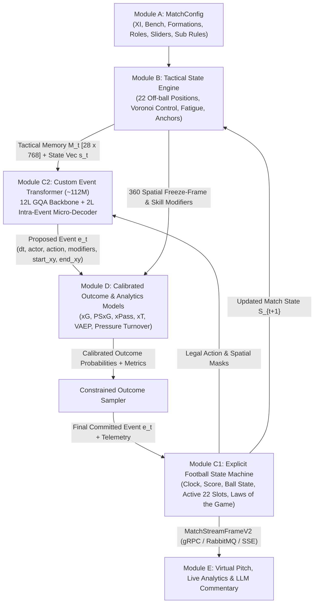
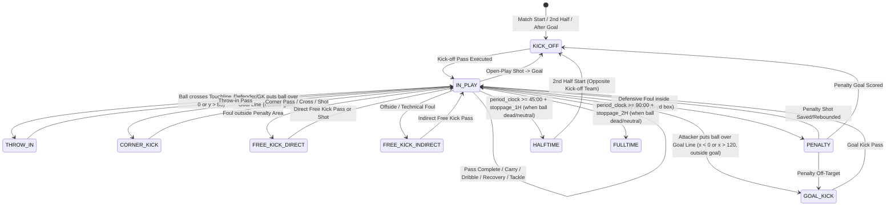

# PixelPitchAI v2 Revamp — Modules C & D: Hybrid Event & Possession Simulator, Custom Event Transformer, and Calibrated Outcome Models

> **Owner**: `@event-transformer`  
> **Scope**: Module C (Hybrid FSM + ~112M Custom Football Event Transformer), Module D (Calibrated Outcome & Analytics Models: `xG`, `PSxG`, `xPass`, `xT`, `VAEP`, `Turnover`), and the Google Colab A100/L4 Training, Counterfactual Conditioning & Calibration Pipeline.  
> **Upstream Dependencies**: Pillar 1 (`01_data_and_feature_pipeline.md`) and Modules A & B (`02_tactical_state_and_experimentation.md`).  
> **Downstream Consumers**: Module E (`04_presentation_and_integration.md` — real-time gRPC/RabbitMQ/SSE presentation & supporting LLM commentary).

---

## Executive Summary: From Unconstrained v1 GPT-2 Text Generation to a Stateful Hybrid Football Engine

PixelPitchAI v1 demonstrated end-to-end play-by-play simulation using a fine-tuned 124M GPT-2 language model paired with a 4-input XGBoost match-summary regressor (`simulation-engine/`). While viable as a prototype, inspecting the production v1 implementation reveals structural limitations that prevent tactical realism, counterfactual experimentation, and reliable analytics:

| Dimension | Legacy v1 (`simulation-engine/`) | Revamp v2 (`Modules C & D`) |
| :--- | :--- | :--- |
| **Backbone Architecture** | `GPT2LMHeadModel` (`n_layer=12`, `n_embd=768`, `n_head=12`, `gelu_new`, FP32/FP16) — **124M params**, with **38.7M params (31%)** locked in a `50,438`-token BPE embedding table (`gpt2-football-finetuned/config.json`) | **Custom Football Event Transformer (`PixelPitch-EventTF-112M`)**: `d_model=768`, `n_layers=12`, `n_heads=12`, `n_kv_heads=4` (GQA), RoPE, SwiGLU, RMSNorm, **Gated Tactical Cross-Attention** + **Low-Rank AdaLN-Zero** (`< 2%` embedding overhead) |
| **Context Window & Memory** | **`1,024` BPE tokens** (~13–15 events, or ~20 seconds of play). When `space_left < 100`, `optimized_simulation_service.py` slices `generated_tokens[:, -400:]` and discards match history. | **`16,384` event-step context** (`RoPE theta=500,000`). A full 90+ minute match (~1,800–2,400 structured events) or 120-minute extra-time match fits in **one uninterrupted context window**. |
| **Event Representation** | Verbose English text lines (~25–35 BPE tokens/event); a single 5,537-line match (`Barcelona_2016 vs Real_Madrid_2021.txt`) consumes ~150k–200k tokens (`DEFAULT_GENERATION_PARAMS["num_tokens_to_generate"] = 200000`). | **Composite Factored Event Step** (1 backbone step = 1 complete 10-field event, decoded via a 2-layer **Intra-Event Causal Micro-Decoder**). **~75x fewer sequential steps** per match. |
| **Rules & Entity Grounding** | `bad_words_ids` suppresses 168 hardcoded `Team_Year` special tokens (`SPECIAL_LIST[:-7]`, 6 La Liga seasons 2016–2021); manual `[SECOND HALF START]` regex wipes 1st-half context and injects `45:00 - {team} - pass by`; fragile post-hoc `MatchParser` regexes & 5s duel lookahead (`api/core/parser.py`). | **Explicit Football State Machine (FSM)** enforces clock, stoppage time, score, cards, substitutions, active 22 pitch slots, and restart geometry. **Hard logit masks** guarantee **100% legal validity** by construction. |
| **Conditioning Inputs** | `MatchStatProcessor` (`api/core/xgboost_class.py`) runs `XGBRegressor` on `[teamA_id, teamB_id, seasonA, seasonB]` -> 22 match averages discretized into vague text (`"dominant possession"`, `"low pressing"`). | Continuous conditioning at every step: **22 player capability vectors**, **in/out-of-possession formations & roles**, **team tactical sliders** (line height, PPDA/pressing, tempo, directness, width), **live off-ball positions**, **fatigue**, and **cards**. |
| **Analytics & Calibration** | **No `xG`**, no `PSxG`, no `xPass`, no `xT`, no `VAEP` in generation or training data. | **Module D** runs calibrated `xG`, `PSxG`, `xPass`, `xT`, `VAEP`, and `Pressure Turnover` models (CatBoost/LightGBM teachers + GPU-resident distilled MLP heads for zero-sync batch Monte Carlo). |
| **Coordinate System** | Raw StatsBomb per-team attacking flip (`(116.5, 34.1)` shot vs `(2.3, 42.6)` save on consecutive lines), causing spatial discontinuities across possession changes. | **Canonical Global Pitch Frame** (`Home attacks +x: 0→120`, `Away attacks -x: 120→0`, `y ∈ [0, 80]`) plus ego-centric goal-relative auxiliary features. |
| **Simulation Speed** | ~33.1s–47.6s for 1,000 BPE tokens on 8-core CPU (`performance_comparison_results.json`); ~45+ min for 150k tokens on CPU. | **`< 5 ms/event`** on CPU INT8 ONNX (`~9s` full match); **`B = 128–256` parallel full matches in seconds** on Colab L4/A100 (`26.4 MB` KV cache per match). |

---

## 1. Why Hybrid (Approach A + Approach B) Beats Pure Text LLM and Pure Handcrafted Rules

### 1.1 Failure Modes of Pure Approaches

1. **Why Pure Text LLMs (Legacy Approach A Alone) Fail**:
   - **Token Budget Exhaustion & Context Amnesia**: Representing spatial coordinates, timestamps, and player names as byte-level BPE tokens wastes ~85% of capacity on syntax (`" - pass by "`, `" at ("`, `", height: Ground Pass, to ("`). Because GPT-2 caps at `n_ctx=1024`, `UltraOptimizedSimulationService.generate_text_ultra_optimized()` truncates history to the last `400` tokens (`~13` events) and explicitly wipes all first-half tokens upon detecting `[SECOND HALF START]` (`optimized_simulation_service.py:949-965`). The model forgets yellow/red cards, tactical fatigue, substitutions, and first-half momentum.
   - **Rule Violations & Entity Hallucinations**: `get_cached_bad_words_ids()` (`optimized_simulation_service.py:580-607`) only blocks out-of-match `Team_Year` special tokens (`50257..50430`). It cannot prevent players from appearing after a red card or substitution, players taking throw-ins from inside the penalty area, corners followed by goal kicks without an intervening shot, or matches restarting themselves mid-stream (observed even in `Matches/Barcelona_2016 vs Real_Madrid_2021.txt:5539-5540`).
   - **Uncalibrated Rare Events**: Goals occur in roughly `0.1%–0.15%` of all match events. An unconstrained sequence model systematically drifts on total scorelines and conversion rates when temperature (`0.7`) or top-p (`0.9`) changes, making counterfactual experiments ("does lowering the defensive line reduce conceded xG by 0.25?") statistically noisy or invalid.

2. **Why Pure Handcrafted Rules / Markov Chains (Pure Approach B Alone) Fail**:
   - **Combinatorial Rigidity**: Hand-coded state transition tables and spatial utility functions cannot realistically model football's emergent spatial-temporal patterns—such as how a deep-lying playmaker draws two pressers before releasing a weak-side switch, how third-man runs break compact mid-blocks, or how tactical tempo alters pass length distributions under high press.
   - **Brittleness to Rich Roster Nuance**: Rule engines struggle to smoothly fuse 22 interacting player capability profiles (e.g., an inverted fullback stepping into midfield next to a box-to-box #8) without exploding into unmaintainable nested heuristics.

### 1.2 The Hybrid Architecture: Clear Separation of Concerns

PixelPitchAI v2 combines **explicit football invariants (FSM — Approach B)**, **learned spatio-tactical sequence intelligence (Event Transformer — Approach A)**, and **calibrated outcome physics (Module D)**:



- **Explicit Football State Machine (FSM — Approach B)** owns **hard invariants and deterministic laws**:
  - Match clock (`period ∈ {PRE, 1H, HT, 2H, ET1, ET2, FT}`, `period_elapsed_ms`, `added_stoppage_ms`), computed deterministically by accumulating modeled event `dt` rather than letting a neural network guess timestamps.
  - Scoreline, bookings (`yellow`, `second_yellow_red`, `direct_red`), substitutions (`max_subs`, `sub_windows`, `on_pitch_mask[1..22]`), and tactical policy triggers from Module A.
  - Canonical ball state & restart machine (`IN_PLAY`, `KICK_OFF`, `THROW_IN`, `CORNER_KICK`, `GOAL_KICK`, `FREE_KICK_DIRECT`, `FREE_KICK_INDIRECT`, `PENALTY`, `DROP_BALL`) driven by exact pitch boundary geometry (`x ∈ [0, 120]`, `y ∈ [0, 80]`, penalty box checks, goal mouth `y ∈ [36, 44], z ∈ [0, 2.67]`).
  - Possession team & `possession_phase_id` transitions (incremented on true possession changes, dead-ball restarts, or recoveries).
- **Custom Event Transformer (Approach A)** owns **learned football decision-making**:
  - Tempo & rhythm (`dt`), who steps onto the ball (`actor_slot`), what tactical action they attempt (`action_type`, `modifiers`), and where they carry, pass, press, or shoot (`start_xy`, `end_xy`, `end_z`, `target_slot`), conditioned on the entire match sequence and live tactical/player memory.
- **Module D Outcome & Analytics Sub-Models** own **calibrated physical/statistical resolution**:
  - Once the Transformer proposes a shot or pass at `(start_xy -> end_xy)` given the live 22-player spatial configuration, Module D supplies calibrated `xG` / `PSxG` / `xPass` / `Turnover` probabilities modulated by player finishing/GK/passing residuals, and stamps exact `xT` and `VAEP` telemetry onto the event.

### 1.3 Football State Machine (FSM) Transition Graph



Notice two crucial improvements over v1:
1. **Natural Period Endings**: The FSM draws half-specific stoppage time $\tau_{\text{stoppage}} \sim \text{Gamma/Poisson}(\text{cards}, \text{subs}, \text{goals}, \text{set\_pieces})$ at minute 45' and 90', and terminates the half only when the ball becomes dead or enters a neutral zone after $45{:}00 + \tau_1$ (mirroring real refereeing). At halftime, the Transformer **retains the entire 1st-half KV cache**, receives a single `PERIOD_BOUNDARY (HT -> 2H)` token plus updated Module B halftime substitutions/tactical adjustments, and continues seamlessly.
2. **Coordinate Continuity**: Every event is evaluated in the **Canonical Global Pitch Frame** (`Home attacks x=120`, `Away attacks x=0`, `y ∈ [0, 80]`). When an Away defender intercepts a pass from Home at `(101.7, 13.7)`, the event occurs at `(101.7, 13.7)` in global coordinates (instead of flipping to `(18.3, 66.3)` as raw StatsBomb logs do). Ego-centric attacking coordinates `(x_att, y_att, dist_to_target_goal, angle_to_target_goal)` are computed deterministically inside the continuous feature encoder for the acting team so spatial representations remain symmetric across Home and Away!

---

## 2. Module C — Custom Football Event Transformer (`PixelPitch-EventTF-112M`)

### 2.1 Architecture & Exact Parameter Sizing

Legacy GPT-2 spent `38.7M` of its `124M` parameters on a `50,438`-entry English BPE token embedding table (`vocab_size=50438`, `n_embd=768`). By replacing BPE text with a factored football event representation, `< 2%` of parameters sit in discrete lookups, dedicating **~98% of capacity** to spatio-tactical attention and reasoning.

#### Reference Specification: `PixelPitch-EventTF-112M` (Base — Recommended Default)

| Hyperparameter / Component | Value | Rationale |
| :--- | :--- | :--- |
| **`d_model`** | `768` | Matches GPU Tensor Core multiples (`64/128`); sufficient capacity for 22-player spatial interactions without bloating latency. |
| **`n_layers` (Backbone)** | `12` | Deep enough for multi-pass tactical buildup chains, pressing triggers, and fatigue adaptation. |
| **`n_heads` / `n_kv_heads` (GQA)** | `12` Query / `4` KV (`head_dim=64`) | **Grouped-Query Attention (3:1 ratio)** cuts KV-cache memory & bandwidth by **3x** with negligible perplexity loss—critical for `batch_size=128–256` Monte Carlo runs. |
| **Positional Encoding** | **RoPE** ($\theta_{\text{base}} = 500{,}000$) | Rotary Position Embeddings extrapolate cleanly across `16,384` steps without learned absolute position limits (`n_positions=1024`). |
| **FFN Block** | **SwiGLU** (`d_ff = 2048`, no bias) | $2048 \approx \frac{8}{3} d_{\text{model}}$; superior gradient flow and spatial feature gating over `gelu_new`. |
| **Normalization** | **RMSNorm** + **QK-Norm** (`eps=1e-6`) | Eliminates mean-centering overhead and prevents attention logit spikes across long 16k sequences in `bf16`. |
| **`max_seq_len`** | **`16,384`** backbone steps | Holds an entire 90-min match (~1,800–2,400 events), 120-min extra time (~3,200 events), OR up to ~2,300 events even in flat 7-token-per-event mode (`2,300 × 7 = 16,100 ≤ 16,384`). |
| **Conditioning Mechanism** | **Gated Tactical Cross-Attention** (every layer, GQA `12/4` over `28` Memory Tokens) + **Shared-Trunk Low-Rank AdaLN-Zero** (`rank=32`) | Cross-Attention grounds each event step in the exact 22 active players & positions; AdaLN-Zero injects global match-state (`score_diff`, `minute`, `period`, `red_card_diff`). |
| **Intra-Event Micro-Decoder** | `2` Causal Layers (`d_dec=512`, `n_heads=8`, `d_ff=1408`) | Autoregressively samples the 7 dependent sub-fields of event $e_t$ conditioned on backbone hidden state $h_t$. |

#### Exact Parameter Breakdown & Scaling Spectrum

| Component | `Small-78M` (`d=640, 12L`) | **`Base-112M` (`d=768, 12L`) [Target]** | `Med-128M` (`d=768, 14L`) | `Large-154M` (`d=768, 16L, d_ff=2304`) |
| :--- | :---: | :---: | :---: | :---: |
| Causal Self-Attention + Cross-Attn + SwiGLU + AdaLN (`n_layers`) | `66.63M` | **`96.43M`** | `112.50M` | `138.01M` |
| Tactical & Roster Memory Encoder (`28` tokens + 1 interaction layer) | `5.01M` | **`6.39M`** | `6.39M` | `6.39M` |
| Shared AdaLN Global State Trunk (`64 -> 512 -> 512`) | `0.29M` | **`0.29M`** | `0.29M` | `0.29M` |
| Factored Event Input Embedder & Continuous Projection | `~1.20M` | **`~1.20M`** | `~1.20M` | `~1.20M` |
| Intra-Event Causal Micro-Decoder (`2L` + Output Heads) | `4.49M` | **`7.71M`** | `7.71M` | `7.71M` |
| **Total Parameters** | **`77.6M`** | **`112.0M`** | **`128.1M`** | **`153.6M`** |
| **KV Cache / Event Step (`bf16`)** | `5.0 KB` | **`12.0 KB`** | `14.0 KB` | `16.0 KB` |
| **Full Match KV Cache (`2,200` events)** | `11.0 MB` | **`26.4 MB`** | `30.8 MB` | `35.2 MB` |

---

### 2.2 Composite / Factored Event Representation

In v1, a single pass required ~30 BPE tokens (`"00:43 - Barcelona_2016 - pass by Sergio Busquets at (71.1, 37.2), height: Low Pass, to (86.4, 5.7), outcome: Complete"`), plus separate lines for `ball receipt*` and `carry`, inflating matches to ~5,500 lines (~150k–200k tokens).

In v2, we eliminate redundant receipt text (folding successful reception into `Pass(outcome=Complete, target_slot)` and preserving explicit `Carry` / `Dribble` / `Pressure` / `Duel` / `Shot` / `Interception` / `Clearance` / `Save` / `Foul` / `Substitution` / `PeriodBoundary` events), yielding **~1,800–2,400 rich structured events per 90-minute match**.

#### The 10-Field Structured Event Schema ($e_t$)

Each committed event $e_t$ carries 10 structured fields mapped to compact vocabularies + continuous spatial/analytic residuals:

| # | Field | Representation / Vocabulary | Size | Notes |
| :-: | :--- | :--- | :-: | :--- |
| 1 | **`TIME_DELTA`** | `dt_bucket` (0..63 logarithmic buckets: `0s`, `0.2s`, `0.5s`, ..., `120s+`) + continuous $\Delta t_{\text{res}}$ | `64` + scalar | Enables accurate match pacing across fast counter-attacks vs slow goal kicks / injury stoppages. |
| 2 | **`PERIOD`** | `{PRE, 1H, HT, 2H, ET1, ET2, FT}` | `7` | Owned by FSM; fed into event embedding & AdaLN. |
| 3 | **`POSS_PHASE`** | `{OPEN_BUILDUP, OPEN_PROGRESSION, OPEN_FINAL_THIRD, TRANSITION_FAST, TRANSITION_COUNTERPRESS, SET_PIECE_ATTACK, SET_PIECE_DEFENSE, DEAD_BALL}` | `8` | Tracks tactical phase + monotonically increasing `possession_id` in FSM. |
| 4 | **`ACTOR_SLOT_1_22`** | `0` (`SYSTEM`), `1..11` (Home XI tactical slots), `12..22` (Away XI tactical slots) | `23` | **Slot-indexed, not name-tokenized**: substitutions swap the player capability vector in slot `s` cleanly without unknown-player OOV issues! |
| 5 | **`ACTION_TYPE`** | `PASS`, `CARRY`, `DRIBBLE`, `SHOT`, `CLEARANCE`, `INTERCEPTION`, `TACKLE_DUEL`, `BALL_RECOVERY`, `SAVE`, `BLOCK`, `PRESSURE`, `FOUL_COMMITTED`, `MISCONTROL`, `DISPOSSESSED`, `OFFSIDE`, `CARD`, `SUBSTITUTION`, `PERIOD_BOUNDARY` | `18` (+6 reserved = `24`) | Covers 100% of StatsBomb / Wyscout on-ball & defensive event taxonomy. |
| 6 | **`START_XY`** | Discretized pitch cell (`30 × 20` grid = `600` 4×4-yard cells + `2` off-pitch/center tokens) + continuous sub-cell offset $(\delta x_0, \delta y_0) \in [-2, 2]^2$ | `602` + `R²` | Exact continuous position in Canonical Global Frame `[0, 120] × [0, 80]`. |
| 7 | **`END_XY` (+ `END_Z`, `TARGET_SLOT`)** | Discretized pitch cell (`602` cells) + $(\delta x_1, \delta y_1)$ + `end_z_bin` (`32` height bins for shots, `0..5.0m`) + `target_slot` (`0..22` intended receiver) | `602` + `32` + `23` | Unifies pass target coordinates, carry trajectories, and 3D shot placement `(120/0, y_goal, z_goal)`. |
| 8 | **`MODIFIERS`** | Factored tuple: `restart_type` (`8`: OpenPlay, KickOff, ThrowIn, Corner, FreeKickD, FreeKickI, GoalKick, Penalty), `pass_height` (`4`: N/A, Ground, Low, High), `body_part` (`5`: RightFoot, LeftFoot, Head, KeeperHands, Other), + `8`-bit binary flags (`under_pressure`, `through_ball`, `switch`, `cross`, `cutback`, `first_time`, `one_touch`, `counter_attack`) | `8 + 4 + 5 + 8 bits` | Captures all missing StatsBomb tactical modifiers ignored by v1. |
| 9 | **`OUTCOME`** | Unified outcome taxonomy (`24` tokens): `COMPLETE`, `INCOMPLETE`, `OUT_TOUCHLINE`, `OUT_BYLINE`, `OFFSIDE`, `GOAL`, `SAVED_HELD`, `SAVED_PARRY`, `BLOCKED`, `OFF_TARGET`, `POST`, `WON`, `LOST`, `YELLOW_CARD`, `SECOND_YELLOW`, `RED_CARD`, `FOUL_CONCEDED`, `PENALTY_WON`, `SUB_EXECUTED`, `PERIOD_END`, etc. | `24` | Strictly masked per `action_type`; high-leverage outcomes sampled via **Module D calibrated probabilities**. |
| 10 | **`XG_XT_HEAD`** | Continuous 4D telemetry vector `[xG / PSxG, xPass, xT_delta, VAEP_delta]` | `R⁴` | Fed back into next-step event input embedding so the Transformer perceives cumulative threat & momentum (`"we just survived a 0.45 xG big chance"`). |

#### Backbone Input Encoding vs Intra-Event Causal Micro-Decoder

Why do we use a **1-Step Composite Backbone + 2-Layer Intra-Event Micro-Decoder** instead of flattening every event into 7 sequential backbone tokens?

1. **Flat 7-Token Sequence**: `2,200 events × 7 tokens = 15,400` tokens. Barely fits in `16,384` (overflows in 120-min extra time), increases KV-cache memory **7x** (`185 MB` vs `26.4 MB` per match), and requires **7x more full 12-layer forward passes** per match.
2. **Parallel Multi-Head Prediction from $h_t$**: Breaks intra-event conditional dependence (`END_XY` cannot condition on sampled `ACTION_TYPE` = `SHOT` vs `PASS`).
3. **Hierarchical Composite Step + Intra-Event Causal Micro-Decoder (Chosen)**:
   - **Input to Backbone at Step $t$**: Embed all 10 fields of committed event $e_{t-1}$ into $128$-dim sub-vectors, concatenate + fuse via a 2-layer SwiGLU projection into a single vector $x_t \in \mathbb{R}^{768}$, and append to the `16,384`-window backbone (1 step = 1 event).
   - **Decoding Step $t$**: Backbone produces contextual hidden state $h_t \in \mathbb{R}^{768}$. The tiny **2-layer Causal Micro-Decoder** (`d_dec=512`, `7.71M` params) runs 7 ultra-fast micro-steps (`< 0.1 ms` total!) autoregressively conditioned on $h_t$:
     $$p(e_t \mid e_{<t}, M_t, s_t) = p(\Delta t \mid h_t)\,p(\text{actor} \mid h_t, \Delta t)\,p(\text{action} \mid h_t, \dots)\,p(\text{mods} \mid \dots)\,p(\text{start}_{xy} \mid \dots)\,p(\text{end}_{xy,z} \mid \dots)\,p(\text{outcome} \mid \dots)$$
   - Result: **Exact intra-event causal conditioning**, **7x smaller KV cache**, **7x fewer 12-layer passes**, and full 120-minute matches fit effortlessly inside `< 3,500` steps of the `16,384` context window.

---

### 2.3 Continuous Conditioning Embeddings (Fusing Modules A & B at Every Step)

Instead of v1's static 12-line text prompt (`"Barcelona_2021 had high possession"`), tactical and player context is injected dynamically at **every single event step** via two complementary pathways:

#### Pathway 1: Dynamic Tactical & Roster Memory Tensor $M_t \in \mathbb{R}^{B \times 28 \times 768}$ (Cross-Attention)

At step $t$, Module B (`TacticalStateEngine`) produces a `28`-token state snapshot:
- **Tokens `0..21` (`22` Active Pitch Slots, `1..11` Home, `12..22` Away)**:
  Directly ingests Module B's pre-fused slot conditioning tensor `player_cond` $\mathbf{u}_{b,i,t} \in \mathbb{R}^{128}$ (projected `128 -> 512 -> 768` + slot positional/team embedding), whose exact `128`-dim partition matches `02_...` §3.2 (`64 + 24 + 16 + 10 + 5 + 6 + 3 = 128`):
  1. `z_p` (`64` dims): Dense learned player style embedding (`latent_style_64d`) from Pillar 1 (`player_profiles_v2.parquet`).
  2. `a_eff` (`24` dims): Empirical-Bayes historical attributes (`attributes_24d`: `short_pass_accuracy`, `press_resistance`, `finishing_skill_psxg_delta`, `stamina_endurance`, etc.) after Module B's fatigue and yellow-card degradation multipliers.
  3. `r_role` (`16` dims) + `phi_instr` (`5` dims): Tactical role prior from the 22 canonical `PlayerRole` enums (`SweeperKeeper`, `BallPlayingCB`, `InvertedFullback`, `CompleteWingBack`, `DeepLyingPlaymaker`, `BoxToBoxMidfielder`, `Mezzala`, `InsideForward`, `False9`, `TargetForward`, `PressingForward`, etc.) and slot-level instruction overrides.
  4. `tau_team` (`10` dims): Effective team tactical instruction sliders after game-state elasticity.
  5. `s_pos` (`6` dims) + `s_stat` (`3` dims): Live spatial kinematics `[x_norm, y_norm, vx_norm, vy_norm, dist_to_ball_norm, local_pitch_control]` (`6d`) and slot status `[is_on_pitch, stamina, card_state]` (`3d`).
  > *Note on Pillar 1's `32d` export (`attributes_24d` + `gk_attributes_8d`)*: `attributes_24d` enters `player_cond` directly; the `8d` specialist suffix (`6` GK attributes + `2` spatial lane/verticality biases) routes to Module B's off-ball anchors, Module D's `PSxG` GK shot-stopping residual, and Tokens `22..23` below (`gk_short_buildup_share`, `gk_long_kick_accuracy`, `gk_sweeper_action_rate`, `gk_claim_cross_rate`).
- **Tokens `22..23` (`2` Team Tactical & GK Summary Tokens: Home & Away)**:
  Projects `[defensive_line_height, pressing_intensity_ppda, build_up_tempo, directness, attacking_width, counter_press_tendency, block_compactness, goalkeeper_sweeper_depth, formation_in_poss_id, formation_out_poss_id, red_card_count, tactical_phase_flag, active_gk_attributes_6d]` -> `768`.
- **Tokens `24..27` (`4` Global Ball & Match Context Tokens)**:
  Ball `(x, y, z)`, current restart state embedding, possession phase, score differential, and momentum (`rolling_5min_xT`, `rolling_5min_xG`).

All 28 tokens pass through **1 Bidirectional Spatial-Tactical Interaction Layer** (`d_model=768`) before the event backbone begins—allowing players to implicitly read pressing matchups and passing lanes (e.g., an attacking winger checking the opposing fullback's pace and fatigue) at zero extra sequence length cost. Every layer of the Event Transformer reads $M_t$ through **Gated Cross-Attention** initialized with $\tanh(\alpha_\ell) = 0$ (stabilizing early pre-training).

#### Pathway 2: Global Match-State Modulation via Low-Rank AdaLN-Zero

A shared conditioning MLP maps the global scalar state vector $s_t \in \mathbb{R}^{64}$ (`minute`, `period`, `stoppage`, `score_diff`, `home_red`, `away_red`, `poss_duration_sec`, `home_fatigue_avg`, `away_fatigue_avg`, `rolling_ppda_home`, `rolling_ppda_away`) to a shared representation $c_t \in \mathbb{R}^{512}$. Each layer $\ell \in \{1..12\}$ applies a compact rank-32 adapter producing $(\gamma_1^\ell, \beta_1^\ell, \alpha_1^\ell, \gamma_2^\ell, \beta_2^\ell, \alpha_2^\ell)$ to modulate pre-attention and pre-FFN RMSNorm layers:
$$\tilde{z} = \text{RMSNorm}(z) \odot (1 + \gamma^\ell) + \beta^\ell, \qquad z_{\text{out}} = z + \alpha^\ell \odot \text{SubLayer}(\tilde{z})$$
This smoothly steers global pacing and urgency (e.g., trailing by 1 goal at `84:00` immediately elevates `directness`, shot frequency, and high-press risk across every layer).

---

### 2.4 Multi-Head Output & Hard Grammar / Physics Masks

At every micro-decoder step inside event $t$, the FSM and Module B supply deterministic logit masks (`actor_mask [B, 22]`, `action_mask [B, |A|]`, `target_mask [B, 11]`) and additive spatial feasibility priors (`spatial_log_prior [B, |A| + 11]`) applied *before* temperature/top-p sampling (`logits = logits + log_prior + mask`):

| Micro-Step | FSM Masking Rules (Enforced Before Sampling) | Eliminates Legacy v1 Failure Mode |
| :--- | :--- | :--- |
| **1. `dt_bucket`** | During `KICK_OFF` after half/goal, clamp to `[0s..2s]`; during `PENALTY` or `CORNER`, allow realistic set-piece setup delay (`5s..35s`); cap remaining period clock if near full-time whistle. | Eliminates non-monotonic timestamps and abrupt `45:00` jump hacks. |
| **2. `actor_slot`** | Mask out any slot where `on_pitch == False` or `red_card == True`. During deterministic restarts (`KICK_OFF`, `THROW_IN`, `CORNER`, `GOAL_KICK`, `PENALTY`, `FREE_KICK`), mask out the non-restarting team (`100%` of the other 11 slots). For `SAVE` or `PENALTY` defense, restrict defending actor to active `GK` slot. | Replaces the `bad_words_ids` team-token hack; prevents ghost/subbed/sent-off players from touching the ball. |
| **3. `action_type`** | State-transition mask `LEGAL_ACTIONS[ball_state]`:<br>• `KICK_OFF` -> `{PASS}` only<br>• `THROW_IN` -> `{PASS}` only (StatsBomb/Laws)<br>• `GOAL_KICK` -> `{PASS}` only<br>• `PENALTY` -> `{SHOT}` only<br>• `CORNER_KICK` -> `{PASS}` only (corner deliveries/in-swingers modeled as `PASS(restart_type=Corner, cross=True)`; `CARRY`/`SHOT` masked to match `02` §3.5)<br>• `IN_PLAY` -> `{PASS, CARRY, DRIBBLE, SHOT, CLEARANCE, PRESSURE, FOUL_COMMITTED, ...}` (and `SHOT` masked beyond `42.0` yards from target goal unless `minute >= 88 and score_diff < 0`). | Prevents impossible sequences like a throw-in followed by a goal kick or a penalty turning into a dribble. |
| **4. `modifiers`** | `restart_type` deterministically forced by `ball_state` (`OpenPlay` if `IN_PLAY`, else exact restart enum). `body_part` masks `KeeperHands` to `GK` inside own penalty area during `IN_PLAY`/`SAVE`. `pass_height` masked for non-pass actions. | Eliminates impossible metadata combinations (e.g., header from a throw-in taker, or outfielder using `KeeperHands`). |
| **5. `start_xy`** | If `ball_state` is a fixed restart, clamp `(start_x, start_y)` to exact canonical restart geometry (`(60, 40)` kick-off; `(108, 40)` Home / `(12, 40)` Away penalty; `(120, 0)/(120, 80)` Home / `(0, 0)/(0, 80)` Away corner; touchline `y ∈ {0, 80}` for throw-in). If `IN_PLAY` on-ball action, restrict valid `start_cell` to a kinematic ball-continuity radius around `(ball_x, ball_y)` (or defender's Voronoi radius for `PRESSURE` / `FOUL`). | Eliminates ball teleportation across the pitch between consecutive events. |
| **6. `end_xy` & `target_slot`** | Clamp coordinates to legal target geometry (plus out-of-bounds trigger margins for `OUT_TOUCHLINE` / `OUT_BYLINE`). For `SHOT`, `end_xy` is masked to the target goal mouth/penalty-box corridor (`x=120` or `x=0` projection + `(y_goal, z_goal)`). For `PASS`, mask `target_slot` to on-pitch teammates (when `outcome=COMPLETE`) or plausible contest zone. | Eliminates backward/wrong-goal shots and out-of-bounds pass completions. |
| **7. `outcome`** | Action-legal outcome mask (`SHOT -> {GOAL, SAVED_HELD, SAVED_PARRY, BLOCKED, OFF_TARGET, POST}`, `PASS -> {COMPLETE, INCOMPLETE, OUT_TOUCHLINE, OUT_BYLINE, OFFSIDE}`). **Crucially**, for `SHOT`, `PASS`, and `PRESSURE_DUEL`, raw Transformer outcome logits are **replaced/calibrated by Module D** before final sampling! | Guarantees calibrated goal/pass/turnover physics and removes post-hoc `_infer_duel_outcomes` guesswork. |

---

## 3. Module D — Dedicated Outcome & Analytics Models (`xG`, `PSxG`, `xPass`, `xT`, `VAEP`)

### 3.1 Why Decouple Outcome Physics from the Sequence Backbone

Autoregressive sequence transformers excel at modeling *where play flows and what players attempt*, but they are sub-optimal as standalone rare-event probability estimators:
1. **Class Imbalance**: Goals represent `< 0.15%` of match events; slight sampling temperature tweaks (`T=0.8` vs `T=1.1`) distort match scorelines non-linearly.
2. **Counterfactual Intervention Fidelity**: When a coach tests *"Replace a 0.08 finishing-residual striker with an elite 0.25 finisher, or drop the defensive line by 8 meters"*, a dedicated tabular/spatial outcome model with explicit geometric and 360 freeze-frame features responds monotonically and transparently—and yields exact SHAP feature attributions for diagnostic explainability.

### 3.2 Two-Tier Module D Execution Architecture (Calibration + 100x GPU Batch Speed)

Calling CPU `CatBoost`/`XGBoost` inside a GPU autoregressive generation loop event-by-event would force thousands of CPU–GPU PCIe synchronizations per match, crippling batched Monte Carlo throughput. Module D solves this with a **Teacher–Student Two-Tier Architecture**:

- **Tier 1 — Calibrated GBDT Teachers (`CatBoost` / `LightGBM` + Isotonic/Beta Calibration)**:
  - Trained directly on Pillar 1's Parquet dataset (`3,400+` StatsBomb matches including **360 freeze-frame geometry** where available, plus imputed Module B spatial proxies on non-360 matches).
  - Used for: (a) Ground-truth calibration reference, (b) Exact post-event SHAP/diagnostic explainability in single-match analytics & counterfactual reports, and (c) Generating soft distillation targets on millions of events.
- **Tier 2 — GPU-Resident Distilled Calibrated MLP Heads (`PyTorch / TorchScript / TensorRT`)**:
  - Compact 3-layer residual MLPs (`~0.15M` params each) distilled with `KL(p_GBDT || p_MLP)` + post-distillation temperature/isotonic calibration (`ECE drift < 0.002` vs GBDT teacher).
  - Executed **100% inside the GPU simulation batch (`B = 128..256`)** with **zero CPU–GPU sync** during Monte Carlo rollouts!

### 3.3 Sub-Model Specifications

| Model | Input Features (from FSM + Module B Spatial State) | Target / Output | Calibration Target | Role in Simulator & Analytics |
| :--- | :--- | :--- | :--- | :--- |
| **D1: Pre-Shot `xG`** | Distance & angle to target goal mouth; `body_part` (`RightFoot`, `LeftFoot`, `Head`); `shot_type` (`OpenPlay`, `FreeKick`, `Penalty`, `Corner`); `under_pressure`; `first_time`; **360 Spatial Cone Features** (`n_defenders_in_shot_triangle`, `closest_defender_dist`, `gk_dist_to_goal_line`, `gk_angle_offset`, `open_goal_fraction`); assist pass height & `through_ball`/`cutback` flags; preceding carry speed. | $p_{\text{goal}}^{\text{pre}} \in (0, 1)$ | `ECE < 0.008`, LogLoss `< 0.24`, Brier `< 0.075` | Replaces raw shot outcome prior; stamped on every shot as `xg` for live analytics & counterfactual chance-quality evaluation. |
| **D2: Post-Shot `PSxG`** | All D1 features **plus** sampled shot placement `(y_goal, z_goal)` inside/around frame (`y ∈ [36, 44], z ∈ [0, 2.67]`), `distance_from_nearest_post`, `shot_power_proxy`, and `gk_reach_distance` from `(y_goal, z_goal)`. | Multi-class `[P(Goal), P(SavedHeld), P(SavedParry), P(Blocked), P(OffTarget/Post)]` | `ECE < 0.010` on on-target shots | Determines final shot outcome (`Goal` vs `Saved` vs `Post`), modulated by shooter finishing residual & GK shot-stopping residual! |
| **D3: `xPass`** | Start `(x, y)` & End `(x, y)`, pass length, angle relative to goal, `pass_height`, `restart_type`, `under_pressure`, `through_ball`, `switch`, `cross`; **360 Passing Corridor Features** (`min_defender_dist_to_ray`, `n_defenders_in_corridor`, `receiver_voronoi_area`, `receiver_closest_defender_dist`). | `[P(Complete), P(Incomplete), P(Out), P(Offside)]` + progressive pass value | `ECE < 0.012`, AUC `> 0.86` | Modulates pass completion probability during simulation (incorporating passer vision/press-resistance & fatigue) and emits live `xPass` & `PassDifficulty`. |
| **D4: Expected Threat (`xT`)** | `24 × 16` canonical pitch grid (`5.0 × 5.0` yard cells) solved via 5-step Bellman value iteration over historical move transition matrix $T_{z \to z'}$, move probability $m(z)$, shoot probability $s(z)$, and `xG(z)`:<br>$xT(z) = s(z)\cdot xG(z) + m(z)\sum_{z'} T_{z\to z'} xT(z')$<br>evaluated with **continuous bilinear interpolation** at `(start_xy, end_xy)`. | `xT(start)`, `xT(end)`, and $\Delta xT = xT(\text{end}) - xT(\text{start})$ | Bellman fixed-point residual `< 1e-6` | Feeds step-$t$ `XG_XT_HEAD` feedback token and live territorial threat dashboards without needing a neural call. |
| **D5: `VAEP` Action Value** | Action sequence window `(e_{t-2}, e_{t-1}, e_t)` + score diff + `possession_phase` + `xT` + `xG`/`xPass`: two calibrated CatBoost/MLP classifiers estimating $P_{\text{score}}(s_t)$ and $P_{\text{concede}}(s_t)$ within next 10 actions. | $\text{VAEP}(a_t) = \Delta P_{\text{score}}(s_t) - \Delta P_{\text{concede}}(s_t)$ | `ECE < 0.012` on 10-action goal horizon | Quantifies defensive interventions (interceptions, tackles, blocks that drop $P_{\text{concede}}$) alongside progressive attacking actions. |
| **D6: Pressure Turnover & Duel** | `pressure_proximity`, `n_pressers_3m`, `pressing_intensity_slider`, `carrier_fatigue`, `carrier_press_resistance`, `pitch_zone_risk`, `action_type` (`CARRY`, `DRIBBLE`, `TACKLE_DUEL`). | `[P(Retain), P(DribblePast), P(Dispossessed/Miscontrol), P(FoulWon/Conceded)]` | `ECE < 0.015` | Resolves duels and pressing traps physically—ensuring high-PPDA pressing triggers realistic turnovers and fatigue penalties! |

### 3.4 Bayesian Log-Odds Calibration Bridge (Integrating Player Skill & Fatigue)

To ensure counterfactual player swaps and fatigue curves alter probabilities smoothly *without* breaking league-wide probability calibration (so average match `xG` stays realistic and probabilities never exceed `(0, 1)`), Module D applies a **zero-centered log-odds adjustment** before outcome sampling:

$$\text{logit}(p_{\text{sim}}) = \text{logit}(p_{\text{base}}^{\text{Module D}}) + w_{\text{actor}} \cdot \delta_{\text{actor}} - w_{\text{opp}} \cdot \delta_{\text{opp}} - \lambda_{\text{fatigue}} \cdot \max(0, \text{fatigue}_{\text{actor}} - 0.5)$$

For example, on a shot:
- $p_{\text{base}}^{\text{Module D}} = \text{PSxG}_{\text{calibrated}}(s_t, \text{placement})$
- $\delta_{\text{actor}} \in [-0.45, +0.45]$ is the shooter's Bayesian-shrunk empirical finishing log-odds residual ($\log\text{goals} - \log\text{xG}$ shrunk toward `0` by sample size `n_shots`)
- $\delta_{\text{opp}} \in [-0.45, +0.45]$ is the opposing GK's empirical shot-stopping residual (`PSxG - Goals Allowed` shrunk toward `0`)
- Because $\mathbb{E}[\delta] = 0$ across the population, **league-average calibration is preserved identically** while elite finishers and elite goalkeepers exhibit authentic, measurable impact across 100-match Monte Carlo experiments.

---

## 4. Modern Training & Calibration Pipeline on Google Colab (A100 / L4 GPU)

Building on the existing Colab workflow (`simulation-engine/colab_simulation_engine.ipynb` using `uv pip install --system -r pyproject.toml --no-sources` to preserve Colab's native CUDA PyTorch), the training and export pipeline executes in **four structured stages**.

### 4.1 Stage 1: Multi-Dataset Pre-Training (`3,400+` StatsBomb Matches + Wyscout/Opta)

- **Training Corpus**:
  - **StatsBomb Open Data (`3,400+` matches)** from Pillar 1 DuckDB/Parquet store (~`7.5M` structured events after receipt-folding, including 360 freeze-frame matches across Euros, World Cup, Bundesliga, etc.).
  - **Wyscout Open Data (`1,941` matches across Top-5 leagues + World Cup/Euros)** mapped into Pillar 1's canonical schema (~`3.2M` events, with `360_mask=0` token indicating imputed spatial freeze-frames).
  - Total pre-training corpus: **`~10.7M` structured events (~5,341 full matches)**.
- **Sequence Packing & Batching**:
  - Each match occupies **1 contiguous sequence** (`~1,800–2,400` events) packed into `16,384`-step blocks with block-diagonal causal attention masks (via PyTorch `flex_attention` / FlashAttention-2 `cu_seqlens` varlen) so zero tokens are wasted on padding and cross-match attention leakage is strictly impossible.
- **Multi-Task Objective**:
  $$\mathcal{L}_{\text{pre}} = \sum_{k \in \text{discrete}} \lambda_k \,\text{CE}(y_k, \hat{y}_k) + \lambda_{\text{xy}} \,\text{Huber}(\Delta_{xy}, \hat{\Delta}_{xy}) + \lambda_{\text{dt}} \,\text{Huber}(\Delta t_{\text{res}}, \hat{\Delta t}_{\text{res}}) + \lambda_{\text{aux}} \,\|\hat{z}_{\text{D}} - z_{\text{D}}^{\text{true}}\|_2^2$$
  where $\lambda_k$ balances frequent fields (`action_type`, `start_xy`) with high-leverage tactical tokens (`actor_slot`, `end_xy`, `outcome`).
- **Colab Hardware & Compute Profile**:
  - **Precision**: Native `bfloat16` (`torch.amp.autocast('cuda', dtype=torch.bfloat16)`), `AdamW` ($\beta_1=0.9, \beta_2=0.95$, weight decay `0.1`), cosine decay (`lr_max=3e-4` -> `3e-5`), `2,000` warmup steps.
  - **Memory Footprint (`Base-112M`, `bf16`, micro-batch 2 packed 16k blocks = `32,768` events/step, grad accum `4` -> `131k` events/update)**:
    - Weights + Grads + AdamW states (`fp32` master copy): `~1.8 GB`
    - Activations (FlashAttention-2 + selective checkpointing on L4): `~7–11 GB`
    - **Fits comfortably on Colab L4 (24 GB)** and runs at peak throughput on **Colab A100 (40 GB / 80 GB)**.
  - **Estimated Training Duration (`15` epochs ≈ `160M` event steps)**: `~6–9 hours` on **Colab A100 40GB/80GB** (`~18–24 hours` on L4 24GB).

### 4.2 Stage 2: Tactical & Counterfactual Conditioning Training (Causal Debiasing)

A critical risk in football ML is **confounding between team quality and tactics**: in historical data, elite clubs often play high lines and high possession, while relegation-threatened teams sit in deep low blocks. Without debiasing, a naive model learns `"low block == concede 3 goals"` rather than `"low block reduces space behind the defense and shifts shot locations"`.

We address this during Stage 2 fine-tuning (`3` epochs on StatsBomb + Wyscout with complete Module A/B annotations):

1. **Independent Conditioning Dropout (Classifier-Free Guidance Style)**:
   - Independently drop team tactical slider vectors ($p_{\text{tactic}} = 0.15$), player capability vectors ($p_{\text{player}} = 0.10$), and global team identity proxies ($100\%$ absent—**no `Team_Year` tokens exist in v2!**) by replacing them with learned `[NULL_TACTIC]` / `[AVG_PLAYER]` embeddings.
   - This forces the model to rely *genuinely* on tactical vectors when present and allows optional CFG-style tactical amplification ($\gamma_{\text{tac}} \in [1.0, 1.5]$) during counterfactual experiments.
2. **Inverse-Propensity Weighting (IPW) & Quality-Orthogonalized Tactical Features**:
   - Compute propensity score $e(X) = P(\text{TacticStyle} \mid \text{SquadElo}, \text{OpponentElo})$ via a Ridge/GBDT model on historical matches, and apply stabilized weights $w_i = \min\left(3.0, \frac{P(\text{TacticStyle})}{e(X_i)}\right)$ during Stage 2 sampling so underrepresented combinations (e.g., an elite squad sitting in a disciplined low block or an underdog pressing intensely) are properly weighted.
   - Decompose tactical descriptors into **squad-quality-orthogonal residuals** alongside raw sliders so the model distinguishes *"aggressive pressing"* from *"having better players"*.
3. **Intra-Match Natural Experiments (Halftime & Red-Card State Shifts)**:
   - Upweight training segments around **halftime tactical adjustments** and **post-goal / post-red-card tactical shifts**, where the *exact same 22 players* change defensive line height, PPDA, or directness mid-match—providing clean intra-match causal contrast!

### 4.3 Stage 3: Post-Training Calibration & Realism Validation Suite

Before promoting any checkpoint (`Base-112M` + `Module D v2`), an automated evaluation suite simulates `500` held-out matches across diverse tactical archetypes (`Tiki-Taka High Press`, `Mid-Block Counter`, `Low-Block Direct`, `Asymmetric Red-Card Scenarios`) and checks strict quantitative gates:

| Validation Axis | Metric / Check | Acceptance Gate (vs Held-Out Real Matches) |
| :--- | :--- | :--- |
| **Scoreline Realism** | Home/Draw/Away win rates; Goals/match mean & Poisson dispersion; `0-0`, `1-0`, `2-1` exact scoreline frequencies | Scoreline KL divergence `< 0.03`; mean goals/match within `±0.08` of `2.65–2.75` benchmark |
| **Chance Quality (`xG`)** | Match `xG` correlation vs team strength differential; Shots/match; `xG / Shot` distribution; Set-piece `xG` share | `xG/team/match` within `±0.07`; Set-piece `xG` share within `24%–32%` |
| **Tactical Sensitivity (Counterfactual Checks)** | Monotonic response checks:<br>1. Raising `pressing_intensity` lowers opponent build-up PPDA & increases high turnovers<br>2. Raising `defensive_line_height` shifts opponent ball-recoveries higher & increases behind-line through-ball `xG`<br>3. Swapping an elite finisher (`+0.3` log-odds) increases team goal conversion without inflating shot volume artificially | **100% directional monotonicity pass** across 6 canonical counterfactual unit tests (with `n=100` Monte Carlo seeds per leg) |
| **Temporal & Fatigue Dynamics** | Goals & sprint/dribble rate across 15-min buckets (`0–15`, ..., `75–90+`); trailing team shot volume in `75–90+` | Minute `75–90+` goal uplift & trailing-team field-tilt shift within `±10%` of real data |
| **Spatial & Pass Networks** | 2D Wasserstein distance on pass start/end heatmaps; Pass length & completion % by zone; Center-vs-Wing progression ratio | Pass completion within `±1.5%`; `ECE < 0.015` across all Module D heads |
| **OOD & Extreme-Slider Guardrails** | Clamp extreme user slider combos (e.g., `pressing=1.0` + `line_height=0.05` triggers physiological fatigue multiplier + UI warning); entropy floor/ceiling (`H ∈ [0.6·H_val, 1.3·H_val]`) | **0** illegal FSM transitions; **0** NaNs/out-of-bounds coordinates across `10,000` simulated matches |

### 4.4 Stage 4: Inference Export & Serving Optimization (Dual Runtime Profiles)

To replace v1's slow CPU/GPU loops (`33s/1k tokens` on CPU), the trained weights export into two optimized runtime targets via `simulation-engine/scripts/`:

1. **Profile A — Real-Time Single-Match Streaming (gRPC / FastAPI / Local Dev CPU & GPU)**:
   - **GPU Path**: `torch.compile(model, mode="reduce-overhead", fullgraph=True)` + static KV-cache pre-allocated to `max_seq_len=4096` (`48 MB` static buffer), yielding **`< 1.2 ms / event`** (`~2.5s` for an entire 2,100-event match if unthrottled, or smooth real-time pacing at `1x–20x` broadcast speed).
   - **CPU / Edge Path**: Export Backbone + Intra-Event Micro-Decoder + Distilled Module D heads to **ONNX opset 19** with `KV-cache past_key_values` IO-binding and **INT8 per-channel dynamic quantization** (`ORTModel` / `onnxruntime` AVX2/AVX-512), yielding **`~4–6 ms / event`** (`~10–12 seconds` per full match on standard 8-core CPU—a **>200x match-level speedup** over v1's ~45-minute CPU run for 150k BPE tokens!).
2. **Profile B — 100x–500x Batch Monte Carlo Counterfactual Engine (Colab A100 / L4 GPU)**:
   - Runs `B = 128` (L4 24GB) or `B = 256` (A100 40GB/80GB) independent seeded match timelines **in a single lockstep batched forward pass** per event step (`~2,200` steps total), with **CUDA Graphs + TensorRT FP16/BF16 (or `torch.compile`) + Tier-2 GPU-Resident Distilled Module D MLPs** and vectorized FSM transition kernels in PyTorch/Numba/C++.
   - **Throughput Estimate (`B = 128` parallel matches, `Base-112M` `bf16` on A100/L4)**:
     - Step latency for `B = 128` batched decode + micro-decoder + GPU Module D heads: `~4–8 ms` per batch step.
     - **100 full 90-minute matches (`~2,200` events each) complete in `~10–18 seconds` on an A100 (or `~20–30 seconds` on an L4)**—making interactive counterfactual coaching experiments (*"Compare 4-3-3 High Press vs 4-2-3-1 Mid-Block across 100 Monte Carlo seeds"*) genuinely real-time!

---

## 5. Cross-Module Interface Contracts

### 5.1 Upstream Inputs (From Pillar 1 & Modules A/B)

```python
# Consumed by Module C & Module D at match initialization and each batched step t
class MatchInitContext(BaseModel):
    match_config: MatchConfigurationV2             # XI + bench, in/out-poss formations, tactical sliders, sub policies
    player_attributes_24d: dict[int, list[float]]  # Pillar-1 Empirical-Bayes 24D attributes (plus sigma_24d)
    gk_attributes_8d: dict[int, list[float]]       # Pillar-1 6D GK specialist + 2D spatial bias (completes 32D export)
    player_style_64d: dict[int, list[float]]       # Pillar-1 learned dense 64D style embeddings
    player_skill_residuals: dict[int, dict[str, float]]  # finishing, gk_shot_stop, pass_vision, press_resist
    seed: int

# Per-step batched tensor contract from Module B -> Module C & Module D
# - player_cond:       float32[B, 22, 128]  (u_{b,i,t} = 64 z_p + 24 a_eff + 16 role + 10 tau + 5 instr + 6 s_pos + 3 s_stat)
# - actor_mask:        bool[B, 22]          (active on-pitch + legal restart taker mask)
# - action_mask:       bool[B, |A|]         (FSM Laws-of-the-Game legal action mask)
# - target_mask:       bool[B, 11]          (active teammate pass target mask)
# - spatial_log_prior: float32[B, |A| + 11] (Voronoi lane-clearance & tactical alignment log-prior)
# - freeze_frame_360:  float32[B, 22, 7]    (x, y, vx, vy, is_teammate, is_actor, is_gk -> Module D)
```

### 5.2 Downstream Emission (To Module E: `04_presentation_and_integration.md`)

At every committed event step $t$, the Hybrid Simulator emits typed `MatchStreamFrameV2` messages (`StructuredEventV2`, `PitchSpatialFrameV2` at 5–10 Hz + event keyframes, and `TelemetrySnapshotV2`) over gRPC `footex.simulation.v2.SimulationServiceV2` or RabbitMQ `match_events_v2` for SSE delivery (`GET /api/v2/matches/{id}/stream`) and downstream LLM commentary:

```json
{
  "match_id": "12345",
  "sequence_no": 412,
  "match_clock_seconds": 1412,
  "period": 1,
  "kind": "EVENT",
  "event": {
    "event_index": 412,
    "possession_phase_id": 47,
    "possessing_team_side": 1,
    "actor_slot": 10,
    "recipient_slot": 9,
    "player_id": 5503,
    "player_name": "Lionel Messi",
    "action_type": "pass",
    "sub_type": "ThroughBall",
    "outcome": "Complete",
    "start_x": 82.4,
    "start_y": 34.1,
    "end_x": 104.8,
    "end_y": 41.6,
    "end_z": 0.0,
    "under_pressure": true,
    "body_part": "LeftFoot",
    "pass_height": "Ground",
    "card": "",
    "home_score": 1,
    "away_score": 0,
    "xg": 0.0,
    "post_shot_xg": 0.0,
    "xpass": 0.614,
    "xt_delta": 0.148,
    "vaep_value": 0.192,
    "turnover_risk": 0.21
  },
  "spatial": {
    "sim_timestamp_ms": 1412400,
    "ball_x": 104.8,
    "ball_y": 41.6,
    "ball_z": 0.0,
    "players": [
      { "slot": 1, "player_id": 20055, "x": 6.2, "y": 40.0, "vx": 0.1, "vy": 0.0, "stamina": 0.99, "has_ball": false, "is_sent_off": false }
    ],
    "home_voronoi_control": 0.61
  }
}
```

In **Monte Carlo Batch Mode**, rather than emitting `220,000` raw event payloads over the wire, the engine aggregates per-seed `StructuredEventV2` telemetry in memory on GPU/host and streams `CounterfactualExperimentResult` diagnostic distributions (`win/draw/loss %`, `xG` percentiles, zone threat maps, counterfactual Shapley/feature attribution deltas, and representative median-seed event timelines) to Module E.
