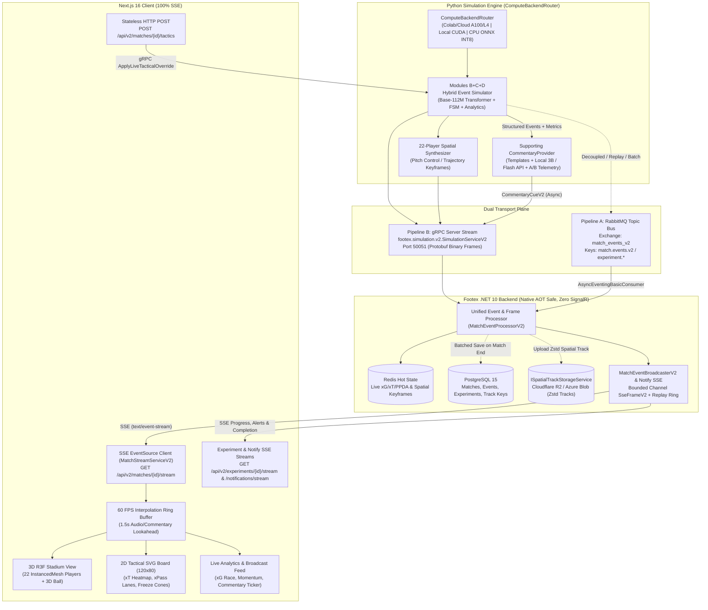

# Module E: Real-Time Match Presentation, Backend Integration & Supporting LLM Commentary (V2 Specification)

**Document Owner:** `@engine-integration`  
**Worktree Target:** `D:\programming\GitHub\PixelPitchAI-v2-revamp` (branch `feat/v2-hybrid-simulation-revamp`)  
**Scope:** End-to-end integration spanning `simulation-engine` (Python 3.12 / FastAPI / `sse-starlette` / gRPC), RabbitMQ & Redis, `backend` (.NET 10 / EF Core 10 / SSE), Caddy reverse proxy, and `frontend` (Next.js 16 / React 19 / React Three Fiber).

---

## 1. Executive Summary & V1 Integration Audit

In PixelPitchAI v1, the presentation and transport stack was built around a raw-text GPT-2 stream (`124M` parameters, `1024`-token context) emitted line-by-line and parsed with string/span heuristics downstream. While the codebase already began migrating live match delivery to **Server-Sent Events (SSE)** (`MatchStreamController.cs` + `MatchEventBroadcaster.cs` + `MatchStreamService.ts`), legacy SignalR match streaming paths (`MatchHub.cs`, dual-connect in `useSignalREventStream.ts`) and polling bottlenecks still remain. Direct inspection of `D:\programming\GitHub\PixelPitchAI` surfaces concrete structural gaps that Module E resolves for V2:

| Layer | V1 Implementation (Observed in Codebase) | V1 Bottleneck / Gap for V2 | V2 Target Architecture |
| :--- | :--- | :--- | :--- |
| **gRPC Contract** (`simulation.proto`) | `StartMatchSimulationStream` yields `MatchEventRaw { match_id, event_index, raw_event_text, timestamp_utc, is_end_of_match }`. `SimulateMatchRequest` carries only team IDs/names/seasons + GPT-2 sampling knobs (`temperature`, `top_p`, `top_k`, `num_tokens_to_generate`). | Text serialization in Python followed by `ZeroAllocationEventParser.TryParseEvent` string slicing in .NET; zero support for formations, lineups, tactical sliders, `xG`/`xT`/`xPass`, or 22-player coordinates. | Versioned `footex.simulation.v2.SimulationServiceV2` streaming typed Protobuf `MatchStreamFrameV2` (`StructuredEventV2`, `SpatialFrameV2` for 22 players + 3D ball, `TelemetrySnapshotV2`, `CommentaryCueV2`) and accepting full `MatchConfigV2` + `MonteCarloExperimentRequest`. |
| **Python API** (`simulation-engine/api/`) | `routes/simulation.py` (`/startMatch`, `/simulationStatus/{id}`, `/simulationResult/{id}/stream` SSE status-only via `sse-starlette`) + `services/optimized_simulation_service.py` (single-match GPT-2 loop). | No live event/spatial SSE streaming endpoint; no GPU-batched counterfactual Monte Carlo endpoint; `config/settings.py` relies on hardcoded `SPECIAL_LIST` (`Team_Year`). | FastAPI + `sse-starlette` `/v2/simulate/stream` (real-time SSE event/spatial/telemetry stream), `/v2/experiments/monte-carlo` (GPU-batched simulation + diagnostic aggregation), `/v2/experiments/{id}/stream` (SSE progress), `/v2/commentary/narrate`, keeping V1 routes as a deprecated bridge. |
| **RabbitMQ Ingestion** (`MatchEventRabbitMqClient.cs`) | Polls `match_events_queue` on topic exchange `match_events` (`match.events`) using `BasicGetAsync` in a `700ms` loop (`ExecuteAsync` lines 523–559). | Artificial up-to-700ms polling latency jitter, single-message `BasicQosAsync(0, 1, false)` throughput ceiling, no dead-letter queue (DLQ), and raw text lines as primary payload. | Push-based `AsyncEventingBasicConsumer` with prefetch QoS, separate routing keys (`match.events.v2`, `match.spatial.v2`, `match.commentary.v2`, `experiment.completed.v2`), DLX/DLQ, and Protobuf/compact-JSON payloads. |
| **.NET 10 Backend Fan-Out** (`MatchEventProcessor.cs`, `MatchEventBroadcaster.cs`, `MatchHub.cs`, `NotificationService.cs`) | Dual ingestion (Pipeline A RabbitMQ + Pipeline B gRPC) converging on `MatchEventProcessor`. Broadcasts `match_event` & `match_statistics` over SSE (`MatchStreamController`) **and** still emits legacy SignalR `MatchHub` (`/matchSimulationHub`) plus SignalR `NotificationService` (`/Notify`). | `BroadcastStatisticsAsync` serializes an anonymous object via reflection-based `JsonSerializer.Serialize(statistics)` (breaks Native AOT trimming/compilation); SignalR hubs (`/matchSimulationHub`, `/Notify`) retain WebSocket/hub state and client packages. | 100% compile-time source-generated serialization in `MatchEventJsonContext` (`[JsonSerializable]`) for all V2 DTOs; **100% SSE** (`GET /api/v2/matches/{id}/stream`, `GET /api/v2/experiments/{id}/stream`, `GET /api/v2/notifications/stream`) for all live match, spatial, telemetry, commentary, experiment, and notification streams; **complete removal of SignalR** from backend & frontend. |
| **Domain & Analytics Storage** (`FootballMatchEvent.cs`, `MatchStatistics.cs`, `MatchEvents.cs`) | `FootballMatchEvent` holds basic coordinates (`position`, `pass_target`, `shot_target`) and string attributes; `MatchStatistics` tracks shots, possession %, passes, corners, cards; `MatchEvents.EventsJson` capped at `[MaxLength(1000000)]`. | Missing `xG`, `post_shot_xG`, `xPass`, `xT`, `VAEP`, `under_pressure`, `possession_phase_id`, `actor_slot`, 22-player spatial snapshots, `PPDA`, `field_tilt`, and `TacticalExperiment` persistence. | Extended V2 domain models (`FootballMatchEventV2`, `MatchAnalyticsTotals`, `MatchTacticalSnapshot`, `TacticalExperimentRecord`); Zstd-compressed 22-player spatial tracks offloaded to **Cloudflare R2 / Azure Blob** behind `ISpatialTrackStorageService` (with only object key + metadata in PostgreSQL). |
| **Frontend Pitch & UI** (`EventPlotter.tsx`, `FootballPitch.tsx`, `useSignalREventStream.ts`, `NotificationService.ts`) | `useSignalREventStream` opens **both** SSE (`MatchStreamService`) and SignalR (`MatchHub`) simultaneously; `NotificationService.ts` uses `@microsoft/signalr` (`/Notify`); `EventPlotter` renders only the last 5 events (`slice(-5)`); `FootballPitch.tsx` divides coordinates by `100` instead of `120x80`. | SignalR WebSocket dependencies (`@microsoft/signalr`) add unnecessary bundle/state overhead; only 1–5 historical event ghosts visible instead of 22 live players; 2D SVG pitch coordinate mismatch (`100` vs `120x80`); no live `xG` race chart, pitch control, passing lanes, or counterfactual comparison UI. | **100% SSE** hooks (`useMatchStreamV2` + `useNotificationsSse`) with `@microsoft/signalr` completely removed; `requestAnimationFrame` interpolation ring buffer driving R3F `InstancedMesh` 22-player + 3D ball renderer at 60 FPS; fixed `120x80` 2D SVG tactical board with `xG`/`xT`/`xPass` overlays; stateless REST `POST` for live tactical tweaks; Monte Carlo Counterfactual Dashboard. |

---

## 2. Module E: Real-Time Match Presentation & End-to-End Streaming Architecture

Module E is responsible for delivering **every simulated match artifact**—structured events, 22-player + ball spatial trajectories, calibrated analytics (`xG`, `post_shot_xG`, `xPass`, `xT`, `VAEP`, `PPDA`, `field_tilt`), and play-by-play commentary—with deterministic ordering, sub-50ms hop latency from simulator to browser, and zero simulation-physics coupling.

### 2.1 End-to-End Streaming & Ingestion Topology



### 2.2 Evolving `simulation.proto` to V2 (Binary Structured Frames)

In V1 (`simulation-engine/api/protos/simulation.proto` and `backend/src/Infrastructure/Protos/simulation.proto`), gRPC sends a single raw string (`raw_event_text`), forcing Python to stringify floats and .NET to re-parse them with `ZeroAllocationEventParser`. In V2, we retain `footex.simulation.SimulationService` for backwards compatibility and introduce `footex.simulation.v2.SimulationService` so structured events, 22-player coordinates, and telemetry travel as zero-parse Protobuf binary frames:

```protobuf
syntax = "proto3";

package footex.simulation.v2;
option csharp_namespace = "Infrastructure.Protos.V2";

service SimulationServiceV2 {
  // Single live match: bidirectional or server-stream with live tactical intervention handle
  rpc StreamMatchV2 (SimulateMatchV2Request) returns (stream MatchStreamFrameV2);
  rpc ApplyLiveTacticalOverride (LiveTacticalOverrideRequest) returns (LiveTacticalOverrideAck);

  // Batch Counterfactual Experimentation (100 - 1,000 matches on GPU)
  rpc RunMonteCarloExperiment (MonteCarloExperimentRequest) returns (stream MonteCarloProgressFrame);

  rpc GetHealthV2 (HealthV2Request) returns (HealthV2Response);
}

message MatchStreamFrameV2 {
  string match_id = 1;
  uint32 sequence_no = 2;
  uint32 match_clock_seconds = 3;   // Canonical clock from Hybrid State Machine
  uint32 period = 4;                // 1=1H, 2=2H, 3=ET1, 4=ET2, 5=FT
  FrameKind kind = 5;

  oneof payload {
    StructuredEventV2 event = 10;
    PitchSpatialFrameV2 spatial = 11;
    TelemetrySnapshotV2 telemetry = 12;
    CommentaryCueV2 commentary = 13;
    MatchLifecycleV2 lifecycle = 14;
  }
}

message StructuredEventV2 {
  uint32 event_index = 1;
  uint32 possession_phase_id = 2;
  uint32 possessing_team_side = 3;  // 0=none, 1=home, 2=away
  uint32 actor_slot = 4;            // 1..11 home, 12..22 away
  uint32 recipient_slot = 5;        // 0 if none
  uint32 player_id = 6;
  string player_name = 7;
  string action_type = 8;           // pass, carry, shot, duel, pressure, interception, substitution, ...
  string sub_type = 9;              // ThroughBall, Switch, Cross, Corner, FreeKick, GoalKick, ThrowIn, Penalty
  string outcome = 10;              // Complete, Incomplete, Goal, Saved, OffTarget, Blocked, Won, Lost
  float start_x = 11;               // StatsBomb canonical 0..120
  float start_y = 12;               // StatsBomb canonical 0..80
  float end_x = 13;
  float end_y = 14;
  float end_z = 15;                 // Goal-mouth / aerial height (meters)
  bool under_pressure = 16;
  string body_part = 17;
  string pass_height = 18;          // Ground, Low, High
  string card = 19;                 // Yellow, SecondYellow, Red
  uint32 home_score = 20;
  uint32 away_score = 21;

  // Module D Calibrated Per-Event Analytics
  float xg = 22;
  float post_shot_xg = 23;
  float xpass = 24;
  float xt_delta = 25;
  float vaep_value = 26;
  float turnover_risk = 27;
}

message PlayerSpatialStateV2 {
  uint32 slot = 1;                  // 1..22 matching lineup slot
  uint32 player_id = 2;
  float x = 3;                      // Canonical pitch yards [0, 120] (105m x 68m normalized frame)
  float y = 4;                      // Canonical pitch yards [0, 80]
  float vx = 5;                     // Canonical yards/s
  float vy = 6;                     // Canonical yards/s
  float facing_rad = 7;
  float stamina = 8;                // 0..1 remaining physical capacity
  bool has_ball = 9;
  bool is_sent_off = 10;
}

message PitchSpatialFrameV2 {
  uint64 sim_timestamp_ms = 1;      // Smooth playback clock relative to kickoff
  float ball_x = 2;
  float ball_y = 3;
  float ball_z = 4;
  repeated PlayerSpatialStateV2 players = 5; // Always <= 22 active slots
  float home_voronoi_control = 6;   // % pitch control in attacking third / overall
}

message TelemetrySnapshotV2 {
  float home_xg = 1;
  float away_xg = 2;
  float home_psxg = 3;
  float away_psxg = 4;
  float home_xt = 5;
  float away_xt = 6;
  float home_possession_pct = 7;
  float home_ppda = 8;
  float away_ppda = 9;
  float home_field_tilt_pct = 10;   // Final-third passes share
  float momentum_index = 11;        // [-1.0 away .. +1.0 home] rolling 3-min xT/xG swing
  uint32 home_shots = 12;
  uint32 away_shots = 13;
  uint32 home_shots_on_target = 14;
  uint32 away_shots_on_target = 15;
  uint32 home_passes = 16;
  uint32 away_passes = 17;
  float home_pass_accuracy = 18;
  float away_pass_accuracy = 19;
  float home_avg_xpass = 20;
  float away_avg_xpass = 21;
  uint32 home_high_turnovers = 22;
  uint32 away_high_turnovers = 23;
}

message CommentaryCueV2 {
  uint32 anchor_event_index = 1;
  string tier = 2;                  // "template" | "llm_broadcast" | "tactical_insight"
  string headline = 3;              // Short ticker text
  string body = 4;                  // Natural-language commentary / tactical note
  float salience_score = 5;         // 0..1 importance for UI highlighting / TTS
  string language = 6;              // "en" | "es" | "fr" (aligns with frontend next-intl)
  string provider_id = 7;           // "template" | "local_3b" | "flash_api" (for A/B comparison)
  string model_version = 8;
  uint32 latency_ms = 9;
  bool verifier_passed = 10;
  bool fallback_used = 11;
}
```

### 2.3 Spatial Trajectory Streaming Without Overloading the Network

A raw 25 Hz stream of 22 full player objects over JSON SSE would consume excessive bandwidth and React state churn. Module E uses a **Keyframe + Event-Driven Trajectory Envelope** strategy:

1. **Keyframe Cadence (5 Hz – 10 Hz over gRPC / SSE)**:
   - The simulator (Module B off-ball spatial model + Module C ball/event transitions) emits a `PitchSpatialFrameV2` at **5 Hz (every 200ms)** during continuous play, plus immediate keyframes at every discrete `StructuredEventV2` contact point (`pass` release, `ball_receipt`, `shot` strike, `tackle`/`interception`).
   - On the wire to the browser (`GET /api/v2/matches/{id}/stream`), each `spatial_frame` SSE payload can optionally be packed as a compact fixed-order tuple array:
     `{"t": 142800, "b": [74.2, 31.8, 1.4], "p": [[1, 8.2, 40.0, 0.1, 0.0, 0.99], ...], "hc": 0.61}`
     At ~450 bytes per frame × 5 Hz = **~2.2 KB/sec (~18 Kbps)**—trivial for HTTP/2 SSE and Caddy, and fast to parse on the main thread or a Web Worker.
2. **Client-Side Cubic/Hermite Interpolation (60 FPS)**:
   - The frontend (`InterpBuffer`) reads `(x, y, vx, vy)` keyframes into a timestamped ring buffer with a configurable lookahead delay (default **1,500ms** in `Broadcast` mode, **150ms** in `Instant` mode).
   - Inside React Three Fiber's `useFrame()` callback, players and ball positions are interpolated at **60 FPS** using Hermite spline interpolation from `(x, y, vx, vy)` directly onto `THREE.InstancedMesh` matrices and `ballRef.current.position`—**zero React `setState` calls per animation frame**.
3. **Ball 3D Parabolic Arcs**:
   - Using `pass_height` (`Ground`, `Low`, `High`) and `end_z` on shots/crosses/saves, the frontend computes realistic Z-axis parabolic arcs $z(\tau) = 4 h_{\text{peak}} \tau (1 - \tau) + \tau \cdot \text{end\_z}$ synchronized to ball flight duration, replacing V1's static `StraightArrow`/`CurvedArrow` props on `EventPlotter.tsx`.

### 2.4 RabbitMQ, Redis & .NET 10 Native AOT Backend Pipeline

1. **Upgrading RabbitMQ (`MatchEventRabbitMqClient`)**:
   - Replace the V1 `700ms` `BasicGetAsync` polling loop in `backend/src/Infrastructure/Services/MatchEventRabbitMqClient.cs` with event-driven `AsyncEventingBasicConsumer` (`BasicQosAsync(0, 32, false)`).
   - Declare a V2 topic topology on exchange `match_events_v2`:
     - `match.events.v2` → `match_events_v2_queue` (event + telemetry persistence & fanout)
     - `match.spatial.v2` → optional transient stream queue (`x-message-ttl: 30000`, `x-max-length: 5000`) when Pipeline A is used instead of gRPC Pipeline B
     - `experiment.completed.v2` → `experiment_results_v2_queue` (notifies backend when long-running Monte Carlo GPU jobs finish)
     - `match_events_dlx` → dead-letter queue for malformed messages (NACK without requeue)
   - Note on Pipeline Selection: **Pipeline B (gRPC `SimulationServiceV2`) is the recommended default for live single-match streaming** because it eliminates serialization hops and delivers `PitchSpatialFrameV2` + `StructuredEventV2` directly into `.NET` memory (`MatchEventGrpcStreamConsumerV2`). Pipeline A (RabbitMQ) remains supported for horizontally scaled multi-worker async simulation and replay ingestion.
2. **.NET 10 Native AOT & Zero-Allocation Compliance**:
   - V1 `MatchEventBroadcaster.BroadcastStatisticsAsync` currently calls `JsonSerializer.Serialize(statistics)` on an anonymous type, which relies on runtime reflection and breaks Native AOT.
   - In V2, **every** SSE and API payload is a `sealed record` or `readonly struct` registered on `MatchEventJsonContext` (`[JsonSerializable(typeof(MatchEventV2Dto))]`, `[JsonSerializable(typeof(SpatialFrameV2Dto))]`, `[JsonSerializable(typeof(TelemetrySnapshotV2Dto))]`, `[JsonSerializable(typeof(CommentaryCueV2Dto))]`, `[JsonSerializable(typeof(MonteCarloExperimentResultDto))]`) using `System.Text.Json` source generation (`JsonSerializer.Serialize(dto, MatchEventJsonContext.Default.SpatialFrameV2Dto)`).
   - On the SSE broadcaster hot path, serialize each frame **once** into a `ReadOnlyMemory<byte>` / `string` before writing to subscriber `Channel<SseMessage>` instances (`IMatchEventBroadcaster`), avoiding $O(N_{\text{subscribers}})$ repeated JSON serializations.
3. **Redis Hot State, PostgreSQL Persistence & Object Storage (`ISpatialTrackStorageService`)**:
   - **Redis** stores rolling live telemetry hashes (`match:v2:{id}:telemetry`), the last 30 `SpatialFrameV2` items for instant reconnect catch-up, and active Monte Carlo experiment progress (`exp:v2:{expId}:status`).
   - **Cloudflare R2 / Azure Blob (`ISpatialTrackStorageService`)**: Zstd-compressed `5 Hz` 22-player spatial track blobs (`~350–500 KB` per 90-minute match) are offloaded out of PostgreSQL via an `ISpatialTrackStorageService` interface backed primarily by **Cloudflare R2** (S3-compatible, zero egress fees for client replay fetches) with an **Azure Blob Storage** adapter extending existing `backend/src/Application/Services/AzureBlobStorageService.cs` (`IFileStorageService`).
   - **PostgreSQL** (`FootballDbContext`) stays lean by storing only the object pointer and match summaries:
     - `Match`: extended with `TacticalConfigJson` (JSONB), `SpatialTrackObjectKey`, `SpatialTrackCodec` (`"zstd-v2"`), `HomeXG`, `AwayXG`, `HomeXT`, `AwayXT`, `ModelVersion`.
     - `MatchEvents`: removes `[MaxLength(1000000)]` text cap by migrating `EventsJson` to PostgreSQL `jsonb` for structured event querying without storing raw spatial frame arrays inside relational rows.
     - `TacticalExperiments`: durable table storing counterfactual experiment inputs, status, Monte Carlo summary JSONB, `CommentaryProvider` A/B telemetry, and representative replay seeds.
4. **Caddy Reverse Proxy & 100% Pure SSE Transport (Zero SignalR)**:
   - **Why 100% SSE Replaces SignalR Across All Streams**: Both live match playback (`match_event`, `spatial_frame`, `match_telemetry`, `commentary`, `match_lifecycle`), Monte Carlo experiment progress, and user notifications (`/Notify` alerts) are strictly unidirectional server-to-client push. Standardizing 100% on **Server-Sent Events (SSE)**—via `sse-starlette` (`EventSourceResponse`) on Python FastAPI and `System.Threading.Channels.Channel<SseMessage>` on .NET 10—eliminates WebSocket handshake/negotiation overhead, removes all SignalR connection state and backplane complexity, gives native browser `EventSource` automatic reconnection (`Last-Event-ID`), and stays 100% Native AOT reflection-free.
   - `MatchStreamV2Controller` (`GET /api/v2/matches/{id}/stream`) and `NotificationsStreamController` (`GET /api/v2/notifications/stream`) retain `X-Accel-Buffering: no`, `Cache-Control: no-cache`, and SSE `id: <sequence_no>` + `Last-Event-ID` resume support backed by bounded `Channel<SseMessage>` replay ring buffers (100 messages for matches, 25 for user notifications).
   - `Program.cs` `JwtBearerEvents.OnMessageReceived` extracts `?access_token=` for `/api/v2/matches`, `/api/v2/experiments`, and `/api/v2/notifications/stream`.
   - In `caddy/api_upstream.conf` & `caddy/Caddyfile`, all SSE routes (`/api/v2/matches/*/stream`, `/api/v2/experiments/*/stream`, `/api/v2/notifications/stream`, and `/ai/v2/*`) configure `flush_interval -1` so frames flush immediately without reverse-proxy buffering.
   - **Complete SignalR Removal (Backend & Frontend)**:
     - Remove `MatchHub` (`/matchSimulationHub`), `NotificationService` SignalR Hub (`/Notify`), `AddSignalR()`, and dual-broadcast hooks in `MatchEventProcessor.cs`, `MatchEventRabbitMqClient.cs`, `MatchesController.cs`, and `Program.cs`.
     - Remove `@microsoft/signalr` from `frontend/package.json`, delete `SignalRService.ts` and `useSignalRNotifications.ts`, replace `useSignalREventStream.ts` with pure SSE `useMatchStreamV2.ts` (wrapping `MatchStreamService.ts`), and migrate `frontend/Services/NotificationService.ts` + `useNotificationsSse.ts` to `EventSource` (`GET /api/v2/notifications/stream`).
     - Infrequent client-to-server actions (such as an interactive mid-match tactical override or substitution) use **stateless REST `POST /api/v2/matches/{id}/tactics`**, which relays to Python via gRPC `ApplyLiveTacticalOverride`; the resulting tactical state change returns naturally over the active SSE connection.

### 2.5 Virtual Pitch (3D & 2D) & Live Analytics Dashboard Upgrades

To realize PixelPitchAI's vision on `frontend/` (Next.js 16 + React 19 + R3F):
1. **3D Virtual Pitch (`Scene3D.tsx`, `EventPlotter.tsx`, `PlayerMarker.tsx`)**:
   - Replace `EventPlotter`'s `allRelevantEvents.slice(-5)` actor-only rendering with a dedicated `PitchPlayersLayer` rendering **all 22 players simultaneously** using two `THREE.InstancedMesh` pools (11 home + 11 away + GK color differentiation + jersey numbers/billboard labels toggled on hover/selection or ball proximity) updated inside `useFrame()` from `InterpBuffer`.
   - Render ball possession aura, active pass target indicator (`xPass` probability ring around target teammates), shot trajectory cone (`xG` & `PSxG` badge), and red-card player removal cleanly based on `is_sent_off`.
   - Add playback scrubber controls: `Live (1x)`, `2x`, `4x`, `Pause/Rewind`, and **"Jump to Key Moment"** bookmarks populated by high-salience events (`|xT| > 0.08`, `xG > 0.15`, `Goal`, `Red Card`, `Tactical Sub`).
2. **2D Tactical SVG Board (`FootballPitch.tsx`)**:
   - Fix the V1 coordinate normalization bug (`position[0] / 100` → canonical StatsBomb `120 x 80` scale: `cx = 50 + (x / 120) * 700`, `cy = 50 + (y / 80) * 420`).
   - Add toggleable tactical layers matching Module B/D outputs:
     - **Voronoi Pitch Control Overlay** (semi-transparent home vs away space control polygons computed from the 22 player coordinates + velocities).
     - **Pass Network & Progressive Lanes** (live node average positions + edge thickness by pass count / `xT` added).
     - **Shot Map & 360 Freeze-Frame Inspector** (clicking any shot renders the 22-player snapshot at the moment of strike, goalkeeper cone, `xG`, and `post_shot_xG`).
3. **Live Analytics & Counterfactual Dashboard**:
   - **Live Match Mode**: Cumulative `xG` step-race chart (`Home xG` vs `Away xG`), 3-minute rolling `Momentum / xT` bar chart, `PPDA` & `Field Tilt` gauges, pass completion vs `xPass` expected completion ("Passing Overperformance"), and the live Broadcast Commentary + Tactical Insight feed.
   - **Counterfactual Experimentation Mode**: Side-by-side Baseline vs Variant comparison view displaying win/draw/loss probability shifts, `xG`/`xT` box/violin distributions across $N$ Monte Carlo runs, Zone-14/Half-Space progression & high-turnover delta heatmaps, OOD confidence badges, and one-click **"Watch Representative Match in 3D"** links.

---

## 3. Role of the Language Model (Supporting Experience, Not Controlling Simulation)

A foundational architectural decision of PixelPitchAI V2 is **Option B: Hybrid Stateful Simulation Engine + Supporting LLM Narrator**.

### 3.1 Core Separation Principle

```
[MatchConfigV2 + Tactical Rules]
        │
        ▼
[Modules B + C + D: Hybrid Event Simulator] ──(100% Ownership of Match Reality)──▶ Clock, Score, 22 Players, Events, xG/xT/xPass
        │
        │  (Read-Only Structured Event + Telemetry Snapshot)
        ▼
[Module E: Two-Tier Narration & Analyst Layer] ──▶ Natural-Language Commentary + Coach Briefings (ZERO feedback into physics/state)
```

- **Why the text LLM must NOT control simulation physics**:
  - In V1, fine-tuned GPT-2 (124M) generated raw text tokens directly, requiring regex `bad_words_ids` hacks to stop Barcelona from turning into Real Madrid mid-line, manual `[SECOND HALF START]` prompt-reset injection, and guessing outcomes without knowing scoreline, fatigue, or 22-player positions.
  - Letting a general text LLM generate match events violates conservation laws (teleporting ball/players, duplicate kickoffs, inconsistent scorelines, ignoring tactical sliders like Defensive Line Height or PPDA).
- **What owns simulation in V2**:
  - The **Explicit State Machine** + **~80M–150M Custom Football Event Transformer** (Module C) + **Tactical State / Spatial Engine** (Module B) + **Calibrated Outcome Models** (Module D) execute the entire match mathematically.
  - Every `StructuredEventV2` emitted is already 100% valid, spatially legal, score-tracked, and annotated with calibrated `xG`, `post_shot_xG`, `xPass`, `xT`, and `VAEP`.
- **What the LLM does in V2**:
  - Translates those verified structured events and aggregated Monte Carlo diagnostics into **engaging broadcast play-by-play commentary** and **actionable tactical analyst insights**—strictly read-only downstream of the simulator.

### 3.2 Two-Tier Commentary Pipeline (Speed + Richness + Zero Hallucination)

Running an instruction LLM on every single one of ~1,600 events per match would add unacceptable latency and GPU/API cost—and most routine passes don't need prose generation. Module E uses a **Two-Tier Hybrid Narrator**:

| Tier | Trigger Condition (~% of Match Events) | Mechanism & Provider Adapters | Target Latency | Output Destination |
| :--- | :--- | :--- | :--- | :--- |
| **Tier 1: Deterministic Micro-Templates** | Routine passes, carries, ball receipts, throw-ins, fouls without cards (~85–90% of events) | Fast parameterized template engine keyed by `(action_type, sub_type, zone_name, under_pressure, xT_delta, xPass)` with syntactic variety pools (localized `en`/`es`/`fr`). | `< 1 ms` (CPU, zero GPU/API cost) | Live ticker log & play-by-play feed (`tier: "template"`). |
| **Tier 2A: Broadcast `CommentaryProvider` (Dual Adapters + A/B Telemetry)** | High-salience events (`salience_score >= 0.65`): Goals, shots with `xG >= 0.12`, woodwork, big GK saves (`PSxG - G >= 0.25`), red cards, penalties, sustained multi-pass `xT >= 0.18` surges, substitutions, HT/FT (~10–15% of events, ~150 calls/match) | Unified `CommentaryProvider` interface supporting runtime switching (`mode: "local_3b" \| "flash_api" \| "ab_split" \| "template_only"`):<br>1. **`LocalSidecarCommentaryProvider`**: Quantized `3B` instruction model (`Qwen2.5-3B-Instruct` / `Llama-3.2-3B-Instruct` INT4/FP8 via `llama.cpp`/vLLM HTTP sidecar)<br>2. **`FlashApiCommentaryProvider`**: External low-latency Flash LLM API (e.g., Gemini Flash REST client)<br>Both receive the same ~350-token JSON state window (max 60 output tokens) and emit A/B telemetry (`provider_id`, `model_version`, `latency_ms`, `verifier_passed`, `fallback_used`). | `120–350 ms` (async, non-blocking) | Broadcast banner + color commentary + optional TTS queue (`tier: "llm_broadcast"`). |
| **Tier 2B: Tactical Analyst Copilot LLM** | Post-half / Post-match tactical summary OR completion of a `/v2/experiments/monte-carlo` counterfactual batch job (1 call per half / per experiment) | Same `CommentaryProvider` abstraction (`local_3b` or `flash_api`) prompted with structured Module D/Monte Carlo diagnostic JSON (zone progression deltas, turnover coordinates, CI bounds, OOD status) to generate an executive coach briefing. | `400–900 ms` (async) | Tactical Insights panel & Counterfactual Experiment Briefing (`tier: "tactical_insight"`). |

### 3.3 Grounding Contract, Fact-Checking & Lookahead Sync

1. **Strict Grounded JSON Prompt Input** (never unformatted text history):
   The sidecar receives only verified facts from Modules B/C/D:
   ```json
   {
     "match": {"home": "Barcelona", "away": "Real Madrid", "score": [2, 1], "minute": 74, "period": 2},
     "tactical_context": {"home_ppda_rolling": 7.4, "away_line_height_m": 48.5, "momentum": 0.42},
     "recent_chain": [
       {"actor": "Pedri", "action": "pass", "sub_type": "ThroughBall", "zone": "Left Half-Space", "xT": 0.11, "xPass": 0.64},
       {"actor": "Lamine Yamal", "action": "carry", "from_zone": "Box Edge", "under_pressure": true, "xT": 0.08}
     ],
     "trigger_event": {
       "index": 1142, "actor": "Lamine Yamal", "action": "shot", "outcome": "Saved",
       "body_part": "Left Foot", "xG": 0.28, "post_shot_xg": 0.51, "keeper": "Thibaut Courtois"
     },
     "constraints": {"max_sentences": 2, "style": "tactical_broadcast", "language": "en"}
   }
   ```
2. **Deterministic Output Verifier (Hallucination Gate)**:
   Before emitting `CommentaryCueV2` on the gRPC/SSE stream, a lightweight Python validator verifies:
   - Any numeric score mentioned matches `score` (`[2, 1]`).
   - Named players appear in the active 22-player match roster / `recent_chain` / `trigger_event`.
   - No banned speculative phrases or conflicting outcome ("goal" when `outcome == "Saved"`).
   - **Timeout / Verification Fallback**: If the LLM sidecar exceeds `600ms` or fails verification, the system immediately emits a rich deterministic Tier-1 fallback (e.g., *"74' — Crucial save by Thibaut Courtois! Lamine Yamal fires with his left foot from the box edge (0.28 xG, 0.51 PSxG) after Pedri's through ball."*)—ensuring the match stream **never stalls** waiting on an LLM.
3. **1.5-Second Presentation Lookahead Buffer**:
   - During live streaming, the simulation engine runs ~1.5–2.5 seconds ahead of the client's `InterpBuffer` visual playback cursor.
   - Because Tier 2A LLM calls complete in ~150–350ms while the client buffer holds 1,500ms of spatial frames, `CommentaryCueV2` attaches to `anchor_event_index` and reaches the user's screen (and optional Web Audio / neural TTS voiceover) **simultaneously with the 3D shot/goal animation**—completely masking LLM inference latency.
4. **Monte Carlo Mode Bypass**:
   - When running `/v2/experiments/monte-carlo` (100–1,000 batched simulations), **Tier 1 and Tier 2A event commentary are disabled completely** so GPU throughput stays at maximum speed; only **Tier 2B** runs **once** at the end of the experiment over the aggregated statistical diagnostics.

---

## 4. API & Contract Evolution (V1 → V2)

### 4.0 Three-Tier Compute Routing (`ComputeBackendRouter`)

To run smoothly across local developer laptops, CUDA workstations, and Colab/Cloud GPUs without code changes, `simulation-engine` routes every V2 request through a centralized **`ComputeBackendRouter`**:

| Compute Tier | Runtime Stack & Model Format | Supported Workloads & Expected Throughput | Selection Rule (`compute_target`) |
| :--- | :--- | :--- | :--- |
| **`remote_gpu` (Colab / Cloud A100/L4)** | PyTorch `bf16` + `torch.compile` / CUDA Graphs (`Base-112M` + GPU Module D MLPs) | Model training + large Monte Carlo experiments (`N = 100–1,000` paired CRN sims: `~10–18s` per `100` on A100, `~20–30s` on L4). | Auto-selected when `n_simulations > 100` (or `> 25` if no local CUDA) and `REMOTE_GPU_WORKER_URL` is configured. |
| **`local_cuda` (Local NVIDIA GPU)** | PyTorch FP16/`bf16` `torch.compile` + GPU Module D MLPs | Local GPU live match streaming (`< 1.2 ms/event`) + medium counterfactual batches (`N = 25–100` sims). | Auto-selected when local `torch.cuda.is_available()` and `n_simulations <= 100`. |
| **`local_cpu_onnx` (Local CPU)** | ONNX Runtime opset 19 **INT8 KV-cache** + CatBoost/ONNX Module D | Default single live match streaming (`~4–6 ms/event`, `~10–12s` full match) + small exploratory batches (`N = 10–25` sims async). | Default when no GPU is attached or explicitly requested (`compute_target: "local_cpu_onnx"`). |

Every `/v2/simulate/stream` and `/v2/experiments/monte-carlo` request accepts an optional `compute_target: "auto" | "local_cpu_onnx" | "local_cuda" | "remote_gpu"`, and responses echo `execution_tier` so the UI displays hardware provenance.

---

### 4.1 Python Simulation Engine V2 Endpoints (`simulation-engine/api/routes/v2/`)

All V2 endpoints live under `/v2/*` in FastAPI (`simulation-engine/api/main.py`) alongside existing V1 routes (`/startMatch`, `/simulationStatus/{id}`, `/simulationResult/{id}`) during the migration period.

#### A. `POST /v2/simulate/stream` — Single Live Match Streaming

Streams a single live match simulated by the Hybrid Event Engine (`Base-112M`) over **HTTP Server-Sent Events (`text/event-stream` via `sse-starlette` `EventSourceResponse`)** (or `application/x-ndjson` when requested via `Accept` header for batch tooling), exposing `X-Accel-Buffering: no` and `Cache-Control: no-cache` headers for direct streaming and gRPC `StreamMatchV2` parity.

**Request Body (`SimulateMatchV2Request`, embedding `MatchConfigurationV2` from `02_tactical_state_and_experimentation.md`):**
```json
{
  "stream_mode": "broadcast",
  "compute_target": "auto",
  "playback_speed": 1.0,
  "spatial_hz": 5,
  "commentary": {
    "enabled": true,
    "provider": "ab_split",
    "language": "en"
  },
  "match_config": {
    "match_id": 4021,
    "random_seed": 918273,
    "home": {
      "team_id": 2,
      "team_name": "Barcelona",
      "formation": { "base_name": "4-3-3" },
      "tactical_instructions": {
        "defensive_line_height": 0.78,
        "pressing_intensity": 0.80,
        "build_up_tempo": 0.72,
        "directness": 0.35,
        "attacking_width": 0.80,
        "defensive_compactness": 0.68,
        "counter_press_vs_regroup": 0.85,
        "counter_attack_urgency": 0.65,
        "possession_risk_appetite": 0.60,
        "game_state_adaptivity": 0.75
      },
      "starting_xi": [
        {"slot_index": 0, "player_id": 2001, "shirt_number": 1, "preferred_foot": "Right", "base_position": "GK", "tactical_role": "SweeperKeeper"},
        {"slot_index": 1, "player_id": 2002, "shirt_number": 23, "preferred_foot": "Right", "base_position": "RB", "tactical_role": "InvertedFullback"}
      ],
      "bench": [
        {"player_id": 2012, "shirt_number": 7, "preferred_foot": "Right", "natural_positions": ["LW", "RW", "ST"], "default_role": "InsideForward"}
      ],
      "substitution_policy": {
        "mode": "rule_based",
        "max_substitutions": 5,
        "max_windows": 3,
        "stamina_sub_threshold": 0.48
      }
    },
    "away": {
      "team_id": 7,
      "team_name": "Real Madrid",
      "formation": { "base_name": "4-3-1-2" },
      "tactical_instructions": { "...": "same TacticalInstructions [0, 1] schema" },
      "starting_xi": [ "..." ],
      "bench": [ "..." ],
      "substitution_policy": { "...": "..." }
    }
  }
}
```
*(Note: `MatchConfigurationV2` field validation rules, 22-role `PlayerRole` enums, 4-phase `FormationConfig`, and normalized `[0.0, 1.0]` `TacticalInstructions` bounds match Module A in `02_tactical_state_and_experimentation.md` identically; internal `actor_slot` `1..22` maps to `home.starting_xi[0..10]` + `away.starting_xi[0..10]`.)*

**SSE Stream Events Emitted:**
- `event: match_lifecycle` — kickoff, half-time, full-time, substitution state changes, red-card slot removals.
- `event: match_event` — full `StructuredEventV2` JSON including `xG`, `post_shot_xG`, `xPass`, `xT_delta`, `vaep_value`, `possession_phase_id`, `under_pressure`, `actor_slot`, `recipient_slot`.
- `event: spatial_frame` — 5–10 Hz compact 22-player `(slot, x, y, vx, vy, stamina)` + 3D ball `(x, y, z)` frame.
- `event: telemetry` — updated cumulative `xG`, `PSxG`, `xT`, `PPDA`, `field_tilt_pct`, `momentum_index`, `avg_xpass`.
- `event: commentary` — `CommentaryCueV2` anchored to `anchor_event_index`.

---

#### B. `POST /v2/experiments/monte-carlo` — High-Speed Batch Counterfactual Experimentation

Executes $N$ paired simulations across a **Baseline Arm** and one or more **Counterfactual Intervention Arms** (e.g., player swap, formation change, defensive line shift, directness tweak) using batched GPU inference with **Common Random Numbers (CRN)** (shared base random seeds across arms to minimize Monte Carlo variance).

- **Execution Modes**:
  - `execution_mode: "sync"` (recommended for $N \le 100$ paired runs on Colab A100 where `B=128–256` GPU batching completes in `~10–18s`, or `~20–30s` on L4): returns full JSON response directly with HTTP `200 OK`.
  - `execution_mode: "async"` (for $N > 100$, multi-arm sweeps up to $1{,}000$ runs, or CPU fallback): returns HTTP `202 Accepted` with `{ experiment_id, status_url: "/v2/experiments/{id}", stream_url: "/v2/experiments/{id}/stream" }`, pushing completion onto RabbitMQ `experiment.completed.v2`.

**Request Body (`MonteCarloExperimentRequest`, wire-compatible with `CounterfactualExperimentRequest` in `02_tactical_state_and_experimentation.md`):**
```json
{
  "experiment_id": "exp_99481",
  "question_type": "tactical_block_comparison",
  "compute_target": "auto",
  "n_simulations": 100,
  "use_paired_crn": true,
  "base_seed": 42000,
  "sample_player_epistemic_uncertainty": true,
  "lock_game_state_adaptivity": 0.0,
  "allow_ood_extrapolation": false,
  "baseline_config": { "...": "MatchConfigurationV2" },
  "opponent_suite": [
    {"archetype_id": "high_press_433", "label": "High-Press 4-3-3", "away_config": { "...": "TeamMatchConfig" }, "weight": 0.5},
    {"archetype_id": "low_block_541", "label": "Low-Block 5-4-1", "away_config": { "...": "TeamMatchConfig" }, "weight": 0.5}
  ],
  "interventions": [
    {
      "arm_id": "high_line_48m",
      "label": "High Defensive Line (47.5m / 0.85) + Aggressive Counter-Press",
      "patches": [
        {"target": "home.tactical_instructions.defensive_line_height", "value": 0.85},
        {"target": "home.tactical_instructions.pressing_intensity", "value": 0.84},
        {"target": "home.tactical_instructions.counter_press_vs_regroup", "value": 0.88}
      ]
    },
    {
      "arm_id": "mid_block_35m",
      "label": "Mid Block (35.5m / 0.45) + Regroup",
      "patches": [
        {"target": "home.tactical_instructions.defensive_line_height", "value": 0.45},
        {"target": "home.tactical_instructions.pressing_intensity", "value": 0.35},
        {"target": "home.tactical_instructions.counter_press_vs_regroup", "value": 0.20}
      ]
    }
  ],
  "diagnostics_options": {
    "compute_zone_progression": true,
    "compute_turnover_heatmaps": true,
    "compute_role_contributions": true,
    "include_ood_check": true,
    "top_representative_seeds": 3,
    "generate_llm_briefing": true,
    "commentary_provider": "ab_split"
  }
}
```

**Response Body (`MonteCarloExperimentResponse`):**
```json
{
  "experiment_id": "exp_99481",
  "status": "completed",
  "execution_tier": "remote_gpu",
  "n_simulations": 100,
  "execution_time_ms": 15400,
  "arms": [
    {
      "arm_id": "baseline",
      "outcome_probs": {"home_win": 0.482, "draw": 0.246, "away_win": 0.272},
      "expected_points": 1.692,
      "metrics_summary": {
        "home_xg": {"mean": 1.74, "std": 0.68, "ci95": [1.61, 1.87]},
        "away_xg": {"mean": 1.18, "std": 0.54, "ci95": [1.07, 1.29]},
        "home_xt": {"mean": 2.41, "ci95": [2.25, 2.57]},
        "home_ppda": {"mean": 9.8},
        "home_field_tilt": {"mean": 0.56}
      },
      "ood_guardrail": {
        "ood_score": 0.14,
        "confidence_tier": "GREEN",
        "mahalanobis_distance": 1.82,
        "triggered_checks": [],
        "support_notes": "Tactical vector within 90th percentile of historical training support."
      }
    },
    {
      "arm_id": "high_line_48m",
      "outcome_probs": {"home_win": 0.514, "draw": 0.204, "away_win": 0.282},
      "expected_points": 1.746,
      "delta_vs_baseline": {
        "home_win_prob_delta": 0.032,
        "expected_points_delta": 0.054,
        "home_xg_delta": {"mean": 0.29, "ci95": [0.22, 0.36], "p_value": 0.0001},
        "away_xg_delta": {"mean": 0.21, "ci95": [0.14, 0.28], "p_value": 0.0004}
      },
      "explainable_diagnostics": {
        "zone_progression_delta_pct": {
          "zone_14_entries_per_90": 3.8,
          "left_half_space_entries_per_90": 2.1,
          "right_half_space_entries_per_90": 1.9
        },
        "high_turnovers_forced_delta_per_90": 4.6,
        "counters_conceded_behind_line_delta_per_90": 2.4,
        "xt_by_role": [
          {"slot": 6, "role": "DeepLyingPlaymaker", "xt_added_mean": 0.34, "delta": 0.09},
          {"slot": 10, "role": "AdvancedPlaymaker", "xt_added_mean": 0.52, "delta": 0.14}
        ],
        "shot_quality_distribution": {
          "home_big_chances_xg_gt_030_per_90": 2.3,
          "away_big_chances_xg_gt_030_per_90": 1.6
        },
        "representative_match_seeds": [
          {"seed": 42119, "score": "3-2", "tag": "median_outcome"},
          {"seed": 42304, "score": "1-3", "tag": "high_line_counter_risk_tail"}
        ]
      },
      "ood_guardrail": {
        "ood_score": 0.41,
        "confidence_tier": "AMBER",
        "mahalanobis_distance": 2.65,
        "triggered_checks": ["TACTICAL_COMBO_OOD"],
        "support_notes": "High line (47.5m) paired with aggressive pressing (0.84) stresses current CB recovery_speed_proxy; 1.5x epistemic variance applied."
      }
    }
  ],
  "tactical_briefing": {
    "tier": "tactical_insight",
    "headline": "High line (47.5m) increases xG created (+0.29/90) via +4.6 high turnovers, at the cost of +0.21 xG conceded in behind.",
    "summary": "Across 100 paired CRN simulations, shifting defensive_line_height to 0.85 (47.5m) raises Expected Points by +0.054 (p < 0.01)..."
  }
}
```

#### C. Supporting Endpoints & V1 Compatibility
- `GET /v2/experiments/{experiment_id}` & `GET /v2/experiments/{experiment_id}/stream`: Poll or SSE-stream progress (`completed_runs / total_runs`, ETA, preliminary delta mean) for large async Monte Carlo jobs.
- `POST /v2/commentary/narrate`: Internal/decoupled endpoint allowing `.NET` or replay services to generate Tier-2B tactical summaries (or A/B benchmark `local_3b` vs `flash_api`) for persisted matches without re-running simulation.
- `GET /v2/health`: Reports readiness of **four** independent components (`event_transformer_loaded`, `outcome_models_loaded`, `player_profiler_loaded`, `commentary_providers: {local_3b_ready, flash_api_ready}`) plus `available_compute_tiers` (`["local_cpu_onnx", "local_cuda", "remote_gpu"]`).

---

### 4.2 .NET 10 Backend V2 API & Persistence Evolution (`backend/`)

The .NET 10 `Footex` API remains the authoritative gateway for auth (JWT), match/team/player persistence, user quotas, object storage (`ISpatialTrackStorageService`), and **100% SSE streaming** (with SignalR removed entirely):

1. **New V2 Controllers (`backend/src/Footex/Controllers/V2/`)**:
   - `MatchesV2Controller` (`api/v2/matches`):
     - `POST simulate/{userId}`: Accepts `SimulateMatchV2Dto` (carrying `MatchConfigV2`, `compute_target`, tactical overrides, player IDs/roles, formation choices), validates player/team ownership, persists `Match` + `MatchTacticalSnapshot`, and dispatches via `ComputeBackendRouter` to `SimulationServiceV2.StreamMatchV2` (gRPC Pipeline B) or RabbitMQ `match_events_v2` (Pipeline A).
     - `GET {id:int}/stream`: Native-AOT SSE endpoint (`text/event-stream` via `Channel<SseMessage>`) streaming `match_event`, `spatial_frame`, `match_telemetry`, `commentary`, and `match_lifecycle` directly from `IMatchEventBroadcasterV2` with `Last-Event-ID` replay support.
     - `POST {id:int}/tactics`: Stateless HTTP command endpoint allowing an authenticated user during live playback to push an in-match tactical tweak (formation shift, line height, substitution) via gRPC `ApplyLiveTacticalOverride` to the running Hybrid State Machine (whose resulting state events return over the active SSE stream).
     - `GET {id:int}/replay`: Returns persisted `StructuredEventV2[]`, signed/proxied Zstd 22-player spatial track stream from `ISpatialTrackStorageService` (Cloudflare R2 / Azure Blob), and analytics summary for post-match scrubbing or re-watching representative Monte Carlo seeds.
   - `ExperimentsController` (`api/v2/experiments`):
     - `POST /api/v2/experiments`: Validates user experiment budget/quota, creates a `TacticalExperimentRecord` in PostgreSQL, invokes Python `POST /v2/experiments/monte-carlo` (routed to Colab/Cloud A100/L4, Local CUDA, or Local CPU ONNX via `ComputeBackendRouter`), streams progress via **SSE** (`GET /api/v2/experiments/{id}/stream`), and persists final diagnostics + OOD guardrails.
     - `GET /api/v2/experiments/{id}` & `GET /api/v2/experiments/user/{userId}`: Retrieves saved experiments for side-by-side comparison and historical coaching research.
     - `POST /api/v2/experiments/{id}/replay-seed/{seed}`: Launches a single deterministic visual replay (`POST /v2/simulate/stream` with the exact `seed` + arm config) so a user inspecting a Monte Carlo distribution can immediately watch the exact 3D match behind an outlier or median result.
   - `NotificationsStreamController` (`api/v2/notifications`):
     - `GET /api/v2/notifications/stream`: Native-AOT user-scoped SSE feed replacing SignalR `/Notify` (`NotificationService.cs`), emitting `notification`, `simulation_started`, `match_completed`, and `experiment_completed` events with `Last-Event-ID` catch-up.
2. **Backend Domain, Storage & DTO Changes (Native AOT Safe)**:
   - Introduce **`ISpatialTrackStorageService`** (`UploadSpatialTrackAsync`, `OpenSpatialTrackReadStreamAsync`, `DeleteSpatialTrackAsync`) implemented primarily against **Cloudflare R2** (S3-compatible API) with an **Azure Blob Storage** fallback extending `AzureBlobStorageService.cs`.
   - Extend `Domain.Models.FootballMatchEvent` (or introduce `FootballMatchEventV2`) with `possession_phase_id`, `actor_slot`, `recipient_slot`, `xg`, `post_shot_xg`, `xpass`, `xt_delta`, `vaep_value`, `under_pressure`, `end_z`.
   - Extend `Domain.Models.Match` (`SpatialTrackObjectKey`, `SpatialTrackCodec`, `TacticalConfigJson`, `ModelVersion`) and `Domain.Models.MatchStatistics` / `Application.Dtos.MatchDetailsDto` (`HomeTeamXG`, `AwayTeamXG`, `HomeTeamPSXG`, `AwayTeamPSXG`, `HomeTeamXT`, `AwayTeamXT`, `HomeTeamPPDA`, `AwayTeamPPDA`, `HomeTeamFieldTilt`, `AwayTeamFieldTilt`).
   - Register all V2 DTOs in `MatchEventJsonContext` (`[JsonSourceGenerationOptions]`) and eliminate anonymous-object `JsonSerializer.Serialize` calls in `MatchEventBroadcaster` and `MatchesController`.

---

## 5. Implementation Checklist & Cross-Module Dependencies

| Integration Boundary | Depends On | Key Verification Target |
| :--- | :--- | :--- |
| `PlayerProfileVector` & Event Schema alignment | `@worktree-data` (`01_data_and_feature_pipeline.md`) | Exact field parity between Parquet/DuckDB training schema (`xG`, `xT`, `xPass`, `VAEP`, `under_pressure`, `360 freeze frame`) and `StructuredEventV2` / PostgreSQL columns. |
| `MatchConfigV2`, Voronoi Pitch Control & Monte Carlo Diagnostic Payload | `@tactical-state` (`02_tactical_state_and_experimentation.md`) | Exact alignment between Module A/B tactical inputs, 22-player off-ball spatial model (`5–10 Hz` output), and `/v2/experiments/monte-carlo` diagnostic JSON + OOD fields. |
| Factored Event Token Decoding & Module D Sub-Model Outputs | `@event-transformer` (`03_hybrid_event_transformer_and_models.md`) | Streaming step-by-step latency (`< 25ms/event` single stream, `>= 100x` batched Monte Carlo GPU throughput) and deterministic mapping from factored tokens + state machine to `MatchStreamFrameV2`. |
| .NET 10 Native AOT Build & Zero-Allocation Hot Path | Backend (`Footex.sln`) | `dotnet build ./backend/Footex.sln` passes with zero reflection-based JSON serialization on SSE/gRPC/RabbitMQ hot paths; `MatchEventRabbitMqClient` switched from `BasicGetAsync` polling to push consumer. |
| Frontend 22-Player Virtual Pitch & Coordinate Alignment | Frontend (`frontend/`) | `EventPlotter` renders 22 `InstancedMesh` players at 60 FPS via `InterpBuffer`; `FootballPitch.tsx` corrected from `/ 100` to `120 x 80` StatsBomb coordinates. |
