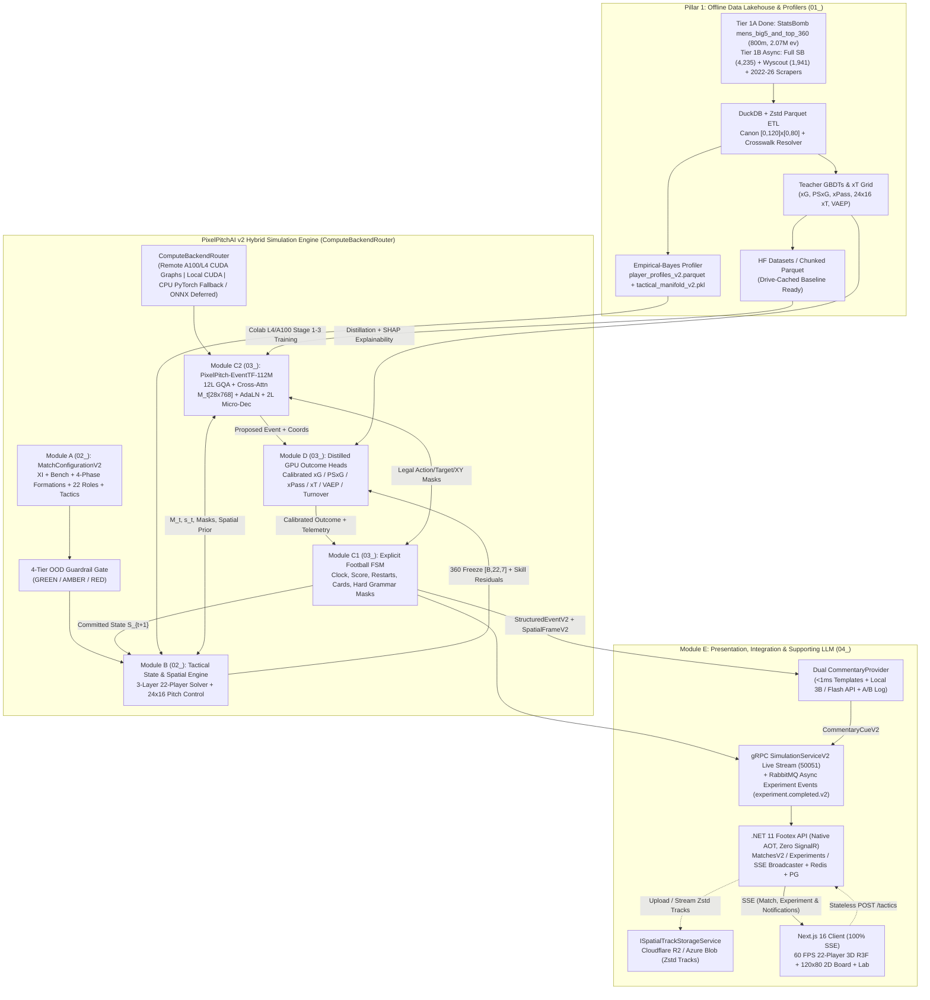
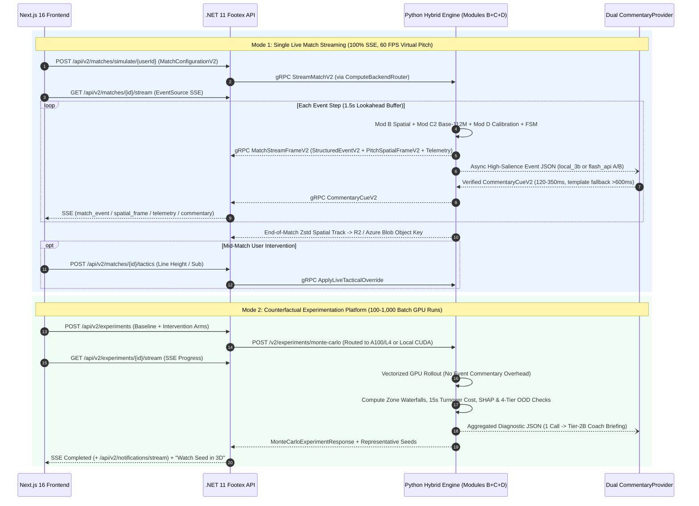
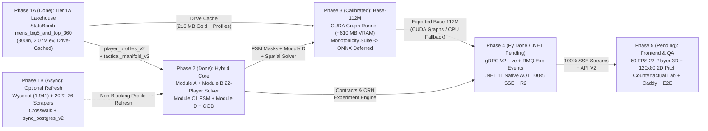

# PixelPitchAI v2 — Master Revamp Plan: Hybrid Football Event Simulation & Counterfactual Experimentation Platform

**Worktree & Branch:** `D:\programming\GitHub\PixelPitchAI-v2-revamp` on branch `feat/v2-hybrid-simulation-revamp`  
**Synthesized By:** `@engine-integration`  
**Contributing Specifications:**
- Pillar 1 (Data Engineering & Feature Pipeline): [`01_data_and_feature_pipeline.md`](file:///D:/programming/GitHub/PixelPitchAI-v2-revamp/docs/revamp/01_data_and_feature_pipeline.md) (`@worktree-data`)
- Modules A & B (Match Config, Tactical State & Experimentation): [`02_tactical_state_and_experimentation.md`](file:///D:/programming/GitHub/PixelPitchAI-v2-revamp/docs/revamp/02_tactical_state_and_experimentation.md) (`@tactical-state`)
- Modules C & D (Hybrid Event Transformer & Outcome Models): [`03_hybrid_event_transformer_and_models.md`](file:///D:/programming/GitHub/PixelPitchAI-v2-revamp/docs/revamp/03_hybrid_event_transformer_and_models.md) (`@event-transformer`)
- Module E (SSE Presentation, Integration & Supporting LLM): [`04_presentation_and_integration.md`](file:///D:/programming/GitHub/PixelPitchAI-v2-revamp/docs/revamp/04_presentation_and_integration.md) (`@engine-integration`)

---

## 1. Executive Blueprint & Strategic Shift (V1 → V2)

PixelPitchAI v1 established an operational multi-service pipeline (`simulation-engine` Python 3.12 FastAPI/gRPC → `backend` .NET 10 API → PostgreSQL/Redis/RabbitMQ → SSE/Next.js 16 virtual pitch). However, forensic inspection of `D:\programming\GitHub\PixelPitchAI` shows that v1's core simulator—a fine-tuned `124M` GPT-2 model (`gpt2-football-finetuned`, `1024`-token context) paired with a 4-input XGBoost summary regressor (`tuned_xgboost_model.json`) trained on 6 La Liga seasons (`2016–2021`)—cannot support modern tactical realism or coaching experimentation.

PixelPitchAI v2 adopts **Option B: the locked `Base-112M` Custom Football Event Transformer (`PixelPitch-EventTF-112M`, within the 80M–150M target range) embedded inside a Hybrid Stateful Simulation Engine**. It fuses **Approach A** (learned spatio-tactical sequence behavior and continuous player style embeddings) with **Approach B** (explicit Football State Machine, kinematic/off-ball spatial physics, calibrated tabular/MLP outcome physics, and hard legality masks), while reserving general **Language Models strictly as a supporting broadcast commentary and tactical analyst narration layer**—never controlling match physics.

### V1 vs. V2 Architecture Comparison

| Capability Area | PixelPitchAI v1 (Current Baseline) | PixelPitchAI v2 (Locked Target Blueprint) |
| :--- | :--- | :--- |
| **Core Simulation Model** | `GPT2LMHeadModel` (`124M` params, `38.7M` wasted in `50,438` BPE tokens, `n_ctx=1024` wiping history at `keep_last_n=400` and `[SECOND HALF START]`). | **Locked `PixelPitch-EventTF-112M`** (`12L`, `d=768`, `12Q/4KV` GQA, RoPE `500k`, SwiGLU, `16,384` event-step context = full 90/120-min match in one uninterrupted KV cache) + **2L Intra-Event Causal Micro-Decoder**. |
| **Training Corpus & Features** | `6` La Liga seasons (`29` teams, `1,329` players); `174` hardcoded `Team_Year` special tokens; verbose 3-line-per-pass text (`~5,500` lines/match); **no `xG`, no `xT`, no `xPass`, no 360 freeze frames, no lineups**. | **Tier 1A Locked Baseline (Done & Cached)**: Curated StatsBomb **`mens_big5_and_top_360` (`800` matches, `2.07M` folded events)** in canonical Parquet lakehouse (`216.12 MB`). **Tier 1B Optional Async Refresh**: Full StatsBomb (`4,235`) + Wyscout Open (`1,941`) + 2022–2026 scrapers (`FBref`, `Understat`, `SofaScore`/`FotMob`/`WhoScored`, `Transfermarkt`/`EA FC`) via `player_id_crosswalk.parquet`. |
| **Team, Player & Tactical Conditioning** | 4-input XGBoost (`[teamA, teamB, seasonA, seasonB]`) → 11 coarse English text buckets; `bad_words_ids` suppresses wrong teams; ignores `Coach.PreferredFormation` & `Player` attributes. | **Module A + B**: Full Starting XI (`11` + `12` bench), 4-phase dual formations (`build_up`, `in_possession`, `high_press`, `out_of_possession`), `22` `PlayerRole` priors, `10` `[0,1]` tactical sliders, sub policies, and Empirical-Bayes `24d` (+ `8d` GK/bias) + `64d` style vectors (`sigma_p` uncertainty). |
| **Rules, Coordinates & 22 Players** | Raw StatsBomb per-team coordinate flips causing spatial jumps; post-hoc `MatchParser` & `ZeroAllocationEventParser`; `EventPlotter` renders only last 5 actor ghosts; `FootballPitch.tsx` divides by `100` instead of `120×80`. | **Canonical Global Frame `[0, 120] × [0, 80]`**; **Explicit Football FSM** + hard logit masks (`100%` legal events); **3-Layer GPU 22-Player Off-Ball Spatial Solver** + `24×16` Pitch Control + synthetic `[B,22,7]` 360 freeze frames. |
| **Calibrated Analytics** | No `xG`/`xT`/`xPass` in simulation or `.NET` `MatchStatistics`; goals emerge purely from uncalibrated `~0.12%` token sampling. | **Module D Teacher–Student Pipeline**: Calibrated CatBoost/LightGBM teachers (`xG`, `PSxG`, `xPass`, `xT`, `VAEP`, `Turnover`) + Bayesian log-odds skill residuals, distilled to **GPU-resident MLPs** (`ECE < 0.017` pre-shot / pass, zero CPU–GPU sync, `xg_prior_logit=-1.30`). |
| **Compute & Experimentation** | Single-match text rollout only (`~45 min` CPU / `~30s` GPU); zero counterfactual or causal diagnostics. | **Three-Tier `ComputeBackendRouter`**: `remote_gpu` (`StaticBackboneCUDAGraphRunner` `bf16` + fused RMSNorm, `~610 MB` VRAM flat at `B=8`, scaling toward `B=32–64` via Python loop vectorization); `local_cuda`; `local_cpu_onnx` (**PyTorch CPU fallback** now, ONNX INT8 KV-cache deferred post-Phase 5), plus **4-tier OOD guardrails** (`GREEN`/`AMBER`/`RED`). |
| **Presentation, Storage & Commentary** | Dual SSE + SignalR (`MatchHub`, `/Notify`); `BasicGetAsync` `700ms` RabbitMQ polling; reflection-based anonymous JSON in `BroadcastStatisticsAsync`. | **100% SSE everywhere** (`sse-starlette` + **.NET 11 Native AOT** `Channel<SseMessage>` including `/api/v2/notifications/stream`, zero SignalR; gRPC-only live streams + RabbitMQ for async experiment events); Zstd spatial tracks in **Cloudflare R2 / Azure Blob** (`ISpatialTrackStorageService`); **Dual `CommentaryProvider`** (Local `3B` + Flash API w/ A/B telemetry + `<1ms` template fallback). |

---

## 2. Unified End-to-End System Architecture

### 2.1 Five-Module Hybrid Engine & Data Lakehouse Topology

### 2.2 Dual Execution Modes: Live Match SSE Stream vs. Batch Monte Carlo

---

## 3. Canonical Cross-Module Contracts & Harmonization

To guarantee zero integration friction across Python, `.proto`, **.NET 11**, PostgreSQL, R2/Blob Storage, and TypeScript, all 4 component specs enforce these canonical contracts:

1. **Dual Pitch Coordinate Standard (`[0, 120] × [0, 80]`):**
   - **Canonical Global Frame**: Home attacks `+x` (`0 → 120`), Away attacks `-x` (`120 → 0`), `y ∈ [0, 80]`. Eliminates StatsBomb's per-possession coordinate flip across consecutive events.
   - **Attacking-Relative Frame**: Acting team attacks `+x` (`x_att → 120.0`, goal mouth `y ∈ [36, 44], z ∈ [0, 2.44]`) inside Module D (`xG`, `PSxG`, `xPass`, `xT`) for Home/Away symmetry.
   - **Frontend Fix**: `frontend/app/Components/FootballPitch/FootballPitch.tsx` (lines 252–253) must normalize by `(x / 120) * 700` and `(y / 80) * 420` instead of `/ 100`.
2. **Slot Addressing & Capability Vectors (`ACTOR_SLOT_1_22`, `24d` Core + `8d` GK/Bias Sidecar + `64d` Style):**
   - `slot 0 = SYSTEM`, `1..11 = Home XI`, `12..22 = Away XI`. Substitutions swap player profiles inside the tactical slot (`starting_xi` + `bench <= 12`) so the Transformer vocabulary stays invariant (`vocab=23`) with zero unknown-player OOV issues.
   - `player_profiles_v2.parquet` exports `attributes_24d` + `sigma_24d`, `gk_attributes_8d` (`6` GK attributes `active_gk_attributes_6d` + `2` spatial lane/verticality biases) + `finishing_log_odds`, and `latent_style_64d` as cleanly separated arrays (linked across StatsBomb, Wyscout, and 2022–2026 scraped sources via `player_id_crosswalk.parquet`). In runtime tensors, Module B assembles `player_cond ∈ R^{B × 22 × 128}` with exact partition `64 (z_p) + 24 (a_eff) + 16 (r_role) + 10 (tau_team) + 5 (phi_instr) + 6 (s_pos) + 3 (s_stat) = 128` for Tokens `0..21`, while routing `gk_attributes_8d` + `finishing_log_odds` to Module B off-ball/role priors, Module D's `PSxG`/finishing log-odds residuals, and Tokens `22..23` (`active_gk_attributes_6d`) of `M_t ∈ R^{B × 28 × 768}`.
3. **Canonical `PlayerRole` Taxonomy (`22` Roles Across All Modules):**
   - All modules standardize on Module A's **22 canonical `PlayerRole` enums (`0..21`)**: `SweeperKeeper`, `ShotStopperGK`, `BallPlayingCB`, `StopperCB`, `WideCenterBack`, `InvertedFullback`, `OverlappingFullback`, `DefensiveFullback`, `CompleteWingBack`, `DeepLyingPlaymaker`, `DestroyerDM`, `BoxToBoxMidfielder`, `Mezzala`, `Carrilero`, `AdvancedPlaymaker`, `InvertedWinger`, `TouchlineWinger`, `InsideForward`, `False9`, `PressingForward`, `TargetForward`, and `Poacher`. Pillar 1 exports `role_suitability_scores ∈ [0,1]^22` and `active_slots_roles ∈ [0..21]` directly in `player_profiles_v2.parquet` and `events_gold_v2.parquet`.
4. **100% SSE Transport, Simplified gRPC/RMQ Boundary & .NET 11 Native AOT Safety:**
   - All live streams—match playback (`GET /api/v2/matches/{id}/stream`), Monte Carlo experiment progress (`GET /api/v2/experiments/{id}/stream`), and user notifications (`GET /api/v2/notifications/stream`)—use **SSE (`text/event-stream`)** exclusively (`sse-starlette` in FastAPI; `System.Threading.Channels.Channel<SseMessage>` in **.NET 11**). Live Python→.NET match streaming (events, 5 Hz spatial frames, telemetry, commentary) runs **exclusively over gRPC `SimulationServiceV2` (Pipeline B)**, while RabbitMQ is scoped strictly to **async `experiment.completed.v2` job notifications** (dropping duplicate `match.spatial.v2` RabbitMQ routing). **SignalR is completely removed** (`MatchHub`, `NotificationService` `/Notify`, `AddSignalR()`, `@microsoft/signalr`, `SignalRService.ts`, `useSignalRNotifications.ts`, `useSignalREventStream.ts`). Live mid-match user commands go over stateless REST `POST /api/v2/matches/{id}/tactics` → gRPC `ApplyLiveTacticalOverride`.
   - Compressed 22-player spatial tracks (`~350–500 KB/match` Zstd) offload to **Cloudflare R2 / Azure Blob** via `ISpatialTrackStorageService`, keeping PostgreSQL rows lean.
   - All **.NET 11** V2 DTOs (`StructuredEventV2Dto`, `SpatialFrameV2Dto`, `TelemetrySnapshotV2Dto`, `CommentaryCueV2Dto`, `MatchConfigurationV2Dto`, `MonteCarloExperimentResultDto`, `NotificationV2Dto`) must be registered in `MatchEventJsonContext` (`[JsonSerializable]`) for reflection-free Native AOT compilation—eliminating V1's anonymous-object serialization in `MatchEventBroadcaster.BroadcastStatisticsAsync`.

---

## 4. Phased Implementation Roadmap (Phase 1 to Phase 5)

| Phase | Status | Core Scope | Primary Artifacts / Targets | Objective Exit Gate |
| :---: | :--- | :--- | :--- | :--- |
| **Phase 1A** | **Done** | **Tier 1A Locked Lakehouse Baseline** (`mens_big5_and_top_360`) | `statsbombapi_v2` curated ETL (`800` matches, `2.07M` folded events), `events_gold_v2.parquet` (`216.12 MB`), `player_profiles_v2.parquet`, `player_id_crosswalk.parquet`, `tactical_manifold_v2.pkl`, `xt_grid_24x16.npy`, `lakehouse_manifest.json` (backed up to Drive). | Clean men's Big-5 + 360 tactical calibration with `0` coordinate/FSM errors and zero leakage. |
| **Phase 1B** | **Optional / Async Refresh** | **Wyscout, 2022–2026 Scrapers & Postgres Sync** *(Decoupled from Phases 4–5)* | Full `4,235` SB + `1,941` Wyscout ingestion, polite `soccerdata` scrapers (`FBref`, `Understat`, `SofaScore`/`FotMob`/`WhoScored`, `Transfermarkt`/`EA FC`), `hf_dataset_v2/` 16k packed shards, `sync_postgres_v2.py`. | Graceful fallback on upstream anti-bot gates; non-blocking profile refresh into `player_profiles_v2.parquet` and PostgreSQL. |
| **Phase 2** | **Done** | **Hybrid Tactical State, FSM & Outcome Physics (A, B, C1, D)** | `MatchConfigurationV2` (Pydantic + `.NET 11` AOT contract), `TacticalStateEngine` (`[B,22,128]` + `SpatialPredictor` `val_rmse=3.1762 yd` + `24×16` Pitch Control), `FootballFSM` + hard masks, `D1..D6` calibrated GBDT/MLP heads (`xG_ECE=0.0168`, `xPass_ECE=0.0143`), 4-tier OOD gate (`39/39` `pytest` passing). | `0` illegal restarts, `0` OOB coordinates, and calibrated pre-shot/pass outcome alignment. |
| **Phase 3** | **Calibrated Baseline Done — Monotonicity Suite Next** | **`Base-112M` Training, Calibration & CUDA Graph Optimization** | `PixelPitch-EventTF-112M` (`112,855,134` params, `bf16`), Stage 1/2 training (`val_loss=8.3381 -> 8.2687`), `xg_prior_logit=-1.30` calibration (`0.129` xG/shot, `2.75` goals/match balanced), `StaticBackboneCUDAGraphRunner` + fused RMSNorm (`~610 MB` VRAM flat at `B=8`). Next: **6-test counterfactual monotonicity validation**, Python step-loop vectorization + GPU batch scaling (`B=32–64`). **Deferred (Post-Phase 5)**: ONNX INT8 KV-cache export. | `100%` pass on 6 counterfactual monotonicity tests (paired CRN seeds), `0` NaN/OOB invariants, sustained GPU Monte Carlo speedup (`B=32–64`). |
| **Phase 4** | **Python Done / .NET 11 Pending** | **Module E Backend Integration, 100% SSE & Dual LLM Sidecar** | **Done (Python):** FastAPI `/v2/*` (`sse-starlette`), `ComputeBackendRouter` (`remote_gpu` / `local_cuda` / `local_cpu_onnx` PyTorch CPU fallback), Dual `CommentaryProvider`. **Pending:** `simulation_v2.proto` (`SimulationServiceV2` exclusive live stream), RabbitMQ scoped to `experiment.completed.v2` (+ DLQ), **.NET 11 Native AOT** V2 controllers (`MatchesV2`, `Experiments`, `NotificationsStream`), `MatchEventJsonContext`, `ISpatialTrackStorageService` (R2/Azure Blob), SignalR removal. | `dotnet build` & `dotnet test` pass on `.NET 11` with zero reflection on SSE paths; end-to-end SSE hop `< 50ms`; LLM verifier catches `100%` of injected score/player mismatches. |
| **Phase 5** | **Pending** | **Next.js 16 22-Player Pitch, Counterfactual Lab & Hardening** | Pure SSE hooks (`useMatchStreamV2`, `useNotificationsSse`), `@microsoft/signalr` removal, R3F `InstancedMesh` 22-player 60 FPS `InterpBuffer`, `120×80` `FootballPitch.tsx` + Voronoi/`xPass`/360 overlays, Counterfactual Experimentation Workbench, Caddy `flush_interval -1`. | Full Docker stack passes E2E live match SSE + Monte Carlo + notification SSE smoke tests at sustained `60 FPS` browser rendering. |

---

## 5. Google Colab L4 / A100 Drive-First Training & Validation Workflow

Building on [`simulation-engine/colab_simulation_engine.ipynb`](file:///D:/programming/GitHub/PixelPitchAI/simulation-engine/colab_simulation_engine.ipynb) and our verified Drive-cached L4 pipeline:

1. **Drive-First Artifact Pulls (Zero Local Weight Uploads):**
   - Never upload large weights or Parquet datasets from local machines over metered/slow links. Pull the shared `PixelPitchAI-v2-lakehouse-mens800` Google Drive folder (Folder ID: `1xw-wXcAfo6qIld291w5wT4k7JqVLl-Y-`) directly inside Colab via `gdown` (`~18s`, `0 MB` local upload bandwidth), uploading only tiny `< 200 KB` code bundles when iterating on uncommitted scripts.
   - Local Windows safety rule: `simulation-engine/pyproject.toml` pins `torch` to `pytorch-cpu`, so **never run bare `uv run`** locally — always use `.\.venv\Scripts\python.exe` or `uv run --no-sync` to keep `torch+cu128` intact.
2. **Environment Bootstrap & Colab Reaper Protection:**
   - Install lightweight Python extras without altering Colab's native CUDA PyTorch (`pip install -q gdown pydantic pyarrow scipy`).
   - Run long evaluations/training detached via `subprocess.Popen(..., start_new_session=True)` logging to `/content/*.log` rather than blocking chat on synchronous `execute_code` calls.
   - Because Colab's idle-kernel reaper terminates VMs after ~15 minutes of kernel inactivity even while background subprocesses run, issue short `execute_code` status heartbeats every **< 15 minutes** (e.g., every 4–6 minutes via `schedule`), and **delete the Colab runtime immediately** once artifacts/logs are retrieved.
3. **Training, Calibration & Batched GPU Optimization:**
   - **Tier 1A Lakehouse Build (`build_v2_lakehouse.py --preset mens_big5_and_top_360 --max-matches 800`)**: Shallow-clones `hudl/open-data` (`--depth 1`) and compiles `events_gold_v2.parquet` (`216.12 MB`), `player_profiles_v2.parquet`, `tactical_manifold_v2.pkl`, `xt_grid_24x16.npy`, and `lakehouse_manifest.json` (cached once to Drive).
   - **Step B & C (`train_colab_v2_pipeline.py`)**: Trains `SpatialPredictor` (`val_rmse=3.1762 yd`), `ModuleDOutcomeSuite` (`xG_ECE=0.0168`, `xPass_ECE=0.0143`), and `PixelPitch-EventTF-112M` (`112.86M` params, `bf16` Stage 1 `val_loss=8.3381` -> Stage 2 `val_loss=8.2687`), plus calibrated `xg_prior_logit=-1.30` and `StaticBackboneCUDAGraphRunner` (`~610 MB` VRAM flat at `B=8`, `~32s/match`).
   - **Monte Carlo Optimization Priority**: Because `StaticBackboneCUDAGraphRunner` keeps transformer GPU memory small (`~610 MB` at `B=8`), the dominant Monte Carlo bottleneck is Python per-step overhead across `rollout_engine.py`, `fsm.py`, and `state_engine.py`. Scaling GPU batch size (`B=32–64`) and vectorizing hot Python loops yields greater speedups than early ONNX INT8 KV-cache graph conversion (deferred until after Phase 5).

---

## 6. Locked Architectural Decisions

All 6 cross-cutting architecture choices have been finalized and locked across Pillar 1 and Modules A–E:

1. **Transformer Scale — `Base-112M` (`PixelPitch-EventTF-112M`, `112,855,134` params):**
   - Standardized on `12L, d_model=768, 12Q/4KV GQA, RoPE theta=500k, SwiGLU (d_ff=2048), 16,384-step context` + `2L (d=512)` intra-event causal micro-decoder (`bf16` weights `215.37 MB` saved on Drive), paired with `StaticBackboneCUDAGraphRunner` and fused RMSNorm.
2. **Supporting LLM Commentary — Dual `CommentaryProvider` (Local `3B` + Flash API + A/B Telemetry):**
   - Both **`LocalSidecarCommentaryProvider`** (`Qwen2.5-3B-Instruct` / `Llama-3.2-3B` INT4 via `llama.cpp`/vLLM) and **`FlashApiCommentaryProvider`** (external Flash API e.g. Gemini Flash) are implemented behind `CommentaryProvider`, with runtime `ab_split` switching, deterministic score/roster verification, `<1ms` Tier-1 micro-template fallback (`600ms` SLA), and per-cue latency/quality telemetry.
3. **Three-Tier Compute Routing (`ComputeBackendRouter` & Deferred ONNX Export):**
   - Seamless runtime routing across **`remote_gpu`** (Colab/Cloud A100/L4 with `StaticBackboneCUDAGraphRunner` `bf16`, scaling toward `B=32–64` via Python step-loop vectorization), **`local_cuda`** (`bf16`/FP16 CUDA fallback), and **`local_cpu_onnx`** (running **PyTorch CPU fallback** now so Phases 4–5 move immediately; ONNX INT8 KV-cache export is **deferred to Post-Phase 5**).
4. **Tiered Multi-Source Data Pipeline (Tier 1A Locked Baseline + Tier 1B Async Refresh):**
   - **Tier 1A (Done & Drive-Cached):** Clean men's Big-5 + StatsBomb 360 curated subset (`--preset mens_big5_and_top_360 --max-matches 800`, `2.07M` events) provides calibrated match physics without youth/low-tier dilution.
   - **Tier 1B (Non-Blocking Async Refresh):** Full StatsBomb (`4,235`), Wyscout Open (`1,941`), `2022–2026` polite web scrapers (`FBref`, `Understat`, `SofaScore`/`FotMob`/`WhoScored`, `Transfermarkt`/`EA FC`) resolved via `player_id_crosswalk.parquet`, and `sync_postgres_v2.py` run asynchronously without blocking Phases 3–5.
5. **Spatial Track Persistence — Cloudflare R2 / Azure Blob (`ISpatialTrackStorageService`):**
   - Zstd-compressed `5 Hz` 22-player spatial track blobs (`~350–500 KB/match`) offload to **Cloudflare R2** (primary S3-compatible zero-egress store) or **Azure Blob Storage** (extending `AzureBlobStorageService.cs`) behind `ISpatialTrackStorageService`, keeping only object keys and match summaries in PostgreSQL.
6. **100% SSE Client Delivery, Exclusive gRPC Live Transport & .NET 11 Native AOT (Zero SignalR):**
   - All browser-facing live match (`GET /api/v2/matches/{id}/stream`), Monte Carlo progress (`GET /api/v2/experiments/{id}/stream`), and user notification (`GET /api/v2/notifications/stream`) feeds run exclusively over **SSE** (`sse-starlette` + **.NET 11** `Channel<SseMessage>`). Python→.NET live match frames travel **exclusively over gRPC `SimulationServiceV2`**, while RabbitMQ handles **async `experiment.completed.v2` notifications only** (no `match.spatial.v2` over RabbitMQ). SignalR (`MatchHub`, `/Notify`, `AddSignalR()`, `@microsoft/signalr`, `SignalRService.ts`, `useSignalRNotifications.ts`) is removed completely from backend and frontend.
